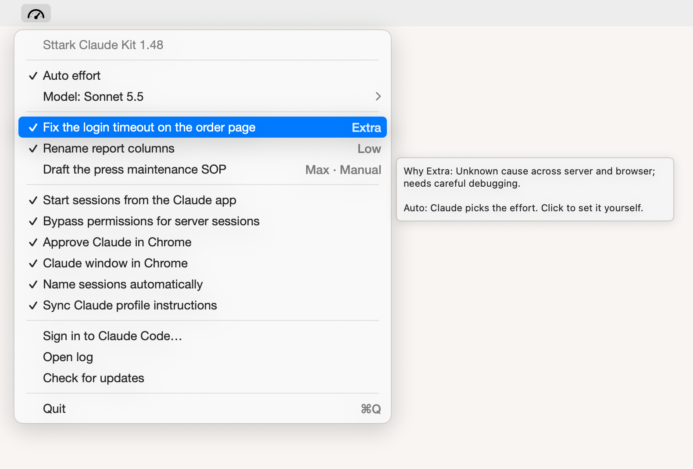
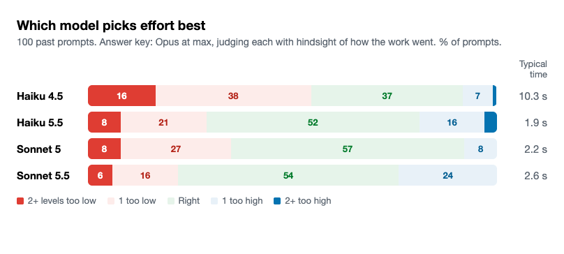

# Sttark Claude Kit

A Mac menu bar app that makes Claude Code easier to live with, for people who keep several sessions going at once and start them from the Claude app on their phone or computer.

| It | Section |
|---|---|
| Sets each session's effort to what the task needs, and adjusts it partway through | [Effort per task](#effort-per-task) |
| Shows which sessions are waiting on you, and tells you when one has waited 10 minutes | [Waiting on you](#waiting-on-you) |
| Names sessions with short handles for the topic they belong to | [Name sessions automatically](#name-sessions-automatically) |
| Warns before your Claude Code login runs out, and starts the sign-in | [Claude Code login](#claude-code-login) |
| Sets your Mac up to run sessions you start from the Claude app | [Start sessions from the Claude app](#start-sessions-from-the-claude-app) |
| Keeps every session that isn't archived running, through restarts | [Sessions stay running](#sessions-stay-running) |
| Gives those sessions Bypass permissions, which the Claude app doesn't offer | [Bypass permissions for server sessions](#bypass-permissions-for-server-sessions) |
| Lets Claude use your signed-in Chrome without taking your screen | [Claude window in Chrome](#claude-window-in-chrome) |
| Answers Claude for Chrome's permission prompts | [Approve Claude in Chrome](#approve-claude-in-chrome) |
| Copies your Claude profile instructions into Claude Code | [Sync Claude profile instructions](#sync-claude-profile-instructions) |
| Gives sessions in Sttark's app repos the Sttark app rules | [Sttark app rules](#sttark-app-rules) |

Everything except effort and the Sttark app rules is off until you turn it on in the menu. It updates itself when a new version is released here.



*Drawn by the app's own code, with sample sessions.*

It only works on sessions that run through **Remote Control**: the ones you start from the Claude app, on your phone or any computer, on a Mac that runs a `claude rc` server, or a terminal session started with `claude --remote-control`. Effort can't be changed from outside any other kind of session. See [Start sessions from the Claude app](#start-sessions-from-the-claude-app) to set that up.

## Install

You need a Mac on macOS 14 or later, with [Claude Code](https://code.claude.com/docs/en/setup) installed and signed in (`claude` at `~/.local/bin/claude`).

1. Download **SttarkClaudeKit.zip** from the [latest release](https://github.com/Sttark/sttark-claude-kit/releases/latest) and open it.
2. Drag **SttarkClaudeKit** into your **Applications** folder, then open it.
3. The first time, macOS says it can't check the app for malicious software, because it isn't sold through Apple. Click **Done**, go to **System Settings > Privacy & Security**, scroll down and click **Open Anyway**. You only do this once.

That's it. The app adds its hook to Claude Code's settings (`~/.claude/settings.json`, backed up first), starts by itself when you log in, and shows a gauge in the menu bar. The needle points at the level of the session you used last: far left for Low, straight up for High, far right for Max. No needle means no session in the last hour. A pause sign means Auto effort is off. New sessions use the hook right away. Sessions that were already open pick it up from their next prompt.

### Coming from Sttark Effort

This app used to be called Sttark Effort. Install Sttark Claude Kit once by hand, as above. On its first launch it moves your settings, hooks, sync and Chrome approver over, then quits Sttark Effort and moves it to the Trash. macOS may ask you to allow notifications again, and to allow **SttarkChromeApprover** under Accessibility again.

## Updates

The app checks for a new version a few times a day. When there is one, you get a notice: click it, or choose **Update to …** at the top of the menu. The app downloads the new version, swaps it in and restarts in a few seconds. Your settings, and the Accessibility permission for the Chrome approver, stay as they are. **Check for updates** in the menu checks right away.

## Using it

Click the gauge:

| Item | What it does |
|---|---|
| **Waiting on you** (top rows, when there are any) | Sessions that need you or that you haven't opened since Claude finished. Click one to open it. See [below](#waiting-on-you). |
| **Auto effort** | On: Claude picks each session's effort. Off: every session keeps the level it has, until you turn it back on. |
| **Model** | Which Claude model picks the levels: the two newest Haiku and two newest Sonnet models, read from Anthropic's list once a day, so new ones appear without an update. Haiku is faster and cheaper; Sonnet is slower and smarter. The newest Sonnet is the default. |
| **A session row** | The session's name in the Claude app and its level. A check means Auto. Click to switch to Manual, then click again for Auto. Hover it to see the latest reason for its level. Hover any item for what it does. |
| **Open log** | Opens the full log in Console. |
| **Start sessions from the Claude app** | Sets this Mac up so you can start Claude Code sessions from the Claude app. See [below](#start-sessions-from-the-claude-app). |
| **Bypass permissions for server sessions** | See [below](#bypass-permissions-for-server-sessions). Off until you turn it on. |
| **Approve Claude in Chrome** | See [below](#approve-claude-in-chrome). Off until you turn it on. |
| **Sync Claude profile instructions** | See [below](#sync-claude-profile-instructions). Off until you turn it on. |
| **Claude window in Chrome** | See [below](#claude-window-in-chrome). Off until you turn it on. |
| **Name sessions automatically** | See [below](#name-sessions-automatically). Off until you turn it on. |
| **Sign in to Claude Code…** | Opens Terminal and starts Claude Code's sign-in; you finish in the browser. Hover it to see when your login runs out. See [below](#claude-code-login). |
| **Check for updates** | Looks for a new version now. Hidden while an update is waiting. |

Sessions show for 12 hours after their last activity. Archived sessions drop off within a minute.

**Setting the effort yourself:** change it in the Claude app's effort picker as usual. Sttark Claude Kit reads each session's level from the server, sees one it didn't send, switches that session to Manual and leaves it alone. The menu shows Manual within a minute, and the kit checks again right before any change it makes, so it never undoes your pick, even in the middle of a long step. Click the row to hand it back. A session that reopens (after the Mac restarts, or when the server brings back an idle one) starts again at the level it was saved with; that doesn't count as you changing it.

### The log

Every decision goes into `~/Library/Logs/sttark-claude-kit.log`, one line each:

```
2026-10-08 11:02:48 change cse_01AbCd… high->xhigh (2.2s) xhigh - Unknown cause spanning firmware and server code | The sensor readings drop out every few hours…
2026-10-08 11:03:22 steady cse_01AbCd… xhigh at 11 steps (4.3s) xhigh - Cause still unconfirmed; needs log checks and a test. | The sensor readings drop out every few hours…
```

| First word | Meaning |
|---|---|
| `change` / `keep` | The check when a prompt arrives. |
| `raise` / `lower` / `steady` | The check at 10, 25 or 50 steps. |
| `manual` | The session is on Manual, or you just changed it yourself. |
| `reopen` | The session came back in a new process, at the level shown. The hook starts from there. |
| `paused` | Auto effort is off. |
| `skip` | Not a Remote Control session, so it can't be changed. |
| `rules` | The Sttark app rules: added to a session, or the saved copy refreshed. |
| `error` | Something failed. The level was left as it was. |

To watch it live: `tail -f ~/Library/Logs/sttark-claude-kit.log`.

## Effort per task

- **Picks the level before Claude starts.** Each prompt you send goes to a quick side check (the newest Claude Sonnet, or another model you pick) along with the last few messages. The model picks Low, Medium, High, Extra or Max, and the session is set to that level before Claude's first step. A plain "go" after a plan gets sized to the plan.
- **Checks again partway through.** At 10, 25 and 50 steps into a task, the model looks at the work so far. If builds keep failing or the cause is still unknown, it raises the level, up to Max for a task that's stuck at Extra. If the hard part is done and the rest is repeat edits, it lowers it. UI work stays at High or above until Claude has looked at the result and judged it, since that look is where the design gets decided.
- **You can take over.** Turn **Auto effort** off for every session, or click one session to set it to Manual. If you change a session's effort yourself in the Claude app, Sttark Claude Kit notices and switches that session to Manual on its own.
- **Shows its reasons.** The menu lists each session with its level; hover one for the latest reason. Every decision is logged.
- **Updates itself** when a new version is released here.

## Waiting on you

You send Claude a prompt, move on to something else, and forget to come back. Every minute, Sttark Claude Kit checks your recent Claude Code sessions and lists, at the top of the menu, the ones waiting on you:

| Shows as | When |
|---|---|
| **needs you** (bold) | Claude stopped to ask you something or for a permission, or its finished reply can't go on without you: a question, a plan waiting for your go-ahead, a choice, or a step only you can do. The menu's model reads the reply once to decide, and leans toward no. Opening the session clears it, even if you don't answer, until Claude writes again. |
| **not opened** | Claude finished, and you haven't opened the session since. The Claude app records when you open a session, on any device, so opening it clears it. |

On this Mac, seeing the reply also counts: if the session was open in the Claude app, with the app in front and the screen on, for a few seconds after Claude finished, it comes off the list. That covers watching a reply arrive, which the Claude app itself doesn't record as opening it.

Each row shows how long it has waited; hover for why, click to open the session. When one has waited 10 minutes, you get one notice. Archived sessions and sessions Claude is still working on never show. It covers Claude Code sessions that run through Remote Control, from the last day.

## Choosing the model

A test on October 15, 2026 found **Sonnet 5.5** picks effort best, so the newest Sonnet is the default. The newest Haiku is faster and cheaper, if you'd rather pick it under **Model**.



| Model | Right level | Within one level | Too low | 2+ levels too low | Too high | Typical time |
|---|---|---|---|---|---|---|
| Sonnet 5.5 | 54% | 94% | 22% | 6% | 24% | 2.6 s |
| Sonnet 5 | 57% | 92% | 35% | 8% | 8% | 2.2 s |
| Haiku 5.5 | 52% | 89% | 29% | 8% | 19% | 1.9 s |
| Haiku 4.5 | 37% | 82% | 55% | 16% | 8% | 10.3 s |

**Why Sonnet 5.5:** a level that's too low is the costly mistake, because the work comes out wrong and has to be done again. A level that's too high only costs some extra time and usage on that task. Sonnet 5.5 is too low least often, and lands within one level 94% of the time. Sonnet 5 is right most often, but it's too low far more often. Haiku 4.5 is slow and too low over half the time.

**How the test works:** it took 100 real past turns from Claude Code session history, 20 each from five sizes (no tool calls, 1 to 5, 6 to 20, 21 to 60, and more than 60). For the answer key, Opus at max effort read each whole turn, including how the work actually went (each step, which failed, how long it took), and named the level the work truly needed. Then each model judged the same 100 prompts the way the hook does, seeing only the prompt and the conversation before it. One limit: the answer key is one model's hindsight, not a measured result.

**Run it again** when new models come out. From an empty folder:

```sh
python3 ~/path/to/sttark-claude-kit/tools/model-test/sample.py   # picks 100 past turns: cases.json
python3 ~/path/to/sttark-claude-kit/tools/model-test/run.py      # answer key and models: results.json (edit the model list first)
python3 ~/path/to/sttark-claude-kit/tools/model-test/score.py    # table and chart.png
```

It reads your own session history, which stays on your Mac, and makes about 500 Claude calls with your Claude Code login.

## Start sessions from the Claude app

Sttark Claude Kit can set your Mac up so you start Claude Code sessions from the Claude app, on your phone or any computer. Each session runs on the Mac, with the Mac's files, tools and logins, and Sttark Claude Kit sets the effort for every one of them.

1. Click the gauge and turn on **Start sessions from the Claude app**.
2. Pick the folder sessions start in. A folder that holds all your projects works well, so any session can reach any of them.
3. Click **Start**.

From then on, open the Claude app, go to **Code**, pick your Mac, and type. The setting stays on through restarts. Turn the switch off to stop it.

The Mac has to be on and awake for sessions to run. On a laptop, set **System Settings > Battery > Options > Prevent automatic sleeping when the display is off** while it's plugged in.

If this Mac already runs a Remote Control server that you set up another way, the menu shows it as on and leaves it alone.

### Sessions stay running

A Mac restart ends every session, and so does archiving one. The server only starts a session again when something reaches it, so a session can sit in the Claude app with nothing on the Mac answering it. While a Remote Control server runs on this Mac, Sttark Claude Kit checks every minute for sessions on it that aren't archived but have stopped, and starts each one again: on the same link, with its whole conversation, and with nothing added to the chat. It does this by sending the session its own effort level, which is enough for the server to start it.

- After a restart, every session that isn't archived is back within a minute or two of logging in.
- The server won't start a session that was archived and then unarchived. After two tries, Sttark Claude Kit starts it as a session of its own, outside the server, with its whole conversation: it gets a new link, and the old entry is archived so the app lists it once. Its Routines move with it (each is copied to the new link and the old one turned off). After a restart it comes back on that same new link. Logged as `move` and `start`.
- Archive a session to stop it for good.
- Timed tasks a session set for itself come back with it, except ones whose time passed while it was stopped. Loops that pick their own timing, and scripts it was running in the background, don't: ask the session to start them again. Routines (scheduled from the Claude app, or by Claude with the Routines tools) run on Anthropic's side and wake their session when they fire. A Routine that fires into an archived session fails and turns itself off, and a session that runs on its own shows as archived while it's stopped, so a Routine in one of those that comes due while the Mac is off is lost.
- It keeps up to 30 sessions running, the most recently used first, since a server runs 32 at most.
- Each start is logged as `wake` in the log.

### One Accessibility approval, not one per update

Claude Code installs each update in a new folder, and macOS files a program's Accessibility permission by where it lives, so every update used to ask for Accessibility again. While **Start sessions from the Claude app** is on, the server runs from one copy of Claude Code that never moves (`~/.local/share/claude/stable/claude`), so you approve it once. A job checks every 30 minutes for a newer Claude Code, swaps it into that copy, and restarts the server to use it. Restarting ends open sessions, so it waits for between 2 and 5 AM when no session is working. Each step is logged.

## Bypass permissions for server sessions

The Claude app, on desktop or phone, doesn't offer **Bypass permissions** for sessions that run on a Remote Control server. It switches each one to asking before commands, even when the server was started to bypass. Without this switch, there's no way to run those sessions in bypass.

With it on, at a session's first permission prompt Sttark Claude Kit approves it and switches the session to Bypass permissions. The Claude app then shows the session in Bypass permissions. Bypass still asks about a few commands Claude Code flags as risky, such as `rm` on a path built from a variable, so in bypass the switch approves those too.

- It acts on sessions whose server was started with `--permission-mode bypassPermissions`. The server **Start sessions from the Claude app** sets up always is, so this switch alone decides.
- Plan mode, plan approvals and questions Claude asks you are left alone.
- Each switch is logged to `~/Library/Logs/claude-bypass-hook.log`.

Only turn it on if you're comfortable with Claude running commands on this Mac without checking with you first.

## Approve Claude in Chrome

When Claude uses Chrome through the Claude for Chrome extension, it stops to ask for permission on each new site. With this switch on, Sttark Claude Kit answers for you: it clicks **Always allow actions on this site** when that's offered, otherwise **Allow this action**. It never clicks Decline, and it only clicks inside the Claude extension's own window, never on web pages.

The first time you turn it on, macOS asks you to allow **SttarkChromeApprover** under **System Settings > Privacy & Security > Accessibility**, because it has to see and click the button. Until you do, the menu shows **Needs Accessibility permission…**, which opens that page. Each approval is logged to `~/Library/Logs/claude-chrome-approver.log`.

## Sync Claude profile instructions

The Claude app has a box for instructions to Claude in **Settings > Profile**. Claude in the app follows them, but Claude Code never sees them. With this switch on, Sttark Claude Kit copies them into Claude Code's own instructions file (`~/.claude/CLAUDE.md`, in a marked block it keeps up to date) every 15 minutes. It also puts them in front of every prompt you send, because Claude Code reads that file only when a session starts, so a session that's already running would otherwise miss an edit.

- It needs the Claude desktop app installed and signed in. It reads your profile with that sign-in, and checks the account matches before writing anything.
- The first time you turn it on, it installs two small Python add-ons it needs into the app's own folder. That takes a few seconds.
- Hover the switch to see the last sync. Each sync is logged to `~/Library/Logs/claude-profile-sync.log`.
- Edit your instructions in the Claude app, not in `CLAUDE.md`: the marked block is overwritten. Anything else in that file is left alone.

## Claude window in Chrome

When Claude uses your browser, it usually opens a new tab or window, and Chrome jumps in front of whatever you're typing in: your cursor goes, and your keystrokes land in Chrome. Opening a tab does that even in a window behind others. Running a script in a page that's already open doesn't.

With this switch on, Sttark Claude Kit opens one Chrome window named **Claude**, in your own profile with all your logins, and installs `claude-window`, a small command Claude Code sessions use to work in it without opening anything:

```
claude-window go https://example.com    open a page in the Claude window and wait for it to load
claude-window url                       the current page's title and address
claude-window text                      the page's visible text
claude-window js 'document.title'       run JavaScript in the page
```

- Opening the window brings Chrome forward once, when you click the switch or when it reopens. Sttark Claude Kit puts the app you were using back in front right after.
- If the Claude window closes (by mistake, because Chrome quit, or a restart), it comes back by itself once no one has typed or moved the mouse for a minute, so it never jumps in front of you mid-sentence. If Chrome isn't running, Sttark Claude Kit starts it hidden first. To get it back right away, click **Open Claude window** in the menu.
- While the switch is on, every Claude Code prompt carries the rule to use only the Claude window, so Claude Code needs nothing from you.
- **For Claude chat too** (claude.ai and the Claude app's chats), add this line to your Claude profile instructions (**Settings > Profile**). Chats don't run hooks, so this is the only way they learn the rule: *"Browser: use only the Chrome window named Claude. In Claude Code, use the claude-window command (go, url, text, js) for every page. Never open a new tab or window, and never bring Chrome to the front."* With **Sync Claude profile instructions** on, Claude Code gets the same line, which does no harm alongside the automatic rule.
- It needs Chrome's **View > Developer > Allow JavaScript from Apple Events**.
- The Claude in Chrome extension opens tabs its own way, and that can't be changed from outside it.

## Name sessions automatically

Claude names each new Claude Code session with a long description of the first task. With this switch on, sessions get a short handle for their project or area instead, like "Order Page" or "Label Printer", the way you'd label a folder.

- It names a session at your first message that shows what the session is about. A greeting or a bare "yes" waits for a later one.
- It reuses one of your own handles when a session clearly belongs to that area, and learns your handles from the sessions you name yourself.
- A name you set yourself is never changed. A name this chose gets a second look on your 3rd, 6th and 12th prompts and every 12th after that: if the session has moved on to another topic (a session that starts with "build an Apple TV app" and turns into YouTube playlists), it's renamed to the new topic.
- It names Claude Code sessions only. Claude chats can't be renamed by an app.
- It also sets the name in the Claude app, after the app's own automatic title lands, so the app shows it too.
- It runs alongside the effort check, so it adds no wait. Each name is logged, with lines starting `name`.

## Sttark app rules

When a session works in one of Sttark's app repos, Sttark Claude Kit adds the five Apps chapters of the Sttark Brand and App Guidelines (Building Web Apps, Look, Pages and Behavior, Sign-in and Access, Checks) to the session, with one line before them: follow them for any UI work, and run the Checks chapter's Before you ship list. It's on for everyone; there's no switch, since it only reads.

- **Which repos.** A git repo, or a worktree of one, that is set up for the guide: it has the page check (`scripts/page-check.mjs`, in the repo or an app folder in it), as building, sttark-docs, sttark-inventory and hvac_automation do. Also a new repo with no `origin` yet that has screens (files a page is made of: `.astro`, `.tsx`, `.jsx`, `.vue`, `.svelte`, `.html`, `.css`, `.scss`, templates; committed or new). Every other repo gets nothing, whoever's it is: an app that was never set up is left as it is.
- **A new app.** A folder outside any git repo, or a new repo without screens yet, gets one short line instead: if the session builds a web app or page for Sttark, read the chapters first, and set the app up with the setup command (below). The full chapters follow at the first prompt after the repo gains a page.
- **Setting up an app.** The chapters and that line give the command, which fetches `page-check/setup.mjs` from Sttark/sttark-docs and runs it in the repo root. It adds the page check, the AI review and the agent notes; see the Checks chapter of the guide.
- **When.** At the first prompt whose working folder is in one of those repos, once per session. After Claude compacts the session, the next prompt adds them again.
- **What is left out.** Code a session needs only to build that one thing, the logo's SVG and a Chat card's dots, is replaced by a line saying where to read it, so all five chapters fit.
- **Where the rules come from.** docs.sttark.com needs sign-in, so the app reads the chapters as you, through Claude Code's Sttark Workrouter connector, and keeps a copy on this Mac. The copy is refreshed in the background once a day; a prompt never waits for it. Until the first copy arrives, the session is told to read the five chapters itself.
- The chapters are never stored in this repo. Each addition and refresh is logged, with lines starting `rules`.

## Claude Code login

Claude Code's sign-in lasts about a month. When it runs out, every Claude Code session and the server for **Start sessions from the Claude app** stop working until you sign in again, and nothing tells you. Sttark Claude Kit checks the end date every hour and warns you 3 days, 1 day and 2 hours before, and right away if Claude Code is signed out. Click the notice, or **Sign in to Claude Code…** in the menu: Terminal opens and starts the sign-in, and you finish it in the browser. Within 3 days of the end, the sign-in item also shows at the top of the menu.

After you sign in, the server picks up the new login by itself the next time it starts. If it stopped because the login ran out, macOS restarts it within seconds.

## Cost

Each effort check is one short call to the model picked under **Model** (the newest Sonnet unless you change it): about 2 to 5 seconds before a prompt starts, plus about a second and a half when the level changes. The checks at 10, 25 and 50 steps, the naming check, and the Waiting on you check (once per finished reply) run alongside or in the background and don't slow the work. All of them count toward your Claude plan's usage like any other Claude Code call.

## Troubleshooting

- **Nothing in the menu.** Sessions only appear once they run through Remote Control and you send a prompt. Look for `skip` lines in the log.
- **`error … send … failed`** in the log. The effort change goes through the same Anthropic server message the Claude app's effort picker sends. That interface isn't published, so a Claude Code update could change it. Check for a Sttark Claude Kit update. Meanwhile sessions just keep their level.
- **`judge failed`.** The model call didn't answer in time, or Claude Code isn't signed in. Run `claude` in Terminal once to check.

## Uninstall

Turn **Auto effort** off to pause it. To remove it completely, run [`uninstall.sh`](uninstall.sh). It takes the hooks out of Claude Code's settings, stops the Chrome approver, the profile sync, the night job and the server if they were turned on here, removes the fixed copy of Claude Code and the `claude-window` command, and deletes the app and its folder in Application Support. The logs stay.

## How it works

The app is a small Swift menu bar app. The work is done by a Python hook it installs into Claude Code:

1. **On launch** the app copies `Resources/hooks/*.py` to `~/Library/Application Support/SttarkClaudeKit/hooks/` and runs `install-hooks.py`, which adds `effort-hook.py` to `~/.claude/settings.json` twice: as a `UserPromptSubmit` hook (40-second limit), and as a background `PostToolUse` hook. It does this on every launch, so an update brings new scripts and a removed hook comes back.
2. **On each prompt** the hook finds the session's claude.ai id (`CLAUDE_CODE_BRIDGE_SESSION_ID` for `claude --remote-control`, or the `--session-id cse_…` a `claude rc` server starts it with). It runs `claude -p` with the model picked in the menu, the rules in `effort-hook.py`, the prompt, and the last few messages, keeping Claude's latest reply nearly whole.
3. **To change the level**, `set-session-effort.py` posts a `control_request` with `apply_flag_settings {effortLevel}` to `https://api.anthropic.com/v1/code/sessions/<id>/events`. That's the same message the Claude app's effort picker sends. It signs in with the Claude Code login in the Mac's Keychain (`Claude Code-credentials`). Claude Code hooks can't set effort themselves, and the documented ways (`/effort`, the app's picker) need a person.
4. **Partway through**, the `PostToolUse` hook counts tool calls since the prompt in the session's transcript. At 10, 25 and 50 it sends Haiku the request plus a short account of each step and which ones failed.
5. **Bypass permissions for server sessions** adds `bypass-hook.sh` to Claude Code's settings as a `PermissionRequest` hook. It answers with Claude Code's own "switch this session to bypass" reply, only when the session's parent processes include `claude rc` or `claude remote-control` started with `--permission-mode bypassPermissions`.
6. **Approve Claude in Chrome** copies the helper `SttarkChromeApprover` (source in `Helpers/ChromeApprover.swift`) out of the app and runs it at login with a LaunchAgent, `~/Library/LaunchAgents/com.sttark.chrome-approver.plist`. The copy is replaced only when the helper changes. It watches Chrome's windows through macOS's Accessibility interface every 0.4 seconds.
7. **Sync Claude profile instructions** installs `curl_cffi` and `cryptography` into a private Python folder (`~/Library/Application Support/SttarkClaudeKit/venv`), runs `profile-sync.py` every 15 minutes with a LaunchAgent (`com.sttark.claude-profile-sync`), and adds `profile-hook.sh` as a `UserPromptSubmit` hook. The sync decrypts the Claude desktop app's sign-in cookie with its Keychain password and asks `claude.ai/api/account_profile` for the instructions, connecting the way Chrome does so Cloudflare lets it through. If that fails it reads through a claude.ai tab already open in Google Chrome, and never opens one. The hook adds the synced block to each prompt and starts a sync in the background when the last one is over a minute old.
8. **Name sessions automatically** adds `name-hook.py` as a `UserPromptSubmit` hook. Claude Code passes it `session_title` once a session has a custom name; until then it asks the menu's model for a handle and answers with Claude Code's `sessionTitle` hook output. Handles it sees are kept in the state file. Claude Code keeps that name on the Mac only, so the hook also sets it in the Claude app through the same session interface the effort change uses, after the app's own automatic title lands.
9. **The login check** reads `refreshTokenExpiresAt`, and whether the tokens are present, from the Keychain item `Claude Code-credentials`. The tokens themselves are never read out or saved. **Sign in to Claude Code…** opens a small `.command` file in Terminal that runs `claude auth login`.
10. **Start sessions from the Claude app** writes a LaunchAgent, `~/Library/LaunchAgents/com.sttark.claude-rc.plist`, that runs `claude rc` (Claude Code's Remote Control server) inside `screen` in the chosen folder, starts at login and restarts if it stops. Turning it off ends the server and removes the file.
11. **Waiting on you**: every minute the app runs `effort-hook.py --track`, which reads each recent session's status, whether it's archived, and whether the Claude app has it marked unread. It also counts a reply as seen when the session was on screen after Claude finished: the Claude app's log (`~/Library/Logs/Claude/main.log`) says which session is open in it, and the menu bar app keeps a day of when the Claude app was in front with the screen on (`claude-front.json` in its Application Support folder). For a finished reply you haven't seen it asks the menu's model once whether the reply needs the person.
12. **The fixed copy of Claude Code**: `stable-claude.sh`, run every 30 minutes by the LaunchAgent `com.sttark.claude-stable` while the server is on, keeps a real copy of the newest Claude Code at `~/.local/share/claude/stable/claude` (written next to the old one and renamed over it), points the server's LaunchAgent at it, and restarts the server only between 2 and 5 AM with no session working.
13. **Sttark app rules**: `install-hooks.py` adds `app-rules-hook.py` as eight `UserPromptSubmit` hooks, `app-rules-hook.py 1` to `8`, and once as a `SessionStart` hook for `compact`. Claude Code saves any hook text over 10,000 characters to a file and shows Claude only a preview, so the chapters go in parts of at most 9,000 characters, one per hook, each labeled "part N of M". Each hook reads the prompt's `cwd`, checks `git config remote.origin.url` there and, with `git ls-files`, whether the repo has screens, and adds its part once per session (marked in `app-rules/seen/`). The copy is `app-rules/chapters.json` in the Application Support folder. At a session's first prompt the hook reads `app-rules.md` on Sttark/sttark-docs main with `gh` (4 seconds at most; that file is the chapters word for word, refreshed from docs.sttark.com twice a day and right after a chapter is published) and saves it when its revision is newer than the copy, so a published change reaches the next session; the parts run side by side, the first checks and the others wait for it, and without `gh` the saved copy is used. `app-rules-hook.py --refresh`, started in the background when the copy is over a day old (at most once an hour), runs `claude -p --output-format stream-json --model haiku` with only `docs_read` allowed and hooks off, asks it to read each chapter, and saves the tool's own output from the stream, never a model's retyping. It uses the fixed copy of Claude Code when there is one.
14. **State** shared by the hook and the app is in `~/Library/Application Support/SttarkClaudeKit/state.json`: the on/off switch, and per session the level, the last level sent and its change id, and the latest change id it has seen on the server (the server keeps the id of the latest change; one that is new since the kit last looked and isn't the kit's own is yours), the session's process (a new one means it reopened), Manual, the latest reason and the name. Both lock it before writing.

### Building it yourself

`./install.sh` builds the app with Apple's command line tools (`xcode-select --install`), puts it in `/Applications` and opens it. Only a copy in an Applications folder starts at login, so opening a test build from `build/` never takes that over.

### Releases

Every change to the app's code on `main` (`Sources`, `Resources`, `Helpers`, `Info.plist`, `build.sh`) makes GitHub build, sign and publish a new release by itself (`.github/workflows/release.yml`). The version is 1 followed by the number of commits, so each one is higher than the last. The app installs a new release only if it's signed with the same Sttark Claude Kit certificate. The certificate is in the repo's secrets (`SIGN_P12`, `SIGN_P12_PASSWORD`). It's self-made, not from Apple: it keeps the Chrome approver's Accessibility permission on through updates, but can't skip the Open Anyway step on a first install.

### Files

| File | What it is |
|---|---|
| `Sources/Menu.swift` | The menu bar icon and menu. |
| `Sources/Stable.swift`, `Resources/hooks/stable-claude.sh` | The fixed copy of Claude Code and its night job. |
| `Sources/Server.swift` | The Start sessions from the Claude app switch. |
| `Sources/Switches.swift` | The Bypass permissions and Approve Claude in Chrome switches. |
| `tools/model-test/` | The model test: `sample.py`, `run.py`, `score.py`. |
| `tools/make-icon.py` | Draws the app icon. The menu bar gauge is drawn in code to match it. |
| `Helpers/ChromeApprover.swift` | The Chrome approver helper. `--dump` prints what it sees without clicking. |
| `Resources/hooks/bypass-hook.sh` | The Bypass permissions hook. |
| `Resources/hooks/name-hook.py` | The session naming hook. |
| `Resources/hooks/app-rules-hook.py` | The Sttark app rules hook and its refresh. |
| `Resources/hooks/claude-window.sh` | The `claude-window` command. |
| `Sources/Waiting.swift` | The Waiting on you section and its notices. |
| `Sources/Login.swift` | The login check, warnings and sign-in. |
| `Resources/hooks/profile-sync.py`, `profile-hook.sh` | The profile instructions sync and its prompt hook. |
| `tools/screenshot.swift` | Draws the menu image above from the app's own code, with sample sessions. |
| `Sources/State.swift` | Reads and writes the shared state; installs the hooks. |
| `Sources/Update.swift` | Checks GitHub for a new version and installs it. |
| `Resources/hooks/effort-hook.py` | The hook: picks the level, rechecks, Manual and pause. |
| `Resources/hooks/set-session-effort.py` | Sends an effort change to a session. Also usable by hand: `set-session-effort.py cse_… high`. |
| `Resources/hooks/install-hooks.py` | Adds the hook to Claude Code's settings, or removes it with `--remove`. |

## AI review for Sttark app pull requests

This repo also holds one GitHub Actions workflow that every Sttark web app calls on pull requests that change its pages, styles or server code: [`.github/workflows/app-review.yml`](.github/workflows/app-review.yml). Claude reads the changed pages against the Pages and Behavior chapter and the Checks chapter's Usability list of the Sttark Brand and App Guidelines, and every new way to change data against "Every change has a name on it" in Sign-in and Access (recorded with who made it, shown on a page, never edited or erased), posts one comment with what it found, and fails the check on a clear miss. It reads the guide at run time from `app-rules.md` on Sttark/sttark-docs main (the Apps chapters word for word, refreshed there from docs.sttark.com), with the calling repo's read-only deploy key, so apps carry no copy and the rules are never copied into this public repo. It also reads the app's own `DESIGN-DECISIONS.md` at its repo root, where the app departs from or settles a rule: it never flags what a decision covers, and when a change seems to need a new exception it says so as a suggestion. Only clear misses anyone can see in the code fail; every comment ends with the three ways out (fix the page, record a design decision, or change the guide). A later push is reviewed against the earlier review, not from scratch: only what changed since in the pull request's files is judged, the earlier clear misses are checked for a fix, and a push that changes none of those files keeps the earlier verdict. How to call it is at the top of the workflow file.

## License

Copyright Sttark. For use by Sttark employees. The code is public so the app can update itself; it isn't offered for use outside Sttark.
