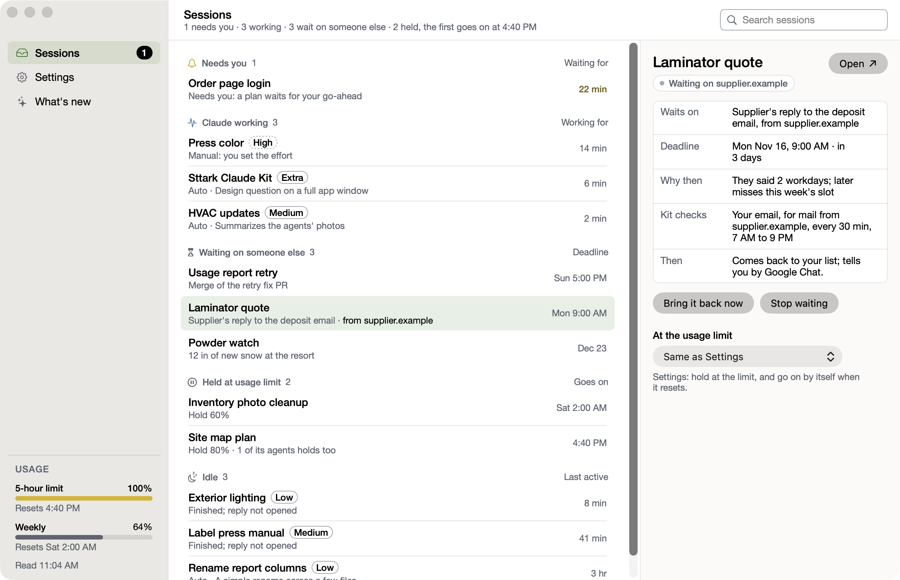
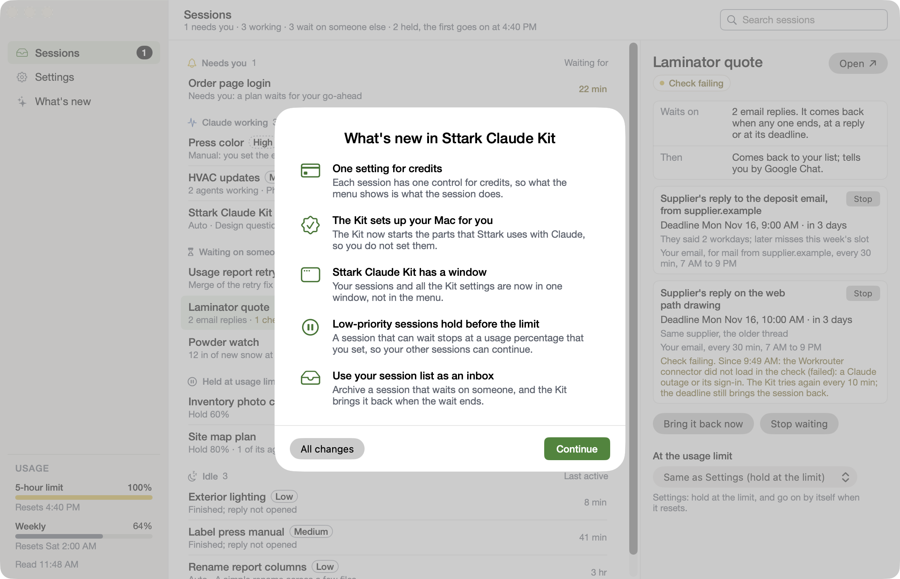
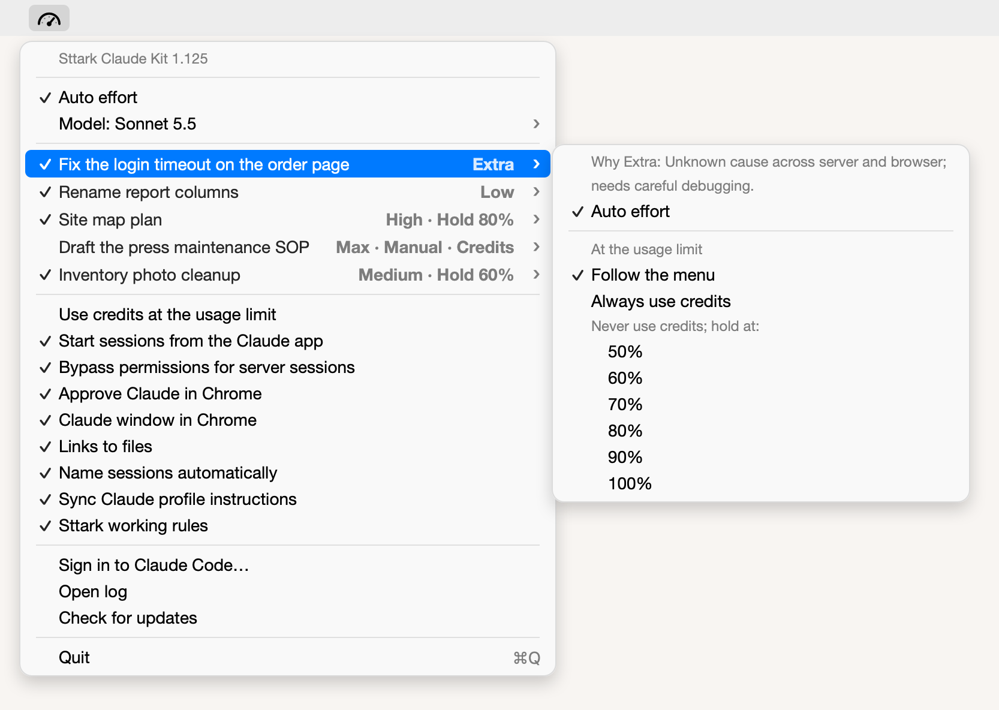
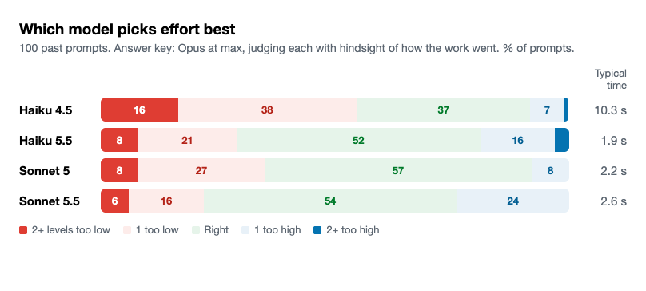

# Sttark Claude Kit

A Mac menu bar app that makes Claude Code easier to live with, for people who keep several sessions going at once and start them from the Claude app on their phone or computer.

| It | Section |
|---|---|
| Sets each session's effort to what the task needs, and adjusts it partway through | [Effort per task](#effort-per-task) |
| Shows which sessions are waiting on you, and tells you when one has waited 10 minutes | [Waiting on you](#waiting-on-you) |
| At your 5-hour or weekly usage limit, holds sessions until the limit resets instead of spending usage credits, then lets them go on by themselves. One session can instead always use credits, or never use them and hold earlier, at a percentage you pick | [Wait at the usage limit](#wait-at-the-usage-limit) |
| Names sessions with short handles for the topic they belong to | [Name sessions automatically](#name-sessions-automatically) |
| Warns before your Claude Code login runs out, and starts the sign-in | [Claude Code login](#claude-code-login) |
| Sets your Mac up to run sessions you start from the Claude app | [Start sessions from the Claude app](#start-sessions-from-the-claude-app) |
| Keeps every session that isn't archived running, through restarts | [Sessions stay running](#sessions-stay-running) |
| Gives those sessions Bypass permissions, which the Claude app doesn't offer | [Bypass permissions for server sessions](#bypass-permissions-for-server-sessions) |
| Lets Claude use your signed-in Chrome without taking your screen, each session in its own tab | [Claude window in Chrome](#claude-window-in-chrome) |
| Gives you a link to open a file Claude made, instead of a path | [Links to files](#links-to-files) |
| Answers Claude for Chrome's permission prompts | [Approve Claude in Chrome](#approve-claude-in-chrome) |
| Copies your Claude profile instructions into Claude Code | [Sync Claude profile instructions](#sync-claude-profile-instructions) |
| Lets you archive a session that waits on someone else, and brings it back, with a message the way you pick, when that happens or when its deadline passes | [Reach me by](#reach-me-by) |
| Puts Sttark's working rules in front of every prompt, and checks each reply for Simplified Technical English | [Sttark working rules](#sttark-working-rules) |
| Gives sessions in Sttark's app repos the Sttark app rules | [Sttark app rules](#sttark-app-rules) |

Effort, Waiting on you, the wait at the usage limit, the login warnings, the Claude window in Chrome, the Sttark working rules and the Sttark app rules are on from the start. Everything else is off until you turn it on in the Kit's Settings. It updates itself when a new version is released here.



*Drawn by the app's own code, with sample sessions.*

It only works on sessions that run through **Remote Control**: the ones you start from the Claude app, on your phone or any computer, on a Mac that runs a `claude rc` server, or a terminal session started with `claude --remote-control`. Effort can't be changed from outside any other kind of session. See [Start sessions from the Claude app](#start-sessions-from-the-claude-app) to set that up.

## Install

You need a Mac on macOS 14 or later, with [Claude Code](https://code.claude.com/docs/en/setup) installed and signed in (`claude` at `~/.local/bin/claude`).

1. Download **SttarkClaudeKit.zip** from the [latest release](https://github.com/Sttark/sttark-claude-kit/releases/latest) and open it.
2. Drag **SttarkClaudeKit** into your **Applications** folder, then open it.
3. The first time, macOS says it can't check the app for malicious software, because it isn't sold through Apple. Click **Done**, go to **System Settings > Privacy & Security**, scroll down and click **Open Anyway**. You only do this once.

That's it. The app adds its hooks to Claude Code's settings (`~/.claude/settings.json`, backed up first), starts by itself when you log in, and shows a gauge in the menu bar. The needle points at the level of the session you used last: far left for Low, straight up for High, far right for Max. No needle means no session in the last hour. A pause sign means Auto effort is off. New sessions use the hook right away. Sessions that were already open pick it up from their next prompt.

### Coming from Sttark Effort

Sttark Claude Kit replaces an earlier app named Sttark Effort. If you have Sttark Effort, install Sttark Claude Kit once by hand, as above. On its first launch it moves your settings, hooks, sync and Chrome approver over, then quits Sttark Effort and moves it to the Trash. macOS may ask you to allow notifications again, and to allow **SttarkChromeApprover** under Accessibility again.

## Updates

The app checks for a new version 20 seconds after it starts, then every hour, and installs it by itself: you don't click anything. It downloads the new version, checks that it's signed by Sttark, swaps it in and restarts in a few seconds, in the background. Sessions keep running, because they don't run inside the app. If the menu or one of the app's dialogs is open, or you are using the window, it waits until you're done. Your settings, and the Accessibility permission for the Chrome approver, stay as they are.

After an update that brings something you'd notice, the Kit shows it once in a short [What's new](#whats-new) window.

You see a notice only when an update fails to install. Click it, or choose **Update to …** at the top of the menu, to try again; the app also tries again by itself after 6 hours. **Check for updates** in Settings checks right away and installs a new version at once.

### What's new

When an update brings a change you'd notice, a short note explains it. Nothing opens by itself.



*Drawn by the app's own code, with this repo's notes. The same in dark mode, with dark colors.*

- **A dot and a badge.** While a note is unseen, the gauge in the menu bar has a blue dot, and **What's new** in the menu has a badge such as "3 new".
- **The sheet.** Click **What's new**: the window opens with a sheet that lists each new change with an icon, its title and one line. Opening it marks the notes seen, and the dot and the badge go away. **Continue** closes it; **All changes** opens the window's What's new page: every note, newest first, under a heading with the day and version of the update that brought it. Each note has an icon, its title with a New or Better tag, one sentence on what changes for you, 2 or 3 short points, and a picture of the part that changed (a dark one in dark mode). Click a picture to see it bigger.
- What you have seen is `whats_new_seen` in the state file. A new install starts with every note seen.
- Notes are `whats-new/*.md` in this repo, one per change, written in the same pull request as the change. See `AGENTS.md`.

## Using it

Click the gauge for a glance; open the window for everything else.



*Drawn by the app's own menu code, with sample sessions.*

| Menu item | What it does |
|---|---|
| **Sttark Claude Kit 1.…** | The version you have. |
| **Update to …** | Shows while a new version waits for the menu or the window to close, or after one failed to install by itself. Installs it now. **Updating…** shows in its place while an update installs. |
| **Claude login ends …: Sign in…** (only near the end) | Shows within 3 days of the end of your Claude Code login, or when Claude Code is signed out. See [below](#claude-code-login). |
| **Needs Accessibility permission…** (only when needed) | Shows while **Approve Claude in Chrome** is on and macOS hasn't allowed it to click. Opens the Accessibility settings. |
| **Needs you**, **Held at usage limit**, **Claude working**, **Waiting on someone else** | How many sessions are in each group, when there are any. Under **Needs you** (up to 5) and **Held at usage limit** (up to 3), each session with how long it has waited or when it goes on. Click a session to open the window at it; click a group to open the window at its first session. |
| **Open Sttark Claude Kit** | Opens the window. |
| **What's new** | Opens the window with the What's new sheet. A badge ("3 new") shows while notes are unseen. See [above](#whats-new). |
| **Quit** | Quits the menu bar app. Sessions and the server keep running; the hooks keep working, except the parts the app runs (Waiting on you, keeping sessions running, closing unused Claude window tabs, login warnings and updates). It starts again at your next login. |

### The window

The window opens only when you click **Open Sttark Claude Kit**, **What's new** or a session in the menu. It never opens, comes to the front or takes the keyboard by itself, and an update doesn't bring it back after the app restarts. While it is open the Kit is in the Dock and in Command-Tab, with its own menus; when you close it (Command-W), the Kit is only in the menu bar again. It follows your Mac's light or dark look, and changes when the look changes. **View > Zoom In** (Command-plus), **Zoom Out** (Command-minus) and **Actual Size** (Command-0) make everything in it larger or smaller, from 70% to 200%; the Kit remembers the size. Text in it can be selected and copied.


*Drawn by the app's own code, with sample sessions. The same in dark mode, with dark colors.*

**Sessions** is your session inbox: the sessions the Claude app lists (not archived, and not runs of scheduled tasks, which the app shows under Scheduled), plus archived sessions that wait on someone else. Each session shows once, in the first group that fits, and the page reads the state again every 3 seconds; the app's list is read every minute:

| Group | Which sessions | Time column |
|---|---|---|
| **Needs you** | Only where you must act: Claude asks you a question or a decision, waits for a permission, or is blocked (see [Waiting on you](#waiting-on-you)). Oldest first. | Waiting for; in bold after 10 minutes |
| **Claude working** | Claude is in a turn. | Working for: since your last prompt |
| **Waiting on someone else** | Waits handed to the Kit with `claude-wait` (see [Reach me by](#reach-me-by)), by deadline. | Deadline |
| **Held at usage limit** | Sessions waiting at the limit, or set to hold before it (see [Wait at the usage limit](#wait-at-the-usage-limit)). | Goes on |
| **Idle** | Every other session in the Claude app's list, newest first. A reply that needs nothing from you and that you haven't opened shows "Finished; reply not opened" here, and doesn't count as needing you. | Last active |

Search at the top filters by name. Click a session to see it on the right:

- **Open** opens it in the Claude desktop app (`claude://code/<session>`), or in the browser when the app isn't installed.
- What it is doing: how long it has waited and why; or what it waits on, the deadline, why then, how the Kit checks and what happens then, with **Bring it back now** and **Stop waiting**; or the percentage it holds at and when it goes on, with **Use credits until …**.
- **Effort**: **Auto** on lets Claude pick the level for each task, with the latest reason under it. Click a level to set it yourself: the session goes to Manual at that level, as with the Claude app's picker. Turn **Auto** on to hand it back. A session that waits on someone else shows no effort, since it isn't running.
- **At the usage limit**: **Same as Settings**, **Always use credits**, or **Never use credits; hold at** 50% to 100% (see [One session, its own setting](#one-session-its-own-setting)).

The 5-hour and weekly usage show at the bottom of the sidebar, with when each resets and when they were read.

![The window's Settings page: Effort (Auto effort, the model), Usage limit (Use credits at the usage limit), Reach me by (Email, Claude app, Google Chat, Text message, Mac notice, Send a test), Sessions (Start sessions from the Claude app, Bypass permissions, Name sessions automatically, Sttark working rules, Sync Claude profile instructions), Chrome and files (Claude window in Chrome, Approve Claude in Chrome, Links to files) and This Mac (the version and Check for updates, the Claude Code login and Sign in…, Open log)](docs/window-settings.png)

**Settings** has every setting of the Kit, saved as you change it:

| Setting | What it does |
|---|---|
| **Auto effort** | On: Claude picks each session's effort. Off: every session keeps the level it has, until you turn it back on. |
| **Model that picks the level** | Which Claude model picks the levels: the two newest Haiku and two newest Sonnet models, read from Anthropic's list once a day, so new ones appear without an update. Haiku is faster and cheaper; Sonnet is slower and smarter. The newest Sonnet is the default. |
| **Use credits at the usage limit** | Off (the default): at the limit, sessions hold until it resets. On: they go on with usage credits. A session with its own setting keeps it either way. See [below](#wait-at-the-usage-limit). |
| **Reach me by** | How a session tells you that something it waited on happened. Check the ways you want; **Set…** or **Change…** for the address, phone number or webhook a way needs; **Send a test**. See [below](#reach-me-by). |
| **Start sessions from the Claude app** | Sets this Mac up so you can start Claude Code sessions from the Claude app. Shows the folder sessions start in. See [below](#start-sessions-from-the-claude-app). |
| **Bypass permissions for server sessions** | See [below](#bypass-permissions-for-server-sessions). Off until you turn it on. |
| **Name sessions automatically** | See [below](#name-sessions-automatically). Off until you turn it on. |
| **Sttark working rules** | See [below](#sttark-working-rules). On until you turn it off. |
| **Sync Claude profile instructions** | See [below](#sync-claude-profile-instructions). Off until you turn it on. Shows the last sync. |
| **Claude window in Chrome** | See [below](#claude-window-in-chrome). On until you turn it off. **Open Claude window** shows beside it while Chrome runs and the Claude window is closed. |
| **Approve Claude in Chrome** | See [below](#approve-claude-in-chrome). Off until you turn it on. **Open Accessibility…** shows beside it while macOS hasn't allowed it to click. |
| **Links to files** | See [below](#links-to-files). Off until you turn it on. |
| **Sttark Claude Kit 1.…** | The version you have and when it last checked; **Check for updates** checks now and installs a new version at once, or **Update to …** when one waits. |
| **Claude Code login** | When your login ends; **Sign in…** opens Terminal and starts Claude Code's sign-in. See [below](#claude-code-login). |
| **Log** | **Open log** opens the full log in Console. |

**What's new** shows every note, newest first, with its picture.

**Setting the effort yourself:** click a level on the session in the window, or change it in the Claude app's effort picker as usual. Sttark Claude Kit reads each session's level from the server, sees one it didn't send, switches that session to Manual and leaves it alone. The window shows Manual within a minute, and the kit checks again right before any change it makes, so it never undoes your pick, even in the middle of a long step. Turn **Auto** on for the session to hand it back. A session that reopens (after the Mac restarts, or when the server brings back an idle one) starts again at the level it was saved with; that doesn't count as you changing it.

### The log

Every decision goes into `~/Library/Logs/sttark-claude-kit.log`, one line each:

```
2026-10-08 11:02:48 change cse_01AbCd… high->xhigh (2.2s) xhigh - Unknown cause spanning firmware and server code | The sensor readings drop out every few hours…
2026-10-08 11:03:22 steady cse_01AbCd… xhigh at 11 steps (4.3s) xhigh - Cause still unconfirmed; needs log checks and a test. | The sensor readings drop out every few hours…
```

| First word | Meaning |
|---|---|
| `change` / `keep` | The check when a prompt arrives. A `keep` line with a session name in quotes comes from the check that keeps sessions running instead. |
| `raise` / `lower` / `steady` | The check at 10, 25 or 50 steps. |
| `manual` | The session is on Manual, or you just changed it yourself. |
| `reopen` | The session came back in a new process, at the level shown. The hook starts from there. |
| `paused` | Auto effort is off. |
| `skip` | Not a Remote Control session, so it can't be changed; or at the usage limit, so no check was made. |
| `wake` / `start` / `reattach` / `move` | A stopped session started again. See [Sessions stay running](#sessions-stay-running). |
| `name` | Name sessions automatically: a name picked, kept or changed. |
| `limit` | The wait at the usage limit: each hold, wait, resume and choice of credits (`credits`, also from the switch in Settings and **Use credits until …** in the window), and each change to a session's own setting (`mode`), with where it came from: the menu, typed in the session, or the command. |
| `rules` | The Sttark app rules: added to a session, or the saved copy refreshed. |
| `wait` | Waits handed to the Kit: each one set, each check that failed, and each session brought back. |
| `notify` | Reach me by: each message `claude-notify` sent, each way, and how it went. |
| `ste` | The working rules' check of a finished reply: ok, noted for the session's next prompt, or error. |
| `agents` | The working rules' manager check: work that made more than 8 tool calls in the chat with no agent, noted for the session's next prompt. |
| `icons` | The working rules' status icon check: a status table cell with more than one of ✅ 🔄 🔴 ⚪, noted for the session's next prompt. |
| `stable` | The fixed copy of Claude Code and its night job. |
| `app` | The menu bar app itself: switches turned on or off, updates, notices, and What's new (`what's new:` shown, Got it). |
| `error` | Something failed. The level was left as it was. |

To watch it live: `tail -f ~/Library/Logs/sttark-claude-kit.log`.

## Effort per task

- **Picks the level before Claude starts.** Each prompt you send goes to a quick side check (the newest Claude Sonnet, or another model you pick) along with the last few messages. The model picks Low, Medium, High, Extra or Max, and the session is set to that level before Claude's first step. A plain "go" after a plan gets sized to the plan.
- **Checks again partway through.** At 10, 25 and 50 steps into a task (the session's own steps; a subagent's steps don't count), the model looks at the work so far. If builds keep failing or the cause is still unknown, it raises the level, up to Max for a task that's stuck at Extra. If the hard part is done and the rest is repeat edits, it lowers it. UI work stays at High or above until Claude has looked at the result and judged it, since that look is where the design gets decided.
- **You can take over.** Turn **Auto effort** off for every session, or turn it off on one session's row to set that session to Manual. If you change a session's effort yourself in the Claude app, Sttark Claude Kit notices and switches that session to Manual on its own.
- **Shows its reasons.** The window shows each session's level and the latest reason for it. Every decision is logged.
- **Updates itself** within an hour of a new version being released here, with no click.

## Waiting on you

You send Claude a prompt, move on to something else, and forget to come back. Every minute, Sttark Claude Kit checks your recent Claude Code sessions and lists the ones waiting on you, at the top of the menu and under **Needs you** in the window:

| Shows as | When |
|---|---|
| **Needs you** | Claude stopped to ask you something or for a permission, or its finished reply can't go on without you: a question, a plan waiting for your go-ahead, a choice, or a step only you can do. Plain signs decide first: the server's own summary of the turn names something you must do, a step in the reply's status table is marked 🔴, or the reply ends with a question (yes); the reply says nothing is needed, or "no alert" (no). Only when none of them shows does the model picked in Settings read the reply, once, and it leans toward no. Opening the session clears it, even if you don't answer, until Claude writes again. |
| **Finished; reply not opened** (in Idle) | Claude finished a reply that needs nothing from you, and you haven't opened the session since. It doesn't count as needing you and sends no notice. The Claude app records when you open a session, on any device, so opening it clears it. |

On this Mac, seeing the reply also counts: if the session was open in the Claude app, with the app in front and the screen on, for a few seconds after Claude finished, it comes off the list. That covers watching a reply arrive, which the Claude app itself doesn't record as opening it.

Each row shows how long it has waited; click it to see why in the window, and **Open** to open the session. When one that needs you has waited 10 minutes, you get one notice. Archived sessions, runs of scheduled tasks and sessions Claude is still working on never show. It covers Claude Code sessions that run through Remote Control, from the last day.

## Wait at the usage limit

When your account has usage credits turned on, Claude Code doesn't stop at your 5-hour or weekly limit: it goes on and charges usage credits. With Sttark Claude Kit, a session holds at the limit instead, spends nothing, and goes on with its task by itself when the limit resets. Credits are used only when you choose them. Nothing changes in your account's settings.

Each session can also have [its own setting](#one-session-its-own-setting): always use credits, or never use credits and hold before the limit, at a percentage you pick.

- **Claude tells you, in the chat.** At the limit Claude says one line: **Usage limit reached. I continue at 6:00 PM. Type use credits to continue now on credits.** Then it runs `claude-limit-wait`, which shows as a running command with the line **Waiting for the 5-hour usage limit to reset at 6:00 PM**. When the wait ends, the command prints why (the limit reset, or credits were chosen), and Claude goes on with the task. You never see a silent spinner, and you never need the menu. (A session set to never use credits can hold with no reply when even one would cost credits: see [below](#one-session-its-own-setting).)
- **A session at work** is stopped before its next step (tool call); Claude says the line, waits, then takes that step again. **A message you send at the limit** goes to Claude, which says the line, waits, then answers it. Nothing you type is lost.
- **The app's Now using usage credits banner** shows your account's setting (credits are on). It doesn't mean the session is spending them.
- **What a limit costs:** one short reply on credits each time a session reaches the limit (the line, then the wait command), and one more short reply every 9 minutes of waiting, because a command can run at most 10 minutes; each is a few output tokens plus a cached read of the session. In a Sonnet test with a 26,000-token session that was about $0.008 each. A session set to never use credits makes no reply on credits at all: see [below](#one-session-its-own-setting).
- **To use credits for one session:** send `use credits` in it. The wait ends within 10 seconds (30 seconds in a brand-new session) and Claude goes on, using credits until that limit resets. Clicking **Use credits until …** on the session in the window does the same, and the log says so: `limit  credits abcdef12 uses credits until 2:59 PM (menu)`. Sent before a limit, `use credits` lets that session go on with credits if it reaches a limit in the next 5 hours.
- **A limit counts when it is at 100%**, or at its own percentage for a session set to hold earlier. A limit at 90% or more is read every 15 seconds, so the hold starts soon after it is reached.
- **Subagents** of a session set to Same as Settings are stopped before their tool calls like the main session, and wait the same way. A session set to hold holds its agents with no reply at all (below).
- **Background work that finishes at the limit** (a background agent or command) starts a turn by itself; that turn says the line and waits like any other.
- **To use credits for every session:** turn on **Use credits at the usage limit**. Turn it off to go back to holding. A session with its own setting keeps it either way. The log says each change: `limit  credits every session uses credits at the limit, except one set to hold (menu)`, or `limit  credits every session waits at the limit, except one set to use credits (menu)`.
- **Stopping a session** in the Claude app ends its hold, as with any step.
- A model's own weekly limit (for example a weekly limit for one model) holds only the sessions that run on that model.
- At the limit the kit's own side calls to Claude (the effort check, the reply check, naming, the app rules refresh) are skipped too, so nothing is spent.
- Accounts without usage credits, or at their credits spend limit, are left alone: there Claude Code stops at the limit by itself.

It works for every Claude Code session on this Mac, Remote Control or not. Each hold, resume and choice is logged, with lines starting `limit`.

### One session, its own setting

Some work can wait, and some can't. Each session has one of three settings:

| Setting | What the session does |
|---|---|
| **Same as Settings** (the default; `follow the menu` when typed) | What **Use credits at the usage limit** says: hold at the limit when it's off, go on with usage credits when it's on. |
| **Always use credits** | Goes on with usage credits at the limit, even when **Use credits at the usage limit** is off. |
| **Never use credits; hold at N%** | Never spends usage credits, not even for one reply, and even when **Use credits at the usage limit** is on. It holds when the 5-hour or the weekly limit reaches N% (80% unless you pick another), and goes on by itself when that limit resets under N%. Use it for work that can wait, to keep the rest of your usage for other sessions. At 100%, it holds at the limit itself. |

Set it in any of three ways. The setting lasts for the life of the session, also when the Mac restarts or the session comes back on its link.

- **In the window:** click the session. Under **At the usage limit**, pick **Same as Settings**, **Always use credits**, or **Never use credits; hold at** 50%, 60%, 70%, 80%, 90% or 100%.
- **In the session:** send one of these as the whole message. Claude says the new setting in one line. Sent while the session waits, it counts at once, and the wait ends if the new setting lets the session go on.

  | Send | Setting |
  |---|---|
  | `no credits` | Never use credits; hold at 80% |
  | `no credits 90`, `no credits 90%`, `no credits at 90` or `never use credits 90` | Never use credits; hold at 90% (any number from 1 to 100) |
  | `credits ok` or `always use credits` | Always use credits |
  | `follow the menu` | Same as Settings |

- **With a command**, which a session or a script can run:

  ```
  claude-limit-mode                       # this session's setting (run in a session)
  claude-limit-mode hold 80               # this session: never use credits; hold at 80%
  claude-limit-mode <session> credits     # always use credits
  claude-limit-mode <session> follow      # same as Settings
  claude-limit-mode <session>             # that session's setting
  claude-limit-mode --list                # every session that has its own setting
  ```

  `<session>` is the session's id, its Remote Control id (`cse_…` or `session_…`), the first 6 or more characters of either, or its full name, as in the Claude app. Leave it out to mean the session the command runs in. A session this Mac has never seen is an error (exit code 2), as is a bad setting. A session that holds can run the command itself, by itself on one line, to change its own setting.

When a session set to hold reaches its percentage:

- **It stops before its next step**, as at the limit. Claude says one line, for example **This session holds at 80% usage. I continue at 4:40 PM. Type use credits to continue now.**, and runs `claude-limit-wait`. The wait makes no model calls until it ends, and it ends by itself when every limit that counts is under the percentage again.
- **When even that one line would cost usage credits**, it holds with no reply at all. That is the case while a limit is at 100% and the account has credits on: for example, other sessions went on with credits past the limit. Then the session's next step, or a message you send it, waits before Claude sees it, and goes on by itself when the hold ends; the message then reaches Claude as you wrote it. Nothing shows in the chat meanwhile, only the running step or your sent message; the menu shows the hold. Once it holds this way, it holds until the hold ends, even if the limit drops under 100% first.
- **Its subagents and background agents hold too**, each before its next step, with no reply at all, and go on by themselves with that step when the hold ends. A notice that a background task finished, which reaches the session like a message, waits the same way while a reply would cost credits.
- **The window shows it under Held at usage limit**, with its percentage and when it goes on (**Hold 80%**, 4:40 PM), and how many of its agents hold too; so does the menu. Click it to change its setting, or to use credits until the reset.
- **To let it go on now**, send `use credits` (it goes on, with usage credits if it needs them, until that limit resets; then its setting holds it again), click **Use credits until …** on it in the window, pick a higher percentage, or change its setting.
- **The kit's own side calls for it** (the effort check, the reply check, naming) are skipped while it holds.

Each change, hold and resume is in the log:

```
2026-10-08 16:02:11 limit  mode   5d1e0c7a never use credits; hold at 80% (typed)
2026-10-08 16:05:40 limit  hold   5d1e0c7a at 80%: the 5-hour limit is at 83%, until 4:40 PM (Edit)
2026-10-08 16:05:52 limit  wait   5d1e0c7a at 80%: the 5-hour limit is at 83%, until 4:40 PM, with no model calls until it ends
2026-10-08 16:06:10 limit  hold   5d1e0c7a/a91f3c02 at 80%: the 5-hour limit is at 84%, until 4:40 PM (Bash)
2026-10-08 16:40:02 limit  resume 5d1e0c7a the 5-hour limit is under 80%, after 34 min
2026-10-08 16:40:03 limit  resume 5d1e0c7a/a91f3c02 the 5-hour limit is under 80%, after 33 min
```

A `hold` line ends with the step that was held; `5d1e0c7a/a91f3c02` is an agent of session `5d1e0c7a`, and a hold with no reply says `no reply: one now would use credits`. On a `mode` line, the word in brackets says where the change came from: `menu`, `typed` or `command`.

## Choosing the model

A test on October 15, 2026 found **Sonnet 5.5** picks effort best, so the newest Sonnet is the default. The newest Haiku is faster and cheaper, if you'd rather pick it under **Model that picks the level** in Settings.



| Model | Right level | Within one level | Too low | 2+ levels too low | Too high | Typical time |
|---|---|---|---|---|---|---|
| Sonnet 5.5 | 54% | 94% | 22% | 6% | 24% | 2.6 s |
| Sonnet 5 | 57% | 92% | 35% | 8% | 8% | 2.2 s |
| Haiku 5.5 | 52% | 89% | 29% | 8% | 19% | 1.9 s |
| Haiku 4.5 | 37% | 82% | 55% | 16% | 8% | 10.3 s |

**Why Sonnet 5.5:** a level that's too low is the costly mistake, because the work comes out wrong and has to be done again. A level that's too high only costs some extra time and usage on that task. Sonnet 5.5 is too low least often, and lands within one level 94% of the time. Sonnet 5 is right most often, but it's too low far more often. Haiku 4.5 is slow and too low over half the time.

**How the test works:** it took 100 real past turns from Claude Code session history, 20 each from five sizes (no tool calls, 1 to 5, 6 to 20, 21 to 60, and more than 60). For the answer key, Opus at max effort read each whole turn, including how the work actually went (each step, which failed, how long it took), and named the level the work truly needed. Then each model judged the same 100 prompts the way the hook does, seeing only the prompt and the conversation before it. One limit: the answer key is one model's hindsight, not a measured result.

**Run it again** when new models come out. From an empty folder:

```sh
python3 ~/path/to/sttark-claude-kit/tools/model-test/sample.py   # picks 100 past turns: cases.json
python3 ~/path/to/sttark-claude-kit/tools/model-test/run.py      # answer key and models: results.json (edit the model list first)
python3 ~/path/to/sttark-claude-kit/tools/model-test/score.py    # table and chart.png
```

It reads your own session history, which stays on your Mac, and makes about 500 Claude calls with your Claude Code login.

## Start sessions from the Claude app

Sttark Claude Kit can set your Mac up so you start Claude Code sessions from the Claude app, on your phone or any computer. Each session runs on the Mac, with the Mac's files, tools and logins, and Sttark Claude Kit sets the effort for every one of them.

1. Click the gauge and turn on **Start sessions from the Claude app**.
2. Pick the folder sessions start in. A folder that holds all your projects works well, so any session can reach any of them.
3. Click **Start**.

From then on, open the Claude app, go to **Code**, pick your Mac, and type. The setting stays on through restarts. Turn the switch off to stop it.

The Mac has to be on and awake for sessions to run. On a laptop, set **System Settings > Battery > Options > Prevent automatic sleeping when the display is off** while it's plugged in.

If this Mac already runs a Remote Control server that you set up another way, Settings shows it as on and leaves it alone.

### Sessions stay running

A Mac restart ends every session, and so does archiving one. The server only starts a session again when something reaches it, so a session can sit in the Claude app with nothing on the Mac answering it. While a Remote Control server runs on this Mac, Sttark Claude Kit checks every 15 seconds for sessions on it that aren't archived but have stopped, and starts each one again: on the same link, with its whole conversation, and with nothing added to the chat. It does this by sending the session its own effort level, which is enough for the server to start it.

- After a restart, every session that isn't archived is back within a minute or two of logging in.
- **Unarchive and keep typing.** The server won't start a session that was archived and then unarchived. Sttark Claude Kit sees that the session was archived since its last reply and, within 15 seconds, starts it as a session of its own, outside the server, on the same link and with its whole conversation. Messages you sent after unarchiving are answered, in order; nothing older runs again. Logged as `reattach`. After a restart it is woken through the server first, like any other session; only if two wakes bring nothing is it started on its own again on that link (logged as `start`).
- **One session, one copy.** Newer Claude Code servers also start sessions that were archived and then unarchived. When the server runs a session that Sttark Claude Kit started on its own, the kit quits its own copy and leaves the session to the server (logged as `handover`). It does the same when its own copy was taken over elsewhere and stood down (code 4090; logged as `standdown`), then wakes the session through the server. A copy that stood down stays open but answers nothing, and while it lives, reminders for that session go to it in a form only it reads, so they would be lost.
- If Claude Code can't reattach the link, the session gets a new one instead, and the old entry is archived so the app lists it once. Its Routines move with it (each is copied to the new link and the old one turned off). Logged as `move`. A stopped session that wasn't archived gets two wakes before this.
- Archive a session to stop it for good.
- Timed tasks a session set for itself come back with it, except ones whose time passed while it was stopped. Loops that pick their own timing, and scripts it was running in the background, don't: ask the session to start them again. Routines (scheduled from the Claude app, or by Claude with the Routines tools) run on Anthropic's side and wake their session when they fire. A Routine that fires into an archived session fails and turns itself off, and a session that runs on its own shows as archived while it's stopped, so a Routine in one of those that comes due while the Mac is off is lost.
- It keeps up to 30 sessions running, the most recently used first, since a server runs 32 at most.
- Each start is logged as `wake` in the log.

### One Accessibility approval, not one per update

Claude Code installs each update in a new folder, and macOS files a program's Accessibility permission by where it lives, so a server run from Claude Code's own folder asks for Accessibility again after every update. While **Start sessions from the Claude app** is on, the server runs from one copy of Claude Code that never moves (`~/.local/share/claude/stable/claude`), so you approve it once. A job checks every 30 minutes for a newer Claude Code, swaps it into that copy, and restarts the server to use it. Restarting ends open sessions, so it waits for between 2 and 5 AM when no session is working. Each step is logged.

## Bypass permissions for server sessions

The Claude app, on desktop or phone, doesn't offer **Bypass permissions** for sessions that run on a Remote Control server. It switches each one to asking before commands, even when the server was started to bypass. Without this switch, there's no way to run those sessions in bypass.

With it on, at a session's first permission prompt, also when a forked agent of the session asks, Sttark Claude Kit approves it and switches the session to Bypass permissions. The Claude app then shows the session in Bypass permissions. Bypass still asks about a few commands Claude Code flags as risky, such as `rm` on a path built from a variable, so in bypass the switch approves those too.

- It acts on sessions whose server was started with `--permission-mode bypassPermissions`, and on sessions the Kit opens again on their own with `--remote-control --permission-mode bypassPermissions`. The server **Start sessions from the Claude app** sets up always is, so this switch alone decides.
- Plan mode, plan approvals and questions Claude asks you are left alone.
- Each switch is logged to `~/Library/Logs/claude-bypass-hook.log`.

Only turn it on if you're comfortable with Claude running commands on this Mac without checking with you first.

## Approve Claude in Chrome

When Claude uses Chrome through the Claude for Chrome extension, it stops to ask for permission on each new site. With this switch on, Sttark Claude Kit answers for you: it clicks **Always allow actions on this site** when that's offered, otherwise **Allow this action**. It never clicks Decline, and it only clicks inside the Claude extension's own window, never on web pages.

The first time you turn it on, macOS asks you to allow **SttarkChromeApprover** under **System Settings > Privacy & Security > Accessibility**, because it has to see and click the button. Until you do, the menu shows **Needs Accessibility permission…**, and Settings **Open Accessibility…**, which open that page. Each approval is logged to `~/Library/Logs/claude-chrome-approver.log`.

## Sync Claude profile instructions

The Claude app has a box for instructions to Claude in **Settings > Profile**. Claude in the app follows them, but Claude Code never sees them. With this switch on, Sttark Claude Kit copies them into Claude Code's own instructions file (`~/.claude/CLAUDE.md`, in a marked block it keeps up to date) every 15 minutes. It also puts them in front of every prompt you send, because Claude Code reads that file only when a session starts, so a session that's already running would otherwise miss an edit.

- It needs the Claude desktop app installed and signed in. It reads your profile with that sign-in, and checks the account matches before writing anything.
- The first time you turn it on, it installs two small Python add-ons it needs into the app's own folder. That takes a few seconds.
- Hover the switch to see the last sync. Each sync is logged to `~/Library/Logs/claude-profile-sync.log`.
- Edit your instructions in the Claude app, not in `CLAUDE.md`: the marked block is overwritten. Anything else in that file is left alone.

## Claude window in Chrome

When Claude uses your browser, it usually opens tabs or windows the way Claude in Chrome does, and Chrome jumps in front of whatever you're typing in: your cursor goes, and your keystrokes land in Chrome. That happens even with a window behind others.

This switch is on until you turn it off. While it's on, Sttark Claude Kit opens one Chrome window named **Claude**, in your own profile with all your logins, and installs `claude-window`, a small command Claude Code sessions use to work in it without taking your screen. Each session gets its own tab in that window, so sessions working at the same time never move each other's pages:

```
claude-window go https://example.com    open a page in this session's tab and wait for it to load
claude-window url                       the current page's title and address
claude-window text                      the page's visible text
claude-window js 'document.title'       run JavaScript in the page
claude-window done                      close this session's tab
```

- A session's tab becomes the Claude window's front tab whenever the session uses it, so sites that only work in the front tab work.
- Claude closes its tab with `claude-window done` when it's finished. Sttark Claude Kit also closes any tab whose session has ended or that hasn't been used for 30 minutes.
- Chrome comes forward when a script gives a tab its address, so `claude-window` never does: it opens a blank tab and moves it to the page from inside. Opening, switching and closing tabs and running scripts in a page leave Chrome where it is.
- Making a window is the one step that brings Chrome forward. If the Claude window is gone (closed by mistake, Chrome quit, or a restart), the next `claude-window` command makes it, puts the app you were in back in front at once, and goes on. Chrome is in front for less than half a second. If Chrome isn't running, it starts Chrome hidden first. Two sessions that ask at the same moment get one window. **Open Claude window** in the menu does the same step.
- While the switch is on, every Claude Code prompt carries the rule to use only the Claude window, so Claude Code needs nothing from you.
- **For Claude chat too** (claude.ai and the Claude app's chats), add this line to your Claude profile instructions (**Settings > Profile**). Chats don't run hooks, so this is the only way they learn the rule: *"Browser: use only the Chrome window named Claude. In Claude Code, use the claude-window command (go, url, text, js, done) for every page; it gives each session its own tab. Never open a tab or window any other way, and never bring Chrome to the front."* With **Sync Claude profile instructions** on, Claude Code gets the same line, which does no harm alongside the automatic rule.
- It needs Chrome's **View > Developer > Allow JavaScript from Apple Events**.
- It works only in your own Chrome. A Chrome that a test tool such as Playwright or Puppeteer starts at the same time is a second copy of Chrome; `claude-window` never sends it anything.
- The Claude in Chrome extension opens tabs its own way, and that can't be changed from outside it.

## Links to files

Claude Code sessions save what they make (a picture, a page, a PDF) on the Mac and hand you its path, like `/private/tmp/claude-501/…/chart.svg`. You read the reply in the Claude app, often on your phone, where a path opens nothing.

With this switch on, Sttark Claude Kit runs a small web server on the Mac (port 8732) and installs `claude-link`, a command that turns a file into a link:

```
claude-link ~/Desktop/chart.svg
http://Your-Mac.local:8732/k3J9xQ2mV7pL1aTz/chart.svg
```

- Every Claude Code prompt carries the rule to give you that link instead of a path, so Claude Code needs nothing from you.
- The link opens in your browser on the Mac, or on a phone or computer on the same network.
- Each link has its own random part, and the server shows only files a session linked: no list, nothing else on the Mac. Anyone on your network with the link can open that file.
- The link shows the file as it is now, so a file Claude changes shows the change. A deleted file stops opening. Links go away after 30 days.

## Name sessions automatically

Claude names each new Claude Code session with a long description of the first task. With this switch on, sessions get a short handle for their project or area instead, like "Order Page" or "Label Printer", the way you'd label a folder.

- It names a session at your first message that shows what the session is about. A greeting or a bare "yes" waits for a later one.
- It reuses one of your own handles when a session clearly belongs to that area, and learns your handles from the sessions you name yourself.
- A name you set yourself is never changed. A name this chose gets a second look on your 3rd, 6th and 12th prompts and every 12th after that: if the session has moved on to another topic (a session that starts with "build an Apple TV app" and turns into YouTube playlists), it's renamed to the new topic.
- It names Claude Code sessions only. Claude chats can't be renamed by an app.
- It also sets the name in the Claude app, after the app's own automatic title lands, so the app shows it too.
- It runs alongside the effort check, so it adds no wait. Each name is logged, with lines starting `name`.

## Reach me by

Treat the Claude app's list of sessions like an inbox: it holds only the sessions you must act on. When a session waits on someone else (a pull request someone must merge, a reply to an email, a check at a set time), it hands the wait to Sttark Claude Kit with `claude-wait` and a deadline it picks, and tells you that you can archive it. The Kit watches the wait with no model calls. When the thing happens, or the deadline passes and it hasn't, the Kit brings the session back to your list on the same link, the session goes on with the work, and you get a message the way you picked here: what happened, where the session stands, what it does next and what you must do. At a deadline it says plainly who did not do what, and asks what you want to do.

You can always tell a session is watched: it ends its turn with one handoff line, such as "I am watching for New Star's reply. If none by Mon 11/16 9 AM, I bring this session back and ask if we follow up. You can archive this session." A plain "let me know when they reply", "tell me when it merges" or "has X replied?" sets up a wait too. At a deadline the session checks once more, gets the next step ready (for an email, a follow-up draft) and asks one question, such as "New Star has still not replied about the laminator quote. Should I send the follow-up now?", so one word from you does it.

Open waits show in the window under **Waiting on someone else**, with what each waits on and its deadline; click one for the session's reason for that deadline, how the Kit checks, **Bring it back now**, or **Stop waiting**.

| Wait | How the Kit knows it happened |
|---|---|
| `claude-wait pr <owner/repo#n> merged\|closed --by <deadline> --why "<line>"` | Reads the pull request with `gh` every 5 minutes. A pull request closed without a merge also ends a merge wait. |
| `claude-wait at <time> --why "<line>"` | The clock. |
| `claude-wait email-reply <Gmail thread id> [--from <sender>] --by <deadline> --why "<line>"` | A short Haiku run that calls Workrouter's `gmail_search` once: a message in the thread (or from `--from`) newer than the wait and not from you. The first check also reads the thread's subject once. The answer comes from the tool's own result, not the model's words. |
| `claude-wait check-script <path> --every 10m --by <deadline> --why "<line>"` | The session's own small script, kept by the Kit: exit 0 means it happened, and its first line of output says what. For an API value, a page that changes, a tracking number. No model calls. |
| `claude-wait check-prompt "<yes/no question>" --every 1h --by <deadline> --why "<line>"` | A Haiku run with Workrouter's read-only tools and the web that ends YES or NO. Only when nothing free works. |

The two checks that cost a model call (email reply and check-prompt) run only from 7 AM to 9 PM, never while the session or your account is held at the usage limit, and less often as the wait gets older: every 10 minutes (or the wait's own `--every`, at least 10 minutes) for 3 hours, then every 30 minutes, then hourly after a day. Signed-in pages in the browser (a supplier's messenger, Onshape) are not checked, since they need the Claude window.

`--what "<what it watches for>"` names it in the window and the messages. The session always picks the deadline (`--by`), from who it waits on, how urgent the work is and how long they usually take; there is no default. A time or deadline is `2026-11-16 17:00`, `17:00`, `+4h`, `+2d` or `3 weekdays` (Saturdays and Sundays skipped; company holidays are not). `claude-wait --list` shows every open wait, `--now <id>` brings one back now and `--cancel <id>` drops one.

You run many sessions at once. When something a session waited on happens (a scheduled task or a timed check such as "check at 4:45" fires, a pull request it waited on merges, a reply comes in), the news lands as a new turn in that one session, which is easy to miss. With Reach me by, the session also sends it to you, the way you pick in Settings, and the message stands alone: what happened, the session's name and a link to it, what it is for, what is done, what it waits on now, what it does next, and what you must do, if anything. A reply in a live chat stays in the session as usual.

| Way | What you get | What it needs |
|---|---|---|
| **Email** (the default) | Mail from alerts@sttark.com, in about a minute | Your @sttark.com address (it starts as your Claude Code login's address), and GitHub's `gh`, signed in |
| **Claude app** | A push from the Claude app on your phone; tap it to open the session | A session started from the Claude app (Remote Control) |
| **Google Chat** | A message in a Google Chat space you made for it | The space's webhook: make a space with only you in it, then the space's name > Apps & integrations > Webhooks > Add webhook, and paste its URL under **Google Chat webhook…**. Set the space's notifications to All |
| **Text message** | A text from Messages on this Mac: an iMessage, or a text through your paired iPhone | A phone number under **Phone number…**. The first text asks you to let Sttark Claude Kit use Messages |
| **Mac notice** | A notice on this Mac; click it to open the session | Nothing |

Check as many as you like. A way that needs a setting asks for it when you check it. **Send a test** sends a test message every checked way and says how each went.

- A session that has no Claude app link (a terminal session without Remote Control) can't come back by itself: the Kit sends the message, and you open it.
- If a session that came back sends no message within 15 minutes, the Kit sends one itself.
- Sessions send with `claude-notify "<subject>" "<message>" [--link <url>]`; the working rules tell them when. `claude-notify --show` prints your choice; `claude-notify --test` sends a test.
- Not offered: **Asana inbox**, since through Workrouter a task or comment comes from you, and Asana never notifies a person of their own task or comment; and paid text services.
- Each message is logged, with lines starting `notify`; each wait, with lines starting `wait`.

## Sttark working rules

How Claude works for people at Sttark, in every session. The rules go in front of every prompt, so a running session follows them too. They say, in short: visuals over text; answer the question first, and a question is not an instruction; give the plan in two lines with a step count, then start without asking; do a clear, undoable step and report it, and ask only before a step that deletes, sends, publishes or spends; the shortest reply that fully answers; a warning only when it changes what the person does, and first; treat an example as one case of a pattern and fix every case; search, don't guess; run the tool, show the result, then comment; hand any task of more than a few tool calls to a subagent in the background (reading, research and design count too, with the agent started before the third tool call) and keep the chat for direction, one agent per task when there are several; when one prompt holds several asks, number them and end every turn with a table of each one, its status marked ✅ done, 🔄 in progress, 🔴 needs you or ⚪ dropped; when something a session waited on happens, hand a wait on someone else to the Kit with `claude-wait` and a deadline the session picks, and say the person can archive the session, then, when the Kit brings it back, tell them where things stand with `claude-notify` (see [Reach me by](#reach-me-by)), never for a reply in a live chat; pull and read the project docs before repo work; usability first in UI; full Asana URLs; no em-dashes; end each turn with where things stand; and write replies in ASD-STE100 Simplified Technical English.

A rule in the context is a request. The last one also gets a check: when Claude finishes a reply, the reply's prose goes to a quick side call (Haiku) that names the words and sentences that clearly break Simplified Technical English, and says whether the reply ends by asking for a go it did not need. The check never sends a reply back: you have already seen the reply, so a rewrite would only show it twice. A miss is saved for that session and goes in front of its next prompt ("Your last reply had words that are not STE: ... Use the approved words from now on."), then it is cleared. Replies with no prose (code only) or only a few words are not checked, and any failure of the check saves nothing.

- On for everyone when the app installs. Turn it off with the switch; the app remembers and leaves it off through updates.
- The rules text lives in `Resources/hooks/working-rules-hook.py` in this repo. To change a rule for everyone, change it there and open a pull request.
- The check is a short Haiku call that runs in the background after each reply, so it never holds up the turn. Misses wait in `~/Library/Application Support/SttarkClaudeKit/working-notes.json`. Each check is logged, with lines starting `ste`.
- The same check counts the tool calls the session made itself since your last message. More than 8 with no agent started gets a note in front of the next prompt, to hand such work to a background agent. This count makes no model call; it is logged with lines starting `agents`.

## Sttark app rules

When a session works in one of Sttark's app repos, Sttark Claude Kit adds the five Apps chapters of the Sttark Brand and App Guidelines (Building Web Apps, Look, Pages and Behavior, Sign-in and Access, Checks) to the session, with one line before them: follow them for any UI work, and run the Checks chapter's Before you ship list. It's on for everyone; there's no switch, since it only reads.

- **Which repos.** A git repo, or a worktree of one, that is set up for the guide: it has the page check (`scripts/page-check.mjs`, in the repo or an app folder in it), as building, sttark-docs, sttark-inventory and hvac_automation do. Also a new repo with no `origin` yet that has screens (files a page is made of: `.astro`, `.tsx`, `.jsx`, `.vue`, `.svelte`, `.html`, `.css`, `.scss`, templates; committed or new). Every other repo gets nothing, whoever's it is: an app that was never set up is left as it is.
- **A new app.** A folder outside any git repo, or a new repo without screens yet, gets one short line instead: if the session builds a web app or page for Sttark, read the chapters first, and set the app up with the setup command (below). The full chapters follow at the first prompt after the repo gains a page.
- **Setting up an app.** The chapters and that line give the command, which fetches `page-check/setup.mjs` from Sttark/sttark-docs and runs it in the repo root. It adds the page check, the AI review and the agent notes; see the Checks chapter of the guide.
- **When.** At the first prompt whose working folder is in one of those repos, once per session. After Claude compacts the session, the next prompt adds them again.
- **What is left out.** Code a session needs only to build that one thing, the logo's SVG and a Chat card's dots, is replaced by a line saying where to read it, so all five chapters fit.
- **Where the rules come from.** docs.sttark.com needs sign-in, so the app reads the chapters as you, through Claude Code's Sttark Workrouter connector, and keeps a copy on this Mac. The copy is refreshed in the background once a day; a prompt never waits for it. Until the first copy arrives, the session is told to read the five chapters itself.
- The chapters are never stored in this repo. Each addition and refresh is logged, with lines starting `rules`.

## Claude Code login

Claude Code's sign-in lasts about a month. When it runs out, every Claude Code session and the server for **Start sessions from the Claude app** stop working until you sign in again, and nothing tells you. Sttark Claude Kit checks the end date every hour and warns you 3 days, 1 day and 2 hours before, and right away if Claude Code is signed out. Click the notice, or **Sign in to Claude Code…** in the menu: Terminal opens and starts the sign-in, and you finish it in the browser. Within 3 days of the end, the sign-in item also shows at the top of the menu.

After you sign in, the server picks up the new login by itself the next time it starts. If it stopped because the login ran out, macOS restarts it within seconds.

## Cost

Each effort check is one short call to the model picked under **Model that picks the level** in Settings (the newest Sonnet unless you change it): about 2 to 5 seconds before a prompt starts, plus about a second and a half when the level changes. The checks at 10, 25 and 50 steps, the naming check, and the Waiting on you check (once per finished reply) run alongside or in the background and don't slow the work. The working rules' check of each finished reply is one short Haiku call, a few seconds after the reply shows. The Sttark app rules refresh is one Haiku run a day, in the background. All of them count toward your Claude plan's usage like any other Claude Code call, and all of them are skipped at the usage limit. The usage limit check is not a call to Claude: it reads your usage, at most once a minute (every 15 seconds near a limit), shared by every session.

## Troubleshooting

- **No sessions in the window.** Sessions only appear once they run through Remote Control and you send a prompt. Look for `skip` lines in the log.
- **`error … send … failed`** in the log. The effort change goes through the same Anthropic server message the Claude app's effort picker sends. That interface isn't published, so a Claude Code update could change it. Check for a Sttark Claude Kit update. Meanwhile sessions just keep their level.
- **`judge failed`.** The model call didn't answer in time, or Claude Code isn't signed in. Run `claude` in Terminal once to check.

## Uninstall

Turn **Auto effort** off to pause it. To remove it completely, run [`uninstall.sh`](uninstall.sh). It takes the hooks out of Claude Code's settings, stops the Chrome approver, the profile sync, the night job, the file link server and the server if they were turned on here, removes the fixed copy of Claude Code and the `claude-window`, `claude-link`, `claude-limit-wait`, `claude-limit-mode` and `claude-notify` commands, and deletes the app and its folder in Application Support. The logs stay.

## How it works

The app is a small Swift menu bar app. Most of the work is done by Python and shell hooks it installs into Claude Code:

1. **On launch** the app copies `Resources/hooks/*.py` and `*.sh` to `~/Library/Application Support/SttarkClaudeKit/hooks/` and runs `install-hooks.py`, which adds `effort-hook.py` to `~/.claude/settings.json` twice: as a `UserPromptSubmit` hook (40-second limit), and as a background `PostToolUse` hook. It also adds the Sttark app rules hooks, the usage limit hooks and, unless that switch is off, the working rules hooks (each below). The switches add or remove their own hooks with `install-hooks.py --bypass`, `--names`, `--profile` or `--working` `on` or `off`; `--status` prints which are on. It does this on every launch, so an update brings new scripts and a removed hook comes back. `settings.json` is backed up before each change.
2. **On each prompt** the hook finds the session's claude.ai id (`CLAUDE_CODE_BRIDGE_SESSION_ID` for `claude --remote-control`, or the `--session-id cse_…` a `claude rc` server starts it with). It runs `claude -p` with the model picked in Settings, the rules in `effort-hook.py`, the prompt, and the last few messages, keeping Claude's latest reply nearly whole.
3. **To change the level**, `set-session-effort.py` posts a `control_request` with `apply_flag_settings {effortLevel}` to `https://api.anthropic.com/v1/code/sessions/<id>/events`. That's the same message the Claude app's effort picker sends. It signs in with the Claude Code login in the Mac's Keychain (`Claude Code-credentials`). Claude Code hooks can't set effort themselves, and the documented ways (`/effort`, the app's picker) need a person.
4. **Partway through**, the `PostToolUse` hook counts tool calls since the prompt in the session's transcript. At 10, 25 and 50 it sends the model picked in Settings the request plus a short account of each step and which ones failed. A subagent's own tool calls are left out.
5. **Bypass permissions for server sessions** adds `bypass-hook.sh` to Claude Code's settings as a `PermissionRequest` hook. It answers with Claude Code's own "switch this session to bypass" reply, only when the session's parent processes include `claude rc` or `claude remote-control`, or a `claude ... --remote-control` session, started with `--permission-mode bypassPermissions`. A forked agent asks in the mode `bubble`; the switch it gets moves the whole session to bypass.
6. **Approve Claude in Chrome** copies the helper `SttarkChromeApprover` (source in `Helpers/ChromeApprover.swift`) out of the app and runs it at login with a LaunchAgent, `~/Library/LaunchAgents/com.sttark.chrome-approver.plist`. The copy is replaced only when the helper changes. It watches Chrome's windows through macOS's Accessibility interface every 0.4 seconds.
7. **Sync Claude profile instructions** installs `curl_cffi` and `cryptography` into a private Python folder (`~/Library/Application Support/SttarkClaudeKit/venv`), runs `profile-sync.py` every 15 minutes with a LaunchAgent (`com.sttark.claude-profile-sync`), and adds `profile-hook.sh` as a `UserPromptSubmit` hook. The sync decrypts the Claude desktop app's sign-in cookie with its Keychain password and asks `claude.ai/api/account_profile` for the instructions, connecting the way Chrome does so Cloudflare lets it through. If that fails it reads through a claude.ai tab already open in Google Chrome, and never opens one. The hook adds the synced block to each prompt and starts a sync in the background when the last one is over a minute old.
8. **Name sessions automatically** adds `name-hook.py` as a `UserPromptSubmit` hook. Claude Code passes it `session_title` once a session has a custom name; until then it asks the model picked in Settings for a handle and answers with Claude Code's `sessionTitle` hook output. Handles it sees are kept in the state file. Claude Code keeps that name on the Mac only, so the hook also sets it in the Claude app through the same session interface the effort change uses, after the app's own automatic title lands.
9. **The login check** reads `refreshTokenExpiresAt`, and whether the tokens are present, from the Keychain item `Claude Code-credentials`. The tokens themselves are never read out or saved. **Sign in to Claude Code…** opens a small `.command` file in Terminal that runs `claude auth login`.
10. **Start sessions from the Claude app** writes a LaunchAgent, `~/Library/LaunchAgents/com.sttark.claude-rc.plist`, that runs `claude rc` (Claude Code's Remote Control server) inside `screen` in the chosen folder, starts at login and restarts if it stops. Turning it off ends the server and removes the file.
11. **Waiting on you**: every minute the app runs `effort-hook.py --track`, which reads each recent session's status, whether it's archived, and whether the Claude app has it marked unread. It also counts a reply as seen when the session was on screen after Claude finished: the Claude app's log (`~/Library/Logs/Claude/main.log`) says which session is open in it, and the menu bar app keeps a day of when the Claude app was in front with the screen on (`claude-front.json` in its Application Support folder). For a finished reply you haven't seen it asks the model picked in Settings once whether the reply needs the person.
12. **Sessions stay running**: every 15 seconds the app runs `effort-hook.py --keep`, one at a time. It lists the Claude app's sessions, finds the ones on this Mac's server (by the server's environment, remembered in the state file for after a restart) that aren't archived and have no process, and sends each its own effort level, which makes the server start it. **Unarchived sessions**: a session's events (`/v1/code/sessions/<id>/events`) say which side wrote each one. Messages from you after Claude Code's last event are waiting, and an `end_session` with reason `archived` among them means the server won't take it back. The kit then adds a `bridge-session` line to the session's saved conversation naming its link and the position just before your first waiting message, and runs `claude --resume <conversation> --remote-control` in a `screen`. Claude Code reads that line, reattaches the link (unarchiving it if needed) and reads on from that position. After a Mac restart such a session is first woken through the server like the others; only after two wakes that bring nothing is it started this way again, with the same line first. When the server runs a session the kit started (a `claude --print --sdk-url .../sessions/<id>` child of `claude rc` in `ps`), or the kit's copy stood down (its `screen` shows code 4090 and `/rc failed`), the kit quits its `kit-<id>` screen and drops the session from `keep.alone` in the state file.
13. **The fixed copy of Claude Code**: `stable-claude.sh`, run every 30 minutes by the LaunchAgent `com.sttark.claude-stable` while the server is on, keeps a real copy of the newest Claude Code at `~/.local/share/claude/stable/claude` (written next to the old one and renamed over it), points the server's LaunchAgent at it, and restarts the server only between 2 and 5 AM with no session working.
14. **Sttark app rules**: `install-hooks.py` adds `app-rules-hook.py` as eight `UserPromptSubmit` hooks, `app-rules-hook.py 1` to `8`, and once as a `SessionStart` hook for `compact`. Claude Code saves any hook text over 10,000 characters to a file and shows Claude only a preview, so the chapters go in parts of at most 9,000 characters, one per hook, each labeled "part N of M". Each hook reads the prompt's `cwd` and, with `git ls-files` there (committed and new files), looks for the page check: `scripts/page-check.mjs`, the same in an app folder, or `page-check/check-pages.mjs` in sttark-docs itself. Without it, a repo with no `remote.origin.url` is checked for screens the same way, and any other repo gets nothing. Each hook adds its part once per session (marked in `app-rules/seen/`), and the one-line pointer for a new app goes in once per session too. The copy is `app-rules/chapters.json` in the Application Support folder. At a session's first prompt the hook reads `app-rules.md` on Sttark/sttark-docs main with `gh` (4 seconds at most; that file is the chapters word for word, refreshed from docs.sttark.com twice a day and right after a chapter is published) and saves it when its revision is newer than the copy, so a published change reaches the next session; the parts run side by side, the first checks and the others wait for it, and without `gh` the saved copy is used. `app-rules-hook.py --refresh`, started in the background when the copy is over a day old (at most once an hour), runs `claude -p --output-format stream-json --model haiku` with only `docs_read` allowed and hooks off, asks it to read each chapter, and saves the tool's own output from the stream, never a model's retyping. It uses the fixed copy of Claude Code when there is one.
15. **Links to files** writes a LaunchAgent, `~/Library/LaunchAgents/com.sttark.claude-file-links.plist`, that runs `file-links.py --serve` (Python's built-in web server, port 8732, serving `links/` in the Application Support folder, with no folder lists) and links `~/.local/bin/claude-link` to the same script. `claude-link` makes `links/<random>/<name>`, a symbolic link to the file, and prints the address with the Mac's Bonjour name (`scutil --get LocalHostName`). The server deletes links older than 30 days when it starts, and restarts on each app launch so an update reaches it. The hook adds the rule to each prompt while `file_links` is on in the state file.
16. **Wait at the usage limit**: `install-hooks.py` adds `limit-hook.py` as a `PreToolUse` hook and a `UserPromptSubmit` hook, each with a 60-second limit, plus a second entry for each, `limit-hook.py --hold`, with an 8-day limit (below), and makes the links `claude-limit-wait` and `claude-limit-mode` in `~/.local/bin` to `limit-hook.py` (`--remove` takes them out). It reads your usage from `https://api.anthropic.com/api/oauth/usage`, the same read Claude Code's `/usage` makes, with the Claude Code login in the Keychain, and keeps it in `usage.json` in the Application Support folder for a minute (15 seconds when a limit is at 90% or more); one session reads at a time and the rest use the copy (a decision for a session set to hold waits up to 5 seconds for a read another session is making, so the two hooks of one step decide on the same read). After a failed read (a `429`, say), no session reads again until the `Retry-After` time, or 2 minutes doubling to 15, and every session uses the last good read meanwhile; a limit whose reset time has passed no longer counts, so an old read never holds a session past its reset. The limits that count are the 5-hour (`kind: session`), the weekly (`weekly_all`) and a limit scoped to one model (`weekly_scoped`), which counts only when the session's transcript shows that model; a limit's `is_active` only marks the window that applies now, not a reached limit. Each session's own setting is in `limit_modes` in the state file, keyed by its Remote Control id (`cse_…`) when it has one, else by its session id, with both ids in the entry, so a restart, a wake or a reattach keeps it; the newest entry that matches either id wins, and Follow the menu is no entry. Entries of sessions unused for 30 days (7 when archived) are dropped. A session that follows the menu waits when a limit's `percent` is 100 or more and `extra_usage.is_enabled` says credits would be charged, with `extra_usage.spend_limit_reached` not set, unless `limit_credits_all` (the menu switch) or `limit_credits[<session>]` is set. A session set to Always use credits never waits. A session set to hold at N waits when any limit that counts is at N% or more, whatever `limit_credits_all` and `extra_usage` say, until every one is under N; only `limit_credits[<session>]` (a typed or clicked "use credits") lets it go on sooner. When a session must wait, the `PreToolUse` hook denies the tool call with a reason that tells Claude to say the one line and run `claude-limit-wait <session id>` in the foreground (`limit-hook.py wait <session id>` without the link), then try the step again; the wait command itself is always let through, and so is `claude-limit-mode` on a line of its own, so a held session can change its own setting. The `UserPromptSubmit` hook lets the message through with the same instruction as context (a task notification is told to be handled after the wait). A message that is just "use credits" sets `limit_credits` for that session, until the limit that stops it resets (5 hours when none does yet); a message that is just one of the setting phrases (`no credits`, `no credits 90`, `no credits at 90%`, `never use credits 90`, `credits ok`, `always use credits`, `follow the menu`) sets `limit_modes`; either way Claude is told to say so in one line and go on. The wait command adds a row to `limit_pauses` in the state file (key `<session id>`, or `<session id>/<agent id>` for an agent, with `sid`, `agent`, `mode`, `at`, `percent` (the highest of the limits at or over the point it holds at), `what` and its process id, so the menu drops a closed one), prints the waiting line, and checks every 10 seconds until the session may go on: the reset time has passed and a fresh read shows the limit clear, its setting changed, or credits were chosen; then it prints `GO ON: <why>`. After 9 minutes it prints `WAIT AGAIN`, and Claude runs it again, so it never reaches the Bash tool's 10-minute limit. For a session that holds at its own N%, `--hold` does the wait inside the hook instead, so the hold makes no model calls at all. It holds, each with its own `limit_pauses` row (`what: hold`, key `<session id>/<tool_use_id>`, or `<session id>/prompt-<prompt_id>` for a message): that session's wait command, until the hold ends, when the command runs and prints `GO ON` at once; a subagent's or background agent's tool call (they reach the hooks with the session's id and their own `agent_id`), which is not denied but runs when the hold ends, because an agent can't be counted on to run a wait it is told to; and, while a reply would be charged as usage credits (a limit that counts at 100%, with `extra_usage.is_enabled` and the spend limit not reached), the session's own tool call and a message sent to it (`UserPromptSubmit`, task notifications too), with no reply at all, until the hold ends, even if the limit drops under 100% first. For a call or message it may hold, `--hold` first writes a claim file in the `holds` folder (in the Application Support folder), named by the call's `tool_use_id` or the message's `prompt_id`: `deciding`, then `holding` or `free`. The plain hook, wherever it would leave a call or message to `--hold`, reads that answer (waiting while it says `deciding`) and adds nothing when it says `holding`; with no answer in 3 seconds (a session that runs without the `--hold` entry; Claude Code normally loads a new hook at once) or a `free` answer, it stops the call with the instruction, as for a session that follows the menu. `--hold` lets every other call and message through at once, after one read of the state file. Of the rows of one session (or one of its agents) that hold at once, the first logs the hold and the last the resume. Stopping the turn in the Claude app ends a wait or a hold: Claude Code sends the hook or the command `SIGTERM`, and the row is dropped; a hold also ends when the turn's interrupt shows in the transcript or its Claude Code process is gone. While it waits, it reads new lines of the session's transcript for a `queue-operation` `enqueue` whose content is "use credits" or a setting phrase (Claude Code writes one the moment a message is typed while a command or a hook runs), and every 30 seconds one waiting process per session (it holds that session's lock file in `holds`) reads the session's newest 30 events from `https://api.anthropic.com/v1/code/sessions/<cse id>/events` for a `user` event with `source: client` and such content; it acts on what it finds as the message would, and a change is made and logged once. Every command it runs (`security`, `ps`) has a 10-second limit, and the state file's lock a 20-second one, so a hold never sticks on them. `claude-limit-mode [<session>] follow | credits | hold [N]` sets a session's setting from a session or a script (with no setting it prints it; `--list` prints every session that has one); `<session>` is left out or `.` for the session it runs in (`CLAUDE_CODE_SESSION_ID`), a session id or `cse_` or `session_` id that this Mac knows (a transcript, the app's list of sessions, a setting or a hold), a unique start of one, or a session's full name. Each hold, wait, resume and change is logged with the tag `limit` (`hold`, `wait`, `resume`, `end`, `mode`, `credits`), with the first 8 characters of the session id (the 8 after `cse_` for a session known only by that), and the agent's after a slash. The other hooks call `held(<session id>, <transcript>)` before their own `claude -p` calls for a session, so that session's setting decides, and `held()` for the account. `STTARK_KIT_DIR`, `STTARK_LIMIT_TEST`, `STTARK_LIMIT_EVENTS`, `STTARK_LIMIT_URL`, `STTARK_LIMIT_CHUNK`, `STTARK_LIMIT_TICK` and `STTARK_LIMIT_CLAIM_WAIT` point it at a test folder, a stand-in usage file (read directly; the shared `usage.json` is then never read or written), fake session events, a stand-in usage server, a shorter wait, a shorter check and a shorter wait for `--hold`'s answer; `tools/limit-mode-test.py`, `tools/limit-mode-claude-test.py`, `tools/limit-claude-test.sh` (a real `claude -p` run with only this hook) and `tools/limit-429-test.py` use them.
17. **Sttark working rules**: `install-hooks.py` adds `working-rules-hook.py` as a `UserPromptSubmit` hook, right after the profile hook when that is on, and `working-rules-hook.py --check` as a background (`async`) `Stop` hook with a 60-second limit. The prompt hook adds the rules text from the same file, plus any saved note for the session, and makes no model call. The check reads Claude's last reply from the transcript, drops code blocks, and runs `claude -p --model haiku` with hooks off; a miss is saved in `working-notes.json` in the Application Support folder (the last 3 per session, under a file lock) and cleared when the next prompt reads it. The check also counts the session's own tool calls (not a subagent's) since the person's last message, from the transcript, with no model call; past 8 with no `Agent`, `Task`, `SendMessage` or `Workflow` call, it saves a note the same way, once, in the turn that passed 8. Turning the switch off leaves a `working-rules.off` marker there, so later launches don't add the hooks back.
18. **Claude window in Chrome** links `~/.local/bin/claude-window` to `claude-window.sh` and sets `claude_window` in the state file, which makes the effort hook add the browser rule to each prompt. `claude-window` drives Chrome with Apple events, only in the window whose given name is Claude. It sends them to the person's own Chrome by its process id: the main Google Chrome process started without a test tool's flags (`--headless`, `--remote-debugging-…`, `--enable-automation`, `--user-data-dir`, `--test-type`). AppleScript's `tell application "Google Chrome"` and JavaScript for Automation's `Application()` both pick a copy by name, which is often the test tool's copy while one runs, so the events are built by hand in JavaScript for Automation. The app asks it whether the window is open (`claude-window exists`) and closes the window when the switch goes off (`claude-window close-window`). Each session's tab id and process id are in a file under `claude-window-tabs/` in the Application Support folder, named for the session, and the file's time is the tab's last use. `go` opens a plain new tab when the session has none, then sets `location.href` from JavaScript in the page, since setting a tab's address by AppleScript brings Chrome forward. When there's no window named Claude, `claude-window` makes one (`open -n -g -j` starts Chrome hidden first if it isn't running; `-n` because a test tool's copy may be), under a lock so sessions asking at once make one window, then activates the app that was in front, since a new Chrome window always brings Chrome forward. Every 30 seconds the app runs `claude-window cleanup`, which closes the tabs whose session process ended or that went unused for 30 minutes; the window's last tab is blanked, not closed.
19. **Reach me by**: `install-hooks.py` links `~/.local/bin/claude-notify` to `notify.py`. The choice is `reach` in the state file (`ways`, a list of `email`, `push`, `chat`, `text`, `mac`; `email`, `phone`, `chat`); with no `ways` yet it is Email when the address is a Sttark one, else a Mac notice, and the address starts as the Claude Code login's (`oauthAccount.emailAddress` in `~/.claude.json`). The command finds its session as the effort hook does and reads its name and link from the state file, or from the server. **Email** runs `gh workflow run notify.yml` in this repo with one input: the address, subject and text sealed with `Resources/hooks/notify-key.pem` (an AES-256 key and IV sealed with RSA-OAEP by macOS's own `openssl`, then the message in AES-256-CBC), so none of it shows in this public repo. The workflow (`.github/workflows/notify.yml`) opens it with `NOTIFY_PRIVATE_KEY`, a secret of this repo, sends only to a @sttark.com address, through SparkPost with `NOTIFY_MAIL_SMTP_PASSWORD` (an organization secret, selected for this repo), and prints none of the message. A public repo's runs cost nothing. **Claude app** can only be sent by the session, with Claude Code's `PushNotification` tool, so the command prints that step for it. **Google Chat** posts to the webhook. **Text message** and **Mac notice** need the app's own macOS permissions: the command leaves the message in `notify-queue/` in the Application Support folder, the app reads that folder every 2 seconds, shows the notice (`UNUserNotificationCenter`; a click opens the session) or sends the text with `osascript` to Messages (started hidden with `open -g -j` when it isn't running), and writes back how each went for the command to print. Without the app, a notice still shows through `osascript`. `STTARK_NOTIFY_DRY=1` does everything but send. **Waits**: `install-hooks.py` also links `~/.local/bin/claude-wait` to `wait.py`, which keeps each wait in `waits` in the state file with the session's link, saved conversation, folder and name, so it outlasts archiving and restarts. Every minute the app runs `wait.py --check` (one at a time, under `wait.lock`): pull requests through `gh pr view` at most every 5 minutes, scripts (copied into `wait-scripts/`) at their own interval, the clock for times, and `claude -p --model haiku --output-format stream-json` with only the needed Workrouter tools and hooks off for an email reply or a check-prompt (`model_due` keeps those to the hours, the back-off and outside a usage hold). When a wait ends, or its deadline passes, the Kit brings the session back as the keep check starts an unarchived chat: a session that is active with no turn running is archived first, which ends its process; then, under `keep.lock`, a `bridge-session` line goes in its saved conversation and `claude --resume <conversation> --remote-control` starts in a `kit-` screen with the Kit's prompt as its first message. A prompt typed there runs; one posted to the session through the server is held. Claude Code unarchives the same link, and the session joins `keep.alone`. A session busy in a turn is tried again the next minute. With no link or no saved conversation on this Mac, or when starting it fails, the Kit sends the message itself with `notify.py`; so it does when the session sends nothing within 15 minutes of coming back (it looks for the session's `notify` line in the log). `STTARK_WAIT_DRY=1` checks and decides but brings nothing back.
20. **State** shared by the hooks and the app is in `~/Library/Application Support/SttarkClaudeKit/state.json`: the Auto effort switch (`paused`), the model picked and the list of models, the `claude_window` and `file_links` switches, the usage limit's `limit_credits_all`, `limit_credits`, `limit_pauses` and each session's own setting (`limit_modes`: `mode` `credits` or `hold` with `at`, `sid`, `cse`, `title`, `by` and `set_at`), what the keep check knows (`keep`), and per session the level, the last level sent and its change id, the latest change id it has seen on the server, and the last 20 change ids it has sent or seen (the server keeps the id of the latest change; one the kit has never sent or seen is yours, so a server read taken just before one of the kit's own changes never counts as you), the session's process (a new one means it reopened), Manual, the latest reason, the name, its transcript and what Waiting on you found (`app`). All of them lock it before writing.

### Building it yourself

`./install.sh` builds the app with Apple's command line tools (`xcode-select --install`), puts it in `/Applications` and opens it. `./build.sh` alone builds it into `build/`, for Apple silicon and Intel, after it checks that every hook parses on macOS's own Python 3.9. Only a copy in an Applications folder starts at login, so opening a test build from `build/` never takes that over. A build on a Mac without the signing certificate is signed ad hoc; it still installs a release with a higher number by itself, like a downloaded copy.

### Releases

Every change to the app's code on `main` (`Sources`, `Resources`, `Helpers`, `Info.plist`, `build.sh`, `whats-new`) makes GitHub build, sign and publish a new release by itself (`.github/workflows/release.yml`). The version is 1 followed by the number of commits, so each one is higher than the last. The app installs a new release only if it's signed with the same certificate as the running copy, named "Sttark Effort Signing", and has the same app ID. The certificate is in the repo's secrets (`SIGN_P12`, `SIGN_P12_PASSWORD`). A change to anything else (this README, `tools`, the workflows) makes no release. It's self-made, not from Apple: it keeps the Chrome approver's Accessibility permission on through updates, but can't skip the Open Anyway step on a first install.

### Files

| File | What it is |
|---|---|
| `Sources/main.swift` | Starts the app. |
| `Sources/Menu.swift` | The menu bar gauge and the menu. |
| `Sources/Window.swift` | The window: Sessions, Settings and What's new. |
| `Sources/Inbox.swift` | The session inbox: each session in its group, for the window and the menu. |
| `Sources/State.swift` | Reads and writes the shared state; copies the hooks out of the app and installs them; the login item. |
| `Sources/Switches.swift` | The Bypass permissions, Approve Claude in Chrome, Name sessions automatically, Sttark working rules, Sync Claude profile instructions, Claude window in Chrome and Links to files switches. |
| `Sources/Server.swift` | The Start sessions from the Claude app switch, and the 15-second check that keeps sessions running. |
| `Sources/Stable.swift`, `Resources/hooks/stable-claude.sh` | The fixed copy of Claude Code and its night job. |
| `Sources/Waiting.swift` | The Waiting on you section and its notices, and when the Claude app was in front. |
| `Sources/Limit.swift`, `Resources/hooks/limit-hook.py` | Wait at the usage limit: the holding sessions, each session's own setting and the Use credits switch, and the hook, `claude-limit-wait` and `claude-limit-mode`. |
| `Sources/Reach.swift`, `Resources/hooks/notify.py`, `Resources/hooks/notify-key.pem` | Reach me by: the settings, the app's notices and texts, and `claude-notify`. |
| `Resources/hooks/wait.py` | `claude-wait`: waits handed to the Kit, the minute check, and bringing a session back. |
| `Sources/WhatsNew.swift` | What's new: the window, the dot on the gauge, and when to show it. |
| `whats-new/` | The What's new notes and their pictures, one per change. |
| `tools/whats-new.py` | Checks the notes, builds them into the app (`build.sh` runs it), and on a pull request asks for a note when one looks needed. |
| `tools/whats-new-pictures.swift` | Draws the notes' GIFs. |
| `tools/whats-new-motion.swift` | Plays the What's new page and the bigger picture off the screen, with the window's 3-second refresh, and writes a sheet of what each GIF shows every 0.25 seconds, light and dark. |
| `DESIGN-DECISIONS.md` | Where the window departs from the Sttark Brand and App Guidelines, which are written for web apps, and why. |
| `AGENTS.md`, `CLAUDE.md` | Notes for coding agents: when a change needs a What's new note, and how to write one. |
| `Sources/Login.swift` | The login check, warnings and sign-in. |
| `Sources/Update.swift` | Checks GitHub for a new version and installs it by itself. |
| `Sources/Migrate.swift` | Moves settings, state and switches over from Sttark Effort on the first launch. |
| `Resources/hooks/effort-hook.py` | The effort hook: picks the level, rechecks, Manual and pause. Also `--models` (the model list), `--track` (Waiting on you), `--keep` (sessions stay running) and `--set <cse_…> <level>` (a level picked in the window: the session goes to Manual). |
| `Resources/hooks/set-session-effort.py` | Sends an effort change to a session. Also usable by hand: `set-session-effort.py cse_… high`. |
| `Resources/hooks/install-hooks.py` | Adds the hooks to Claude Code's settings, or removes them with `--remove`. |
| `Resources/hooks/bypass-hook.sh` | The Bypass permissions hook. |
| `Resources/hooks/name-hook.py` | The session naming hook. |
| `Resources/hooks/app-rules-hook.py` | The Sttark app rules hook and its refresh. |
| `Resources/hooks/working-rules-hook.py` | The Sttark working rules: the text in front of every prompt, and the check of each reply. |
| `tools/manager-check-test.py` | Tests the working rules' manager check on sample transcripts, in a temp folder. |
| `Resources/hooks/profile-sync.py`, `Resources/hooks/profile-hook.sh` | The profile instructions sync and its prompt hook. |
| `Resources/hooks/claude-window.sh` | The `claude-window` command. |
| `Resources/hooks/file-links.py` | The `claude-link` command and the Links to files server. |
| `Helpers/ChromeApprover.swift` | The Chrome approver helper. `--dump` prints what it sees without clicking. |
| `build.sh`, `install.sh`, `uninstall.sh` | Build the app, build and install it, and remove it. |
| `tools/model-test/` | The model test: `sample.py`, `run.py`, `score.py`. |
| `tools/limit-claude-test.sh` | Tests the usage limit wait with a real `claude -p` run, on copies: a test state folder, a fake usage read and only this repo's limit hook. |
| `tools/limit-mode-test.py` | Tests each session's usage setting on copies (a test state folder and log, a stand-in usage file, stand-in session events, a temp home folder): every setting against usage at 50, 85 and 100%, the phrases, `claude-limit-mode`, the hold in the hook with and without a reply, the plain hook's fallback when the `--hold` entry doesn't answer, agents' rows, a state file as the menu writes it, and `install-hooks.py`. No model calls. |
| `tools/limit-mode-claude-test.py` | Tests a session set to hold at 80% with real `claude -p` runs: the session, then a background agent, holds when the stand-in usage reaches 85%; then, at 100% with credits on, a message and a step hold with no reply at all. Each makes no model calls while it holds, and finishes after the drop. The Kit's side runs on copies; Claude Code runs with your own login and spends a little usage, and the transcripts it leaves are removed. |
| `tools/wait-test.py` | Tests `claude-wait` on copies (a test state folder and log, nothing brought back or sent): the times it reads, `--by` and `--why`, the list and cancel, and the minute check ending a time wait, a deadline and a merged pull request. |
| `tools/limit-429-test.py` | Tests the usage read's back-off against a local stand-in server that answers `429`. |
| `tools/update-test.sh` | Tests the update that installs by itself: the real `Sources/Update.swift` in a stand-in app (`tools/update-test/main.swift`) with its own ID, against fake releases in a temporary folder. It checks that a new version waits while the menu is open, then installs and restarts with no notice; that a version not signed like the app fails with one notice, no dialog and no second try; and that the same version does nothing. The installed app isn't touched. |
| `tools/screenshot.swift` | Draws the README's pictures with the app's own code, from sample sessions in a temporary folder: the menu (`docs/menu.png`), the window's pages (`docs/window-sessions.png`, `docs/window-settings.png`, `docs/window-news.png`) and the What's new popup (`docs/whats-new.png`). The window and the popup are real windows put off the screen and captured, so nothing shows on the screen. `STTARK_SHOT_DARK=<folder>` also draws them in dark mode. |
| `tools/limit-menu-test.swift` | Tests the app's side of each session's usage setting on a temporary folder, with a stand-in state file and usage file: reading and writing the settings as the hooks do, the log lines, the holding rows, and when the limit counts as reached. |
| `tools/make-icon.py` | Draws the app icon. The menu bar gauge is drawn in code to match it. |
| `.github/workflows/release.yml` | Builds, signs and publishes a release. |
| `.github/workflows/notify.yml` | Sends Reach me by's email. |
| `.github/workflows/whats-new.yml` | On pull requests: fails a note that breaks the format; asks, never fails, when a change people notice has no note. |
| `.github/workflows/app-review.yml`, `.github/workflows/page-check.yml` | The shared AI review and page check for Sttark web apps (below). |

## AI review for Sttark app pull requests

This repo also holds one GitHub Actions workflow that every Sttark web app calls on pull requests that change its pages, styles or server code: [`.github/workflows/app-review.yml`](.github/workflows/app-review.yml). Claude reads the changed pages against the Pages and Behavior chapter and the Checks chapter's Usability list of the Sttark Brand and App Guidelines, and every new way to change data against "Every change has a name on it" in Sign-in and Access (recorded with who made it, shown on a page, never edited or erased), posts one comment with what it found, and fails the check on a clear miss. It reads the guide at run time from `app-rules.md` on Sttark/sttark-docs main (the Apps chapters word for word, refreshed there from docs.sttark.com), with the calling repo's read-only deploy key, so apps carry no copy and the rules are never copied into this public repo. It also reads the app's own `DESIGN-DECISIONS.md` at its repo root, where the app departs from or settles a rule: it never flags what a decision covers, and when a change seems to need a new exception it says so as a suggestion. Only clear misses anyone can see in the code fail; every comment ends with the three ways out (fix the page, record a design decision, or change the guide). A later push is reviewed against the earlier review, not from scratch: only what changed since in the pull request's files is judged, the earlier clear misses are checked for a fix, and a push that changes none of those files keeps the earlier verdict. With `report_only: true` it comments and never fails, for an app still under review. How to call it is at the top of the workflow file.

### Page check

[`.github/workflows/page-check.yml`](.github/workflows/page-check.yml) is the shared page check, in the same way: each Sttark web app calls it in a few lines, so no app writes its own. The check itself lives in Sttark/sttark-docs (`page-check/`); the app keeps its launcher as `scripts/page-check.mjs` and its own part in `scripts/page-check.config.*`, both made by `page-check/setup.mjs` there. What the check does is in the Checks chapter of the guide.

- **On a pull request** it checks the pages the change reaches, and from the second push on only what changed since the last run, plus the pages that failed in it.
- **On a push to main** it checks what main gained since the last passing run.
- **On a schedule** it checks every page, and skips when main has not moved since the last scheduled pass.
- A change to the workflows, the dependencies (`package.json`, `package-lock.json`) or the launcher checks every page, on a pull request or on main.
- A failure on main emails whoever's change failed it.

How to call it, with the secrets it needs, is at the top of the workflow file.

## License

Copyright Sttark. For use by Sttark employees. The code is public so the app can update itself; it isn't offered for use outside Sttark.
