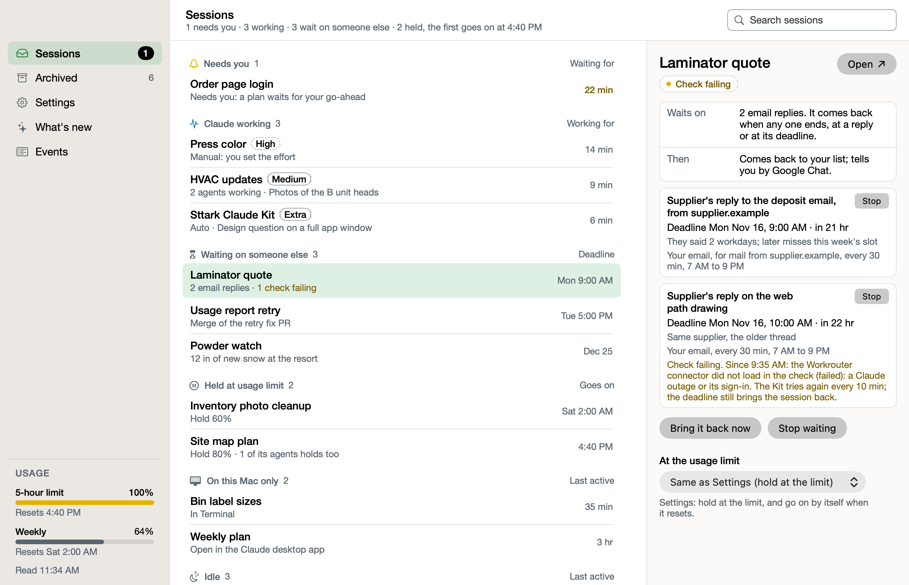
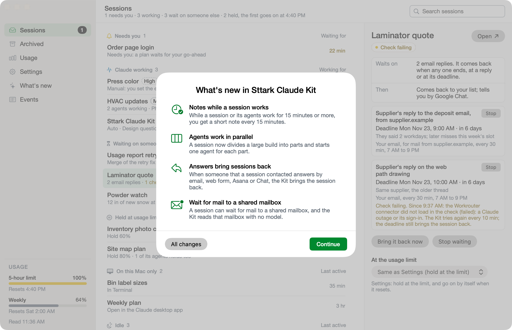
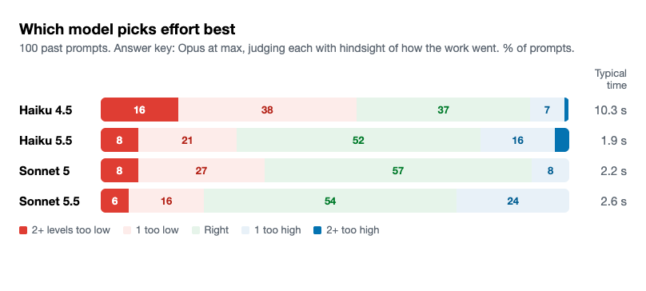

# Sttark Claude Kit

A Mac menu bar app that makes Claude Code easier to live with, for people who keep several sessions going at once and start them from the Claude app on their phone or computer.

| It | Section |
|---|---|
| Sets each session's effort to what the task needs, and adjusts it partway through | [Effort per task](#effort-per-task) |
| Shows which sessions are waiting on you, and tells you when one has waited 10 minutes | [Waiting on you](#waiting-on-you) |
| At your 5-hour or weekly usage limit, holds sessions until the limit resets instead of spending usage credits, then lets them go on by themselves. One session can instead always use credits, or never use them and hold earlier, at a percentage you pick | [Wait at the usage limit](#wait-at-the-usage-limit) |
| Names sessions with short handles for the topic they belong to | [Name sessions automatically](#name-sessions-automatically) |
| Starts the sign-in before your Claude Code login runs out | [Claude Code login](#claude-code-login) |
| Sets your Mac up to run sessions you start from the Claude app | [Start sessions from the Claude app](#start-sessions-from-the-claude-app) |
| Keeps every session that isn't archived running, through restarts | [Sessions stay running](#sessions-stay-running) |
| Moves a session that runs only on this Mac (Terminal, or This computer in the desktop app) to Remote Control, with its whole conversation | [Move a session to Remote Control](#move-a-session-to-remote-control) |
| Gives those sessions Bypass permissions, which the Claude app doesn't offer | [Bypass permissions for server sessions](#bypass-permissions-for-server-sessions) |
| Lets Claude use your signed-in Chrome without taking your screen, each session and each agent in its own window | [Claude window in Chrome](#claude-window-in-chrome) |
| Gives you a link to open a file Claude made, instead of a path | [Links to files](#links-to-files) |
| Answers Claude for Chrome's permission prompts | [Approve Claude in Chrome](#approve-claude-in-chrome) |
| Copies your Claude profile instructions into Claude Code | [Sync Claude profile instructions](#sync-claude-profile-instructions) |
| Lets you archive a session that waits on someone else, and brings it back, with a message the way you pick, when that happens or when its deadline passes | [Reach me by](#reach-me-by) |
| Lists your archived sessions, and brings one back to your list on the same link, with its whole conversation | [Archived](#archived) |
| Shows how much of your Claude Code use each session and its agents took in a period, by day and by model | [Usage](#usage) |
| Shows your sessions on your phone at kit.sttark.com, where the window's buttons work too, and sends Needs you notices there when you are away from this Mac | [Kit on your phone](#kit-on-your-phone) |
| Puts Sttark's working rules in front of every prompt, and checks each reply for Simplified Technical English | [Sttark working rules](#sttark-working-rules) |
| Gives sessions in Sttark's app repos the Sttark app rules | [Sttark app rules](#sttark-app-rules) |

The Kit sets your Mac up the way Sttark works with Claude: most of it is on from the start (see [What the Kit turns on](#what-the-kit-turns-on)), and you can turn each part off in the Kit's Settings. It updates itself when a new version is released here.



*Drawn by the app's own code, with sample sessions.*

It only works on sessions that run through **Remote Control**: the ones you start from the Claude app, on your phone or any computer, on a Mac that runs a `claude rc` server, and sessions that connect to Remote Control when they start (a terminal session, or a desktop app session on **This computer**). Effort can't be changed from outside any other kind of session. The Kit sets both up by itself: see [Start sessions from the Claude app](#start-sessions-from-the-claude-app).

## Install

You need a Mac on macOS 14 or later, with [Claude Code](https://code.claude.com/docs/en/setup) installed and signed in (`claude` at `~/.local/bin/claude`).

1. Download **SttarkClaudeKit.zip** from the [latest release](https://github.com/Sttark/sttark-claude-kit/releases/latest) and open it.
2. Drag **SttarkClaudeKit** into your **Applications** folder, then open it.
3. The first time, macOS says it can't check the app for malicious software, because it isn't sold through Apple. Click **Done**, go to **System Settings > Privacy & Security**, scroll down and click **Open Anyway**. You only do this once.

That's it. The app adds its hooks to Claude Code's settings (`~/.claude/settings.json`, backed up first), starts by itself when you log in, and shows a gauge in the menu bar. The needle points at the level of the session you used last: far left for Low, straight up for High, far right for Max. No needle means no session in the last hour. A pause sign means Auto effort is off. New sessions use the hook right away. Sessions that were already open pick it up from their next prompt.

### What the Kit turns on

The Kit is made to set up every Mac the way Sttark works with Claude. You do not set anything to start.

| Part | When it comes on |
|---|---|
| Effort, Waiting on you, the wait at the usage limit, the sign-in when the login ends, the Claude window in Chrome, the Sttark working rules and the Sttark app rules | At the first start |
| **Name sessions automatically** and **Links to files** | At the first start |
| **Sync Claude profile instructions** | At the first start after the Claude desktop app is signed in |
| **Start sessions from the Claude app**, in `~/src` or the folder that holds the most git repos (its own notice; see [below](#start-sessions-from-the-claude-app)) | About 40 seconds after the first start, when Claude Code is installed and signed in and no other server runs; else it tries again every hour |
| **New sessions start on this Mac's server**: new Code sessions in the Claude desktop app start on **Remote Control** > the server's folder, with nothing to choose (see [below](#new-sessions-start-on-this-macs-server)) | When the server is connected and the Claude app is closed; the Claude app restarts for each of its updates, so it is often soon |
| Remote Control for every session (`remoteControlAtStartup`), so desktop app and terminal sessions show on your phone and in the Kit | At the first start, only when `~/.claude/settings.json` does not have the key yet |
| **Bypass permissions for server sessions**, and Bypass permissions for every other session: Claude Code's `permissions.defaultMode: bypassPermissions` and `skipDangerousModePermissionPrompt: true`, and the Claude desktop app's setting that lets sessions on **This computer** use Bypass permissions (`bypassPermissionsGateByAccount`) | At the first start. Each key is set only when it is missing |
| **Approve Claude in Chrome** | At the first start. macOS then asks you to allow **SttarkChromeApprover** under **System Settings > Privacy & Security > Accessibility**; the Kit's notice says so too |
| The Claude desktop app keeps a session in the list when its pull request closes (`ccAutoArchiveOnPrClose: false`), so the list works as an inbox | At the first start, only when the app's file does not have the key yet |
| Claude Code's phone notices: a notice when Claude waits on you (`inputNeededNotifEnabled`), and notices Claude sends, which **Reach me by**'s Claude app way needs (`agentPushNotifEnabled`) | At the first start, only when `~/.claude/settings.json` does not have the key yet |
| **Kit on your phone**: it sends nothing until you link this Mac, and linking has its own notice (see [below](#kit-on-your-phone)) | At the first start |

- **Turn a part off** in **Settings**. The Kit records that you turned it off and never turns it on again. Turn it on again to clear the record.
- **Phone notices** are Claude Code's own settings. A value that you set yourself, `true` or `false`, is never changed.
- **After an update:** a switch that was off before this came in counts as never chosen, so it comes on once. One Mac notice tells you which parts came on. Click it to open **Settings**.
- **Off until you turn it on:** **Use credits at the usage limit**, because it spends money.
- **Bypass permissions:** turn the switch off and the Kit takes out the Claude Code and Claude app keys it set, and sets none of them again. A value you set yourself stays.
- **The Claude desktop app's file** (`~/Library/Application Support/Claude/claude_desktop_config.json`): the app keeps it in memory and can write it again without a key the Kit set. Every 10 minutes the Kit sets a missing key again (`desktop-prefs.py apply`). A value that is there, yours or the app's, is never changed. The Kit writes a whole new file and moves it in place, and keeps the last one as `claude_desktop_config.json.bak-kit`. What it set is in `desktop-prefs.json` and `kit-settings.json` in the Kit's folder.
- The record of the switches you turned off is `turnedOff` in the app's settings (`defaults read com.sttark.sttark-claude-kit turnedOff`). Each part that comes on is logged, with lines starting `defaults`.

### Coming from Sttark Effort

Sttark Claude Kit replaces an earlier app named Sttark Effort. If you have Sttark Effort, install Sttark Claude Kit once by hand, as above. On its first launch it moves your settings, hooks, sync and Chrome approver over, then quits Sttark Effort and moves it to the Trash. macOS may ask you to allow notifications again, and to allow **SttarkChromeApprover** under Accessibility again.

## Updates

The app checks for a new version 20 seconds after it starts, then every hour, and installs it by itself: you don't click anything. It downloads the new version, checks that it's signed by Sttark, swaps it in and restarts in a few seconds, in the background. Sessions keep running, because they don't run inside the app. If the menu or one of the app's dialogs is open, or you are using the window, it waits until you're done. Your settings, and the Accessibility permission for the Chrome approver, stay as they are.

After an update that brings something you'd notice, the Kit shows it once in a short [What's new](#whats-new) window.

You see a notice only when an update fails to install. Click it, or choose **Update to …** at the top of the menu, to try again; the app also tries again by itself after 6 hours. **Check for updates** in Settings checks right away and installs a new version at once.

### What's new

When an update brings a change you'd notice, a short note explains it. Nothing opens by itself.



*Drawn by the app's own code, with this repo's notes. The same in dark mode, with dark colors.*

- **A dot and a badge.** While a note is unseen, the gauge in the menu bar has a blue dot, and **What's new** in the menu has a badge such as "3 new".
- **The sheet.** Click **What's new**: the window opens with a sheet that lists each new change with an icon, its title and one line. Opening it marks the notes seen, and the dot and the badge go away. **Continue** closes it; **All changes** opens the window's What's new page: the notes from the last 7 days, newest first, under a heading with the day and version of the update that brought it. Each note has an icon, its title with a New or Better tag, one sentence on what changes for you, 2 or 3 short points, and a picture of the part that changed (a dark one in dark mode). Click a picture to see it bigger.
- What you have seen is `whats_new_seen` in the state file. A new install starts with every note seen.
- A note stays on the page for 7 days after its update arrives on your Mac. A note you have not seen stays until you see it. A note that a later change made wrong is removed.
- Notes are `whats-new/*.md` in this repo, one per change, written in the same pull request as the change. See `AGENTS.md`.

## Using it

Click the gauge for a glance; open the window for everything else.


*Drawn by the app's own menu code, with sample sessions.*

| Menu item | What it does |
|---|---|
| **Update to …** (at the top, only when needed) | Shows while a new version waits for the menu or the window to close, or after one failed to install by itself. Installs it now. |
| **Claude login ends …: Sign in…** (only near the end) | Shows within 3 days of the end of your Claude Code login, or when Claude Code is signed out. See [below](#claude-code-login). |
| **Needs Accessibility permission…** (only when needed) | Shows while **Approve Claude in Chrome** is on and macOS hasn't allowed it to click. Opens the Accessibility settings. |
| **Needs you**, **Held at usage limit**, **Claude working**, **Waiting on someone else**, **On this Mac only**, **Idle** | One row for each group that has sessions, with the window's icon for the group and its count, for example **Held at usage limit (2)**. **Needs you** comes first and shows its sessions (up to 5) under it, because they need you now; click it to open the window at its first session. Every other group shows its sessions (up to 25) in a submenu when you point at it. Each session shows its time with what the time is: **waiting 15 min**, **working 7 min**, **continues 4:40 PM**, **deadline Mon 9:00 AM** or **active 2 hr ago**. A wait whose check fails says **check failing**, and its group's row says how many fail, so it never fails silently. Click a session to open it in the Claude app, as **Open** in the window does. A session with no Remote Control link opens in the window instead. |
| **Open Sttark Claude Kit** | Opens the window. |
| **What's new** | Opens the window with the What's new sheet. A badge ("3 new") shows while notes are unseen. See [above](#whats-new). |
| **Sttark Claude Kit 1.…** | The version you have, above **Quit**. It says **updating…** while an update installs. |
| **Quit** | Quits the menu bar app. Sessions and the server keep running; the hooks keep working, except the parts the app runs (Waiting on you, keeping sessions running, closing unused Claude windows, the sign-in when the login ends, and updates). It starts again at your next login. |

### The window

The window opens only when you click **Open Sttark Claude Kit**, **What's new** or a session in the menu. It never opens, comes to the front or takes the keyboard by itself, and an update doesn't bring it back after the app restarts. While it is open the Kit is in the Dock and in Command-Tab, with its own menus; when you close it (Command-W), the Kit is only in the menu bar again. It follows your Mac's light or dark look, and changes when the look changes. **View > Zoom In** (Command-plus), **Zoom Out** (Command-minus) and **Actual Size** (Command-0) make everything in it larger or smaller, from 70% to 200%; the Kit remembers the size. Text in it can be selected and copied.


*Drawn by the app's own code, with sample sessions. The same in dark mode, with dark colors.*

**Sessions** is your session inbox: the sessions the Claude app lists (not archived, and not runs of scheduled tasks, which the app shows under Scheduled), plus archived sessions that wait on someone else. Each session shows once, in the first group that fits, and the page changes as soon as a session on this Mac changes (in under a second). Changes in the Claude app (a new session, an archive, a new name, a session that starts or stops work) show within about 10 seconds while the window or the menu is open, and within a minute otherwise:

| Group | Which sessions | Time column |
|---|---|---|
| **Needs you** | Only where you must act: Claude asks you a question or a decision, waits for a permission, or is blocked (see [Waiting on you](#waiting-on-you)). Oldest first. | Waiting for; in bold after 10 minutes |
| **Claude working** | Claude is in a turn, or the turn ended and its agents (forks too) or background commands still run. Such a row says what runs, such as **2 agents working** and the newest one's task. When they finish, the session goes to Needs you or Idle as usual. | Working for: since your last prompt, or since the oldest agent or command started |
| **Waiting on someone else** | Waits handed to the Kit with `claude-wait` (see [Reach me by](#reach-me-by)), one row per session, by its first deadline. A session with several waits says so, such as **2 email replies**; a wait whose check fails says **check failing**. | Deadline |
| **Held at usage limit** | Sessions waiting at the limit, or set to hold before it (see [Wait at the usage limit](#wait-at-the-usage-limit)). | Goes on |
| **On this Mac only** | Sessions started in Terminal, or under **This computer** in the Claude desktop app, in the last 7 days, that have no Remote Control link, newest first. Your phone and the Claude app's list don't show them. Click one, then **Move to Remote Control** (see [Move a session to Remote Control](#move-a-session-to-remote-control)). | Last active |
| **Idle** | Every other session in the Claude app's list, newest first. A reply that needs nothing from you and that you haven't opened shows "Finished; reply not opened" here, and doesn't count as needing you. | Last active |

Search at the top filters by name. Click a session to see it on the right:

- **Open** opens it in the Claude desktop app (`claude://code/<session>`), or in the browser when the app isn't installed.
- What it is doing: how long it has waited and why; or what it waits on, the deadline, why then, how the Kit checks and what happens then, with **Bring it back now** and **Stop waiting**; or the percentage it holds at and when it goes on, with how to go on now (set it to **Always use credits**).
- **Effort**: **Auto** on lets Claude pick the level for each task, with the latest reason under it. Click a level to set it yourself: the session goes to Manual at that level, as with the Claude app's picker. Turn **Auto** on to hand it back. A session that waits on someone else shows no effort, since it isn't running.
- **At the usage limit**: **Same as Settings** (it shows what Settings says now, for example **Same as Settings (hold at the limit)**), **Always use credits**, or **Never use credits; hold at** 50% to 100%. This menu is the one control for the session: what it shows is what the session does (see [One session, its own setting](#one-session-its-own-setting)).

The 5-hour and weekly usage show at the bottom of the sidebar, with when each resets and when they were read.

#### Archived

**Archived**, under Sessions in the sidebar, lists the sessions you archived (in the Claude app, or that the Kit archived) that this Mac can bring back, with how many on the sidebar.


*Drawn by the app's own code, with sample sessions. The same in dark mode, with dark colors.*

- **The list:** the most recent first, under a heading for each day, with the session's name, its folder, what it was doing (Claude's own summary of its last turn) and when it was last active. **Search archived sessions** at the top filters by any of them. The line under the title says when the list was read.
- **Only what this Mac can bring back:** a session whose conversation is saved on this Mac. One that ran on another computer or in the cloud is not listed; the Claude app's own archive has it. Runs of scheduled tasks are not listed either.
- **One list per session:** a session with a wait handed to the Kit stays under **Waiting on someone else** on the Sessions page, and leaves this page when its wait ends. A session that is back leaves this page at once.
- **Open** opens the session in the Claude app, as on the Sessions page. It stays archived.
- **Bring it back** unarchives the session and starts it again on the same link, with its whole conversation, the way a wait brings a session back (see [Reach me by](#reach-me-by)). Nothing is sent to it: it waits for you in your list. The Kit says so when it is back, with **Show it** to open it on the Sessions page, or why it did not come back. From then on the Kit keeps it running, as the other sessions.
- The list is up to date within about 15 seconds while this Mac's server runs, and covers the archived ones among your account's 500 most recent sessions. With no server, it is read every 10 minutes and when you open the page, and covers your 500 most recent archived sessions.

#### Usage

**Usage**, under Archived in the sidebar, shows how much of your Claude Code use on this Mac each session took in a period, and how much of that its agents did.


*Drawn by the app's own code, with sample sessions. The same in dark mode, with dark colors.*

- **The period:** **Today**, **7 days** (today and the 6 days before), **30 days** or **Custom** (from one day to another, within the last 45 days), at the top right. The line under the title says which days and when the records were last read.
- **The list:** the sessions, the biggest share first, each with when it was last active, how many agents it started, what its work would take one person (**≈ 1 person for 6.5 weeks**) and a bar in two parts: the session itself in blue and its agents in a tint of the same blue, with a legend. Point at a bar for its numbers. The top 15 show; **Show all** shows the rest. Above the list: how many sessions, their tokens, the part the agents did, and what the use is worth at API prices.
- **Human work:** under those totals, what the same work would take people, for example **Human work ≈ 1 person for 5.9 months · ≈ 25 people full time over these 7 days**. It is an estimate: the hours Claude was at work (the model writing and the tools it ran, its agents too), with every wait left out (for you, at the usage limit, for agents, for checks, timers and other sessions), times a factor for the kind of work: software 15, design 5, browser and admin 5.5, small or mixed 2.5. One person works 8 hours a day, 5 days a week; people full time is per weekday of the period. Click the ⓘ beside it to read how it is made, in place. How the time and the kind are found, and where the factors come from: [docs/human-work.md](docs/human-work.md).
- **A share is of your use, not of your limit.** Anthropic gives only the total percent of the 5-hour and weekly limits, and the page says so. Each reply counts at its model's API price for each type of token (input, output, 5-minute and 1-hour cache writes, cache reads), because the limit also counts a larger model as more use.
- **The selected session**, on the right: its share and how it splits between the session and its agents, its tokens, the agents it started, its use at API prices, the hours it was at work (waits left out), its human work (one person's time, people full time in the period, and its human hours by kind of work, with the ⓘ), a bar for each day (point at one for its numbers), and its models. **Open** opens it in the Claude app, as on the Sessions page. A session only on this Mac has **Show it**, which shows it on the Sessions page, when it is listed there.
- **What is in it:** the sessions' records on this Mac (`~/.claude/projects`), from the last 45 days. A session with a Remote Control link is one row, with its agents and the runs started in its scratchpad folder. A session only on this Mac is a row of its own. The Kit's own checks, runs in temporary folders (such as tests), and many short runs with no name in one folder (another app's, say) are one row each. Use in the Claude app, in the cloud or on other computers is not here. No folder or path shows, only names.
- **Up to date:** the page reads what the records gained when it opens and each minute while it shows. The first read, 2 minutes after the Kit starts, takes about 25 seconds for a month of busy use; each later read takes about a second.
- **On your phone,** the **Usage** tab shows the same list under your limits, for the same periods, with the same human work line and estimate on each row (see [Kit on your phone](#kit-on-your-phone)).

![The window's Settings page: Effort (Auto effort, the model), Usage limit (Use credits at the usage limit), Reach me by (Email, Claude app, Google Chat, Text message, Mac notice, Send a test), Phone (Kit on your phone, linked, with the account and when it last sent), Sessions (Start sessions from the Claude app, Bypass permissions, Name sessions automatically, Sttark working rules, Sync Claude profile instructions), Chrome and files (Claude window in Chrome, Approve Claude in Chrome, Links to files) and This Mac (the version and Check for updates, the Claude Code login and Sign in…, Show events)](docs/window-settings.png)

**Settings** has every setting of the Kit, saved as you change it:

| Setting | What it does |
|---|---|
| **Auto effort** | On: Claude picks each session's effort. Off: every session keeps the level it has, until you turn it back on. |
| **Model that picks the level** | Which Claude model picks the levels: the two newest Haiku and two newest Sonnet models, read from Anthropic's list once a day, so new ones appear without an update. Haiku is faster and cheaper; Sonnet is slower and smarter. The newest Sonnet is the default. |
| **Use credits at the usage limit** | Off (the default): at the limit, sessions hold until it resets. On: they go on with usage credits. A session with its own setting keeps it either way. See [below](#wait-at-the-usage-limit). |
| **Reach me by** | How a session tells you that something it waited on happened. Check the ways you want; **Set…** or **Change…** for the address, phone number or webhook a way needs; **Send a test**. See [below](#reach-me-by). |
| **Kit on your phone** | Sends your sessions to kit.sttark.com, where you see them and act on them on your phone. On until you turn it off, but it sends nothing until you link this Mac: **Link this Mac…** opens the link page in your browser and shows this Mac's code. Linked, it shows the account and when it last sent, and says that Needs you notices go to your phone when you are away from this Mac (with what to do when no phone of yours gets them). See [below](#kit-on-your-phone). |
| **Start sessions from the Claude app** | Sets this Mac up so you can start Claude Code sessions from the Claude app. Shows the folder sessions start in. On by itself, unless you turn it off. See [below](#start-sessions-from-the-claude-app). |
| **New sessions start on this Mac's server** | New Code sessions in the Claude desktop app start on this Mac's server. On by itself, unless you turn it off. See [below](#new-sessions-start-on-this-macs-server). |
| **Bypass permissions for server sessions** | See [below](#bypass-permissions-for-server-sessions). On until you turn it off. |
| **Name sessions automatically** | See [below](#name-sessions-automatically). On until you turn it off. |
| **Sttark working rules** | See [below](#sttark-working-rules). On until you turn it off. |
| **Sync Claude profile instructions** | See [below](#sync-claude-profile-instructions). On until you turn it off, once the Claude app is signed in. Shows the last sync. |
| **Claude window in Chrome** | See [below](#claude-window-in-chrome). On until you turn it off. **Open Claude window** shows beside it while Chrome runs and the Claude window is closed. |
| **Approve Claude in Chrome** | See [below](#approve-claude-in-chrome). On until you turn it off. **Open Accessibility…** shows beside it while macOS hasn't allowed it to click. |
| **Links to files** | See [below](#links-to-files). On until you turn it off. |
| **Sttark Claude Kit 1.…** | The version you have and when it last checked; **Check for updates** checks now and installs a new version at once, or **Update to …** when one waits. |
| **Claude Code login** | When your login ends; **Sign in…** opens Terminal and starts Claude Code's sign-in. See [below](#claude-code-login). |
| **Events** | **Show events** opens the [Events](#events) page. |

**What's new** shows the notes from the last 7 days, newest first, with their pictures.

**Setting the effort yourself:** click a level on the session in the window, or change it in the Claude app's effort picker as usual. Sttark Claude Kit reads each session's level from the server, sees one it didn't send, switches that session to Manual and leaves it alone. The window shows Manual within a minute, and the kit checks again right before any change it makes, so it never undoes your pick, even in the middle of a long step. Turn **Auto** on for the session to hand it back. A session that reopens (after the Mac restarts, or when the server brings back an idle one) starts again at the level it was saved with; that doesn't count as you changing it.

### Events

**Events** in the window tells what the Kit did, in plain words, newest first. The page reads it again every 3 seconds while it shows.


*Drawn by the app's own code, with sample events. The same in dark mode, with dark colors.*

- **One row for each thing the Kit did:** its time, an icon for its kind, the session's name and one sentence, for example **Press color: Held: the 5-hour limit is at 80%. Goes on 2:40 PM**. Rows are grouped by day.
- **Problems stand out.** A warning is a yellow row and an error is a red row. A problem that occurs again is one row a day, with how many times it occurred that day, at the time it last occurred. The status line under the title says how many problems occurred in the last day.
- **Click a row** to see more: why the Kit chose an effort level, the start of the prompt, a deadline, or from when to when a problem occurred.
- **Click a session's name** to open that session on the Sessions page. When the session is not on that page, the click shows only that session's events.
- **Filters:** **Kind** (Effort and permissions, Usage limit, Sessions started again, Session names, Waits and messages, Kit on your phone, Updates, Reply checks, The Kit, Problems), **Session**, **Problems only**, and **Search events** at the top. **Routine checks** also shows the checks that run all the time and change nothing, such as a reply check that passed or a name the Kit kept.

The page reads the Kit's log and the bypass log. It never shows their lines as they are.

### The log file

For support, every decision goes into `~/Library/Logs/sttark-claude-kit.log`, one line each. The Events page tells the same things in plain words.

```
2026-10-08 11:02:48 change cse_01AbCd… high->xhigh (2.2s) xhigh - Unknown cause spanning firmware and server code | The sensor readings drop out every few hours…
2026-10-08 11:03:22 steady cse_01AbCd… xhigh at 11 steps (4.3s) xhigh - Cause still unconfirmed; needs log checks and a test. | The sensor readings drop out every few hours…
```

| First word | Meaning |
|---|---|
| `change` / `keep` | The check when a prompt arrives. A `keep` line with a session name in quotes comes from the check that keeps sessions running instead. |
| `raise` / `lower` / `steady` | The check at 10, 25 or 50 steps. |
| `manual` | The session is on Manual, or you just changed it yourself. A level picked in the window ends with `(window)`, one from the phone with `(phone)`. |
| `reopen` | The session came back in a new process, at the level shown. The hook starts from there. |
| `paused` | Auto effort is off. |
| `skip` | Not a Remote Control session, so it can't be changed; or at the usage limit, so no check was made. |
| `wake` / `start` / `reattach` / `move` | A stopped session started again. See [Sessions stay running](#sessions-stay-running). |
| `trust` | A folder a session ran in, marked trusted in Claude Code before the Kit starts the session there on its own, or why it could not be. |
| `name` | Name sessions automatically: a name picked, kept or changed. |
| `migrate` | Move a session to Remote Control: each move, with its new link and where it was closed, a move that waits for a reply to end, and each one that failed. |
| `usage` | The Usage page: the first read of the sessions' records, a model with no price in `usage-scan.py` (once a day), and a read that failed. |
| `limit` | The wait at the usage limit: each hold, wait, resume and change of the switch in Settings (`credits`), and each change to a session's own setting (`mode`), with where it came from: the Kit window, the phone, typed in the session, or the command. |
| `phone` | Kit on your phone: the link page and the link, each connection (a failed one once for each new reason), `bye`, a removal, the switch turned off, and each action from the phone, with who asked and how it went (`action set_level cse_… by name@sttark.com: ok: Effort is High now. …`). Also each Needs you reminder that went to your phone (`reminder to your phone: Order page login`), one that could not go and showed on this Mac instead, and how many of your phones get notices when that changes. |
| `rules` | The Sttark app rules: added to a session, or the saved copy refreshed. |
| `wait` | Waits handed to the Kit: each one set, the answer of each email or Haiku check (`checked: NO, no reply yet`), each check that failed and why (for example, the Workrouter connector did not load), and each session brought back. Also each session brought back from the Archived page (`brought back from the archive (window)`), and why one was not. **Bring it back now**, **Stop waiting** and **Stop** end with who asked, `(window)` or `(phone)`. |
| `notify` | Reach me by: each message `claude-notify` sent, each way, and how it went. |
| `ste` | The working rules' check of a finished reply: ok, noted for the session's next prompt, or error. |
| `agents` | The working rules' manager check: work that made more than 8 tool calls in the chat with no agent, noted for the session's next prompt. |
| `icons` | The working rules' status icon check: a status table cell with more than one of ✅ 🔄 🔴 ⚪, noted for the session's next prompt. |
| `stable` | The fixed copy of Claude Code and its night job. |
| `browser` | The browser guard: each step it stopped (`deny`), with the session, the agent after a slash, and the tool or command; and each session that you let use Claude in Chrome (`allow`). |
| `window` | `claude-window`: each Claude window it made for a session or an agent, until when Chrome or the new window was in front, what it put back in front and how often, and what it saw at each look in the 1.5 seconds after; each spare window that a session or an agent took, each window given back, each spare window closed after 30 minutes or left to you because you opened a page in it, each window it closed with no session, and each Chrome it passed over as not yours (a test tool's copy) before it started another copy. |
| `server` | The Remote Control server: started, a question answered, connected, not connected and why, started again, stopped and started again by macOS, old copies ended, its start command updated, moved to `~/src`, the sign-in started. |
| `app` | The menu bar app itself: switches turned on or off, updates, notices, and What's new (`what's new:` shown, Got it). |
| `error` | Something failed. The level was left as it was. |
| `log` | Old lines removed from a log (see below). |

The Kit keeps each of its logs short: a minute after it starts, and then every 6 hours, it removes the lines older than 30 days, and the oldest lines past 10 MB. This applies to `sttark-claude-kit.log`, `claude-bypass-hook.log`, `claude-chrome-approver.log`, `claude-profile-sync.log` and `claude-rc.log` in `~/Library/Logs`. Lines that arrive while it trims are kept.

To watch it live: `tail -f ~/Library/Logs/sttark-claude-kit.log`.

## Effort per task

- **Picks the level before Claude starts.** Each prompt you send goes to a quick side check (the newest Claude Sonnet, or another model you pick) along with the last few messages. The model picks Low, Medium, High, Extra or Max, and the session is set to that level before Claude's first step. A plain "go" after a plan gets sized to the plan.
- **Checks again partway through.** At 10, 25 and 50 steps into a task (the session's own steps; a subagent's steps don't count), the model looks at the work so far. If builds keep failing or the cause is still unknown, it raises the level, up to Max for a task that's stuck at Extra. If the hard part is done and the rest is repeat edits, it lowers it. UI work stays at High or above until Claude has looked at the result and judged it, since that look is where the design gets decided.
- **Sets each agent's level when it starts.** When a session starts an agent, the same check reads the agent's task and picks its level: a quick search starts at Low, an agent that designs or builds starts higher. The agent keeps that level until it finishes, also when the session's level changes later, because Claude Code gives a running agent no way to change it. A fork always starts at the session's level, so for a fork that needs more, the Kit raises the session first. An effort that the call or the agent's own definition sets is kept. Each pick shows on the Events page under its session.
- **You can take over.** Turn **Auto effort** off for every session, or turn it off on one session's row to set that session to Manual. If you change a session's effort yourself in the Claude app, Sttark Claude Kit notices and switches that session to Manual on its own.
- **Shows its reasons.** The window shows each session's level and the latest reason for it. Every decision is logged.
- **Updates itself** within an hour of a new version being released here, with no click.

## Waiting on you

You send Claude a prompt, move on to something else, and forget to come back. Every minute, Sttark Claude Kit checks your recent Claude Code sessions and lists the ones waiting on you, at the top of the menu and under **Needs you** in the window:

| Shows as | When |
|---|---|
| **Needs you** | Claude stopped to ask you something or for a permission, or its finished reply can't go on without you: a question, a plan waiting for your go-ahead, a choice, or a step only you can do. Plain signs decide first: the server's own summary of the turn names something you must do, a step in the reply's status table is marked 🔴, or the reply ends with a question (yes); the reply says nothing is needed, or "no alert" (no). Only when none of them shows does the model picked in Settings read the reply, once, and it leans toward no. Opening the session clears it, even if you don't answer, until Claude writes again. |
| **Finished; reply not opened** (in Idle) | Claude finished a reply that needs nothing from you, and you haven't opened the session since. It doesn't count as needing you and sends no notice. The Claude app records when you open a session, on any device, so opening it clears it. |

On this Mac, seeing the reply also counts: if the session was open in the Claude app, with the app in front and the screen on, for a few seconds after Claude finished, it comes off the list. That covers watching a reply arrive, which the Claude app itself doesn't record as opening it.

Each row shows how long it has waited; click it to see why in the window, and **Open** to open the session. When one that needs you has waited 10 minutes, you get one reminder: a notice on this Mac when you are at it, or a notice on your phone when you are away and your phone has notices on (see [Needs you notices](#kit-on-your-phone) under Kit on your phone). Never both. A session that sent you a [Reach me by](#reach-me-by) message in the last 30 minutes gets no reminder. Archived sessions, runs of scheduled tasks and sessions Claude is still working on never show. It covers Claude Code sessions that run through Remote Control, from the last day.

## Wait at the usage limit

When your account has usage credits turned on, Claude Code doesn't stop at your 5-hour or weekly limit: it goes on and charges usage credits. With Sttark Claude Kit, a session holds at the limit instead, spends nothing, and goes on with its task by itself when the limit resets. Credits are used only when you choose them. Nothing changes in your account's settings.

Each session can also have [its own setting](#one-session-its-own-setting): always use credits, or never use credits and hold before the limit, at a percentage you pick.

- **Claude tells you, in the chat.** At the limit Claude says one line: **Usage limit reached. I continue at 6:00 PM. Type use credits to set this session to Always use credits and continue now.** Then it runs `claude-limit-wait`, which shows as a running command with the line **Waiting for the 5-hour usage limit to reset at 6:00 PM**. When the wait ends, the command prints why (the limit reset, or the session's setting changed), and Claude goes on with the task. You never see a silent spinner, and you never need the menu. (A session set to never use credits can hold with no reply when even one would cost credits: see [below](#one-session-its-own-setting).)
- **A session at work** is stopped before its next step (tool call); Claude says the line, waits, then takes that step again. **A message you send at the limit** goes to Claude, which says the line, waits, then answers it. Nothing you type is lost.
- **The app's Now using usage credits banner** shows your account's setting (credits are on). It doesn't mean the session is spending them.
- **What a limit costs:** one short reply on credits each time a session reaches the limit (the line, then the wait command), and one more short reply every 9 minutes of waiting, because a command can run at most 10 minutes; each is a few output tokens plus a cached read of the session. In a Sonnet test with a 26,000-token session that was about $0.008 each. A session set to never use credits makes no reply on credits at all: see [below](#one-session-its-own-setting).
- **To use credits for one session:** set it to **Always use credits** under **At the usage limit** in the window, or send `use credits` in it, which sets the same thing. The wait ends within 10 seconds (30 seconds in a brand-new session) and Claude goes on. The setting stays until you pick another item in the same menu, which is also how you undo it. The log says each change: `limit  mode   abcdef12 always use credits (typed)`.
- **A limit counts when it is at 100%**, or at its own percentage for a session set to hold earlier. A limit at 90% or more is read every 15 seconds, so the hold starts soon after it is reached. The server refuses reads that often after a few minutes, so for 6 hours after a read fails it is read every 2 minutes.
- **Subagents** of a session set to Same as Settings are stopped before their tool calls like the main session, and wait the same way. A session set to hold holds its agents with no reply at all (below).
- **Background work that finishes at the limit** (a background agent or command) starts a turn by itself; that turn says the line and waits like any other.
- **To use credits for every session:** turn on **Use credits at the usage limit**. Turn it off to go back to holding. A session with its own setting keeps it either way. The log says each change: `limit  credits every session uses credits at the limit, except one set to hold (menu)`, or `limit  credits every session waits at the limit, except one set to use credits (menu)`.
- **Stopping a session** in the Claude app ends its hold, as with any step.
- A model's own weekly limit (for example a weekly limit for one model) holds only the sessions that run on that model.
- At the limit the kit's own side calls to Claude (the effort check, the reply check, naming, the app rules refresh) are skipped too, so nothing is spent.
- Accounts without usage credits, or at their credits spend limit, are left alone: there Claude Code stops at the limit by itself.

It works for every Claude Code session on this Mac, Remote Control or not. Each hold, resume and choice is logged, with lines starting `limit`.

### One session, its own setting

Some work can wait, and some can't. Each session has one of three settings:

| Setting | What the session does |
|---|---|
| **Same as Settings** (the default; `follow the menu` when typed) | What **Use credits at the usage limit** says: hold at the limit when it's off, go on with usage credits when it's on. |
| **Always use credits** | Goes on with usage credits at the limit, even when **Use credits at the usage limit** is off. |
| **Never use credits; hold at N%** | Never spends usage credits, not even for one reply, and even when **Use credits at the usage limit** is on. It holds when the 5-hour or the weekly limit reaches N% (80% unless you pick another), and goes on by itself when that limit resets under N%. Use it for work that can wait, to keep the rest of your usage for other sessions. At 100%, it holds at the limit itself. |

Set it in any of three ways. The setting lasts for the life of the session, also when the Mac restarts or the session comes back on its link.

- **In the window:** click the session. Under **At the usage limit**, pick **Same as Settings**, **Always use credits**, or **Never use credits; hold at** 50%, 60%, 70%, 80%, 90% or 100%.
- **In the session:** send one of these as the whole message. Claude says the new setting in one line. Sent while the session waits, it counts at once, and the wait ends if the new setting lets the session go on.

  | Send | Setting |
  |---|---|
  | `no credits` | Never use credits; hold at 80% |
  | `no credits 90`, `no credits 90%`, `no credits at 90` or `never use credits 90` | Never use credits; hold at 90% (any number from 1 to 100) |
  | `use credits`, `credits ok` or `always use credits` | Always use credits |
  | `follow the menu` | Same as Settings |

- **With a command**, which a session or a script can run:

  ```
  claude-limit-mode                       # this session's setting (run in a session)
  claude-limit-mode hold 80               # this session: never use credits; hold at 80%
  claude-limit-mode <session> credits     # always use credits
  claude-limit-mode <session> follow      # same as Settings
  claude-limit-mode <session>             # that session's setting
  claude-limit-mode --list                # every session that has its own setting
  ```

  `<session>` is the session's id, its Remote Control id (`cse_…` or `session_…`), the first 6 or more characters of either, or its full name, as in the Claude app. Leave it out to mean the session the command runs in. A session this Mac has never seen is an error (exit code 2), as is a bad setting. A session that holds can run the command itself, by itself on one line, to change its own setting.

When a session set to hold reaches its percentage:

- **It stops before its next step**, as at the limit. Claude says one line, for example **This session holds at 80% usage. I continue at 4:40 PM. Type use credits to set it to Always use credits and continue now.**, and runs `claude-limit-wait`. The wait makes no model calls until it ends, and it ends by itself when every limit that counts is under the percentage again.
- **When even that one line would cost usage credits**, it holds with no reply at all. That is the case while a limit is at 100% and the account has credits on: for example, other sessions went on with credits past the limit. Then the session's next step, or a message you send it, waits before Claude sees it, and goes on by itself when the hold ends; the message then reaches Claude as you wrote it. Nothing shows in the chat meanwhile, only the running step or your sent message; the menu shows the hold. Once it holds this way, it holds until the hold ends, even if the limit drops under 100% first.
- **Its subagents and background agents hold too**, each before its next step, with no reply at all, and go on by themselves with that step when the hold ends. A notice that a background task finished, which reaches the session like a message, waits the same way while a reply would cost credits.
- **The window shows it under Held at usage limit**, with its percentage and when it goes on (**Hold 80%**, 4:40 PM), and how many of its agents hold too; so does the menu. Click it: the window says how long it holds, and that to go on now you set it to **Always use credits** under **At the usage limit**.
- **To let it go on now**, set it to **Always use credits** in the window or send `use credits` (the same setting), or pick a higher percentage. To go back, pick its old setting in the same menu.
- **The kit's own side calls for it** (the effort check, the reply check, naming) are skipped while it holds.

Each change, hold and resume is in the log:

```
2026-10-08 16:02:11 limit  mode   5d1e0c7a never use credits; hold at 80% (typed)
2026-10-08 16:05:40 limit  hold   5d1e0c7a at 80%: the 5-hour limit is at 83%, until 4:40 PM (Edit)
2026-10-08 16:05:52 limit  wait   5d1e0c7a at 80%: the 5-hour limit is at 83%, until 4:40 PM, with no model calls until it ends
2026-10-08 16:06:10 limit  hold   5d1e0c7a/a91f3c02 at 80%: the 5-hour limit is at 84%, until 4:40 PM (Bash)
2026-10-08 16:40:02 limit  resume 5d1e0c7a the 5-hour limit is under 80%, after 34 min
2026-10-08 16:40:03 limit  resume 5d1e0c7a/a91f3c02 the 5-hour limit is under 80%, after 33 min
```

A `hold` line ends with the step that was held; `5d1e0c7a/a91f3c02` is an agent of session `5d1e0c7a`, and a hold with no reply says `no reply: one now would use credits`. On a `mode` line, the word in brackets says where the change came from: `window` (the Kit window), `phone`, `typed` or `command` (older lines say `menu` for the window).

## Choosing the model

A test on October 15, 2026 found **Sonnet 5.5** picks effort best, so the newest Sonnet is the default. The newest Haiku is faster and cheaper, if you'd rather pick it under **Model that picks the level** in Settings.



| Model | Right level | Within one level | Too low | 2+ levels too low | Too high | Typical time |
|---|---|---|---|---|---|---|
| Sonnet 5.5 | 54% | 94% | 22% | 6% | 24% | 2.6 s |
| Sonnet 5 | 57% | 92% | 35% | 8% | 8% | 2.2 s |
| Haiku 5.5 | 52% | 89% | 29% | 8% | 19% | 1.9 s |
| Haiku 4.5 | 37% | 82% | 55% | 16% | 8% | 10.3 s |

**Why Sonnet 5.5:** a level that's too low is the costly mistake, because the work comes out wrong and has to be done again. A level that's too high only costs some extra time and usage on that task. Sonnet 5.5 is too low least often, and lands within one level 94% of the time. Sonnet 5 is right most often, but it's too low far more often. Haiku 4.5 is slow and too low over half the time.

**How the test works:** it took 100 real past turns from Claude Code session history, 20 each from five sizes (no tool calls, 1 to 5, 6 to 20, 21 to 60, and more than 60). For the answer key, Opus at max effort read each whole turn, including how the work actually went (each step, which failed, how long it took), and named the level the work truly needed. Then each model judged the same 100 prompts the way the hook does, seeing only the prompt and the conversation before it. One limit: the answer key is one model's hindsight, not a measured result.

**Run it again** when new models come out. From an empty folder:

```sh
python3 ~/path/to/sttark-claude-kit/tools/model-test/sample.py   # picks 100 past turns: cases.json
python3 ~/path/to/sttark-claude-kit/tools/model-test/run.py      # answer key and models: results.json (edit the model list first)
python3 ~/path/to/sttark-claude-kit/tools/model-test/score.py    # table and chart.png
```

It reads your own session history, which stays on your Mac, and makes about 500 Claude calls with your Claude Code login.

## Start sessions from the Claude app

Sttark Claude Kit sets your Mac up so you start Claude Code sessions from the Claude app, on your phone or any computer. Each session runs on the Mac, with the Mac's files, tools and logins, and Sttark Claude Kit sets the effort for every one of them.

**It does this by itself.** About 40 seconds after the Kit starts, and every hour after that, it turns **Start sessions from the Claude app** on when all of these are true:

- No Remote Control server runs on this Mac yet.
- You never turned the switch off.
- Claude Code is installed and signed in with the normal sign-in (`claude auth login`). Remote Control doesn't accept a long-lived token from `claude setup-token`.

Sessions start in `~/src` on every Mac. The Kit makes that folder when it is missing; an empty folder is fine.

- **Claude Code not installed:** when Claude Code is installed another way (Homebrew or npm), the Kit links it to `~/.local/bin/claude`. Else it runs the official installer (`curl -fsSL https://claude.ai/install.sh | bash`), which needs no password. At most once every 6 hours.
- **Claude Code signed out, or its login ends within a day:** the Kit starts Claude Code's sign-in, which opens the sign-in page in your browser. You approve it there; the server starts the moment the login is there. At most once every 6 hours. This is the one step the Kit can't do for you.
- **It checks that the server connects.** Every 30 seconds, and a few times while it starts, the Kit reads what the server shows. In a folder it hasn't used, `claude rc` asks **Trust <folder>? [y/N]**, and on a first run it can ask **Enable Remote Control? (y/n)**. Nobody sees these questions, because the server runs out of sight, so the Kit answers yes. In a git repo, Claude Code also asks which spawn mode to use. The Kit starts the server with `--spawn same-dir`, so every session starts in the server's folder and the server doesn't ask; if it asks all the same, the Kit answers same-dir. When the server shows that it is connected, you get one notice that says so.
- **A server that doesn't connect** in 3 minutes, or keeps stopping, starts again, waiting longer each time (1, 2, 4 … up to 60 minutes). A server that stops soon after each start doesn't start again every 10 seconds: the Kit stops it, and starts it again after the same wait. When the server gives a reason the Kit can't fix (for example **Remote Control is turned off for your organization**), or asks a question the Kit can't answer, Settings shows it in plain words and the Events page lists it as a problem.
- **One copy of the server.** Before each start, and at each check, the Kit ends the copies of the server that it started earlier and that still run. A copy that waits on a question stays after its start ends, and a copy that runs keeps the folder, so the next server can't connect. The Kit ends only its own copies, never a `claude rc` that you start yourself. The Events page says how many it ended.
- **Once, on update:** a server in another folder that isn't connected moves to `~/src`. The notice says so. A connected server stays where it is.

Settings shows the server's state under **Start sessions from the Claude app**: connected, connecting, or not connected and why.

From then on, a new Code session in the Claude app starts on **Remote Control** > the folder's name (for example **src**), with nothing to choose (see [below](#new-sessions-start-on-this-macs-server)). Type, and the session runs on this Mac. Sessions you start on **This computer** in the desktop app also connect to Remote Control (see below), so they show on your phone and in the Kit too.

To change the folder, turn the switch off and on again in Settings, then pick the folder. A folder you pick stays. To stop it, turn the switch off. The Kit then never turns it on again by itself. The setting stays on through restarts.

**Every session on Remote Control.** On each launch, when `remoteControlAtStartup` isn't in `~/.claude/settings.json`, the Kit sets it to `true` (a backup of the file is saved first). This is Claude Code's **Enable Remote Control for all sessions** setting in `/config`. With it, every session you start in a terminal connects to Remote Control. So does every session you start on **This computer** in the Claude desktop app, while you never changed the app's own **Connect new sessions to Remote Control** switch in **Settings > Code**. Each of these sessions shows in the Claude app on your phone and in the Kit's window, and the Kit sets its effort. The Kit never changes a `false` you set, and when you take the setting out, the Kit doesn't put it back.

### New sessions start on this Mac's server

A new Code session in the Claude desktop app starts where you started the last one, and the app has no setting for it. So the Kit puts this Mac's server first in the app's own list of where sessions were started (`startedPlaces` and `startedFrom` in the app's Local Storage), the way the app records a session you start there. The next new session starts on **Remote Control** > the server's folder. If you start one somewhere else, the Kit puts the server first again later.

- The app locks its Local Storage while it runs, so the Kit writes only while the Claude app is closed: when you quit it, when it restarts for an update, on the Kit's launch and every 10 minutes. It writes nothing while the app is open, or when the server is first already.
- It writes with Google's own LevelDB code (`kit-ldb`, in the app), the same code the Claude app reads with, and keeps the folder from before its last write as `desktop-default-backup` in the Kit's folder.
- It needs the Kit's server, connected (its environment from `GET /v1/environments`). With no server, it does nothing.
- **Settings > Sessions > New sessions start on this Mac's server** turns it off. The Kit then never changes the list again.
- Each write is logged, with lines starting `desktop default`.

The Mac has to be on and awake for sessions to run. On a laptop, set **System Settings > Battery > Options > Prevent automatic sleeping when the display is off** while it's plugged in.

If this Mac already runs a Remote Control server that you set up another way, Settings shows it as on and leaves it alone.

### Sessions stay running

A Mac restart ends every session, and so does archiving one. The server only starts a session again when something reaches it, so a session can sit in the Claude app with nothing on the Mac answering it. While a Remote Control server runs on this Mac, Sttark Claude Kit checks every 15 seconds for sessions on it that aren't archived but have stopped, and starts each one again: on the same link, with its whole conversation, and with nothing added to the chat. It does this by sending the session its own effort level, which is enough for the server to start it.

- After a restart, every session that isn't archived is back within a minute or two of logging in.
- **Unarchive and keep typing.** The server won't start a session that was archived and then unarchived. Sttark Claude Kit sees that the session was archived since its last reply and, within 15 seconds, starts it as a session of its own, outside the server, on the same link and with its whole conversation. Messages you sent after unarchiving are answered, in order; nothing older runs again. Logged as `reattach`. After a restart it is woken through the server first, like any other session; only if two wakes bring nothing is it started on its own again on that link (logged as `start`).
- **Only you archive a session.** The Kit never archives one, and never makes Claude Code archive one. Claude Code archives a Remote Control session when its process ends on its own (its terminal closes, or it gets a hang-up or SIGTERM), so the Kit ends each copy it runs with SIGKILL, which leaves the session as it is. Before the Mac shuts down, restarts or logs out, the Kit ends its copies that way (logged as `halt`), and after the restart it starts them again on the same link. A session you archive while its copy is stopped stays archived. The Kit also puts the tools a session could archive a session with (`mcp__claude-code-remote__archive_session`, `mcp__ccd_session_mgmt__archive_session`) in `permissions.deny` in `~/.claude/settings.json`.
- **One session, one copy.** Newer Claude Code servers also start sessions that were archived and then unarchived. When the server runs a session that Sttark Claude Kit started on its own, the kit quits its own copy and leaves the session to the server (logged as `handover`). It does the same when its own copy was taken over elsewhere and stood down (code 4090; logged as `standdown`), then wakes the session through the server. A copy that stood down stays open but answers nothing, and while it lives, reminders for that session go to it in a form only it reads, so they would be lost.
- If Claude Code can't reattach the link, the session gets a new one instead. The old entry stays in your list with "(old link)" after its name: archive it when you want. Its Routines move with it (each is copied to the new link and the old one turned off). Logged as `move`. A stopped session that wasn't archived gets two wakes before this.
- Archive a session to stop it for good.
- Timed tasks a session set for itself come back with it, except ones whose time passed while it was stopped. Loops that pick their own timing, and scripts it was running in the background, don't: ask the session to start them again. Routines (scheduled from the Claude app, or by Claude with the Routines tools) run on Anthropic's side and wake their session when they fire. A Routine that fires into an archived session fails and turns itself off, and a session that runs on its own shows as archived while it's stopped, so a Routine in one of those that comes due while the Mac is off is lost.
- It keeps up to 30 sessions running, the most recently used first, since a server runs 32 at most.
- **While this Mac's server isn't connected**, the sessions on it wait for it. The Kit doesn't wake them, because a wake can't reach the server, and doesn't start them on their own, because each would then run twice when the server is back. When the server connects, they start again as above.
- Each start is logged as `wake` in the log.

### Move a session to Remote Control

A session started in Terminal, or under **This computer** in the Claude desktop app, without Remote Control runs only on this Mac. Your phone and the Claude app's list don't show it, and the Kit can't set its effort. Since the Kit turns on Remote Control for every new session, this is mostly for sessions started before that. The window lists them under **On this Mac only**.

1. Click the session in the window.
2. Click **Move to Remote Control**.

The session starts again with Remote Control, with its whole conversation, in the same folder on this Mac and with the same model. It gets a link of its own and shows in the Claude app and on your phone. The Kit then keeps it running as it keeps the other sessions (see [above](#sessions-stay-running)): after a restart it comes back on the same link. Archive it in the Claude app to stop it for good.

- **A session runs in one place only.** If it is open in Terminal or in the desktop app, the Kit asks first, then closes it there and moves it. If Claude is in a reply, it moves when the reply ends.
- **The desktop app keeps its old entry** under **This computer**. Archive it there after the move, or the desktop app can open the conversation a second time.
- **From Terminal or a session:** `claude-migrate --list` lists the sessions that run only on this Mac. `claude-migrate <session>` moves one: its id, a start of its id, or its name. A session that is open needs `--yes`. A session can move itself: run in it, the command moves it when its reply ends.
- The move needs the Remote Control server of [Start sessions from the Claude app](#start-sessions-from-the-claude-app) only to keep it running after a restart. Each move is logged with the tag `migrate`.
- The moved session doesn't show under the server's name (**src**) in the Claude app, because only the server can start sessions there, and the server can't start one with an earlier conversation. It shows in the list as a session of this Mac.

### One Accessibility approval, not one per update

Claude Code installs each update in a new folder, and macOS files a program's Accessibility permission by where it lives, so a server run from Claude Code's own folder asks for Accessibility again after every update. While **Start sessions from the Claude app** is on, the server runs from one copy of Claude Code that never moves (`~/.local/share/claude/stable/claude`), so you approve it once. A job checks every 30 minutes for a newer Claude Code, swaps it into that copy, and restarts the server to use it. Restarting ends open sessions, so it waits for between 2 and 5 AM when no session is working. Each step is logged.

## Bypass permissions for server sessions

The Claude app, on desktop or phone, doesn't offer **Bypass permissions** for sessions that run on a Remote Control server. It switches each one to asking before commands, even when the server was started to bypass. Without this switch, there's no way to run those sessions in bypass.

With it on, at a session's first permission prompt, also when a forked agent of the session asks, Sttark Claude Kit approves it and switches the session to Bypass permissions. The Claude app then shows the session in Bypass permissions. Bypass still asks about a few commands Claude Code flags as risky, such as `rm` on a path built from a variable, so in bypass the switch approves those too.

- It acts on sessions whose server was started with `--permission-mode bypassPermissions`, and on sessions the Kit opens again on their own with `--remote-control --permission-mode bypassPermissions`. The server **Start sessions from the Claude app** sets up always is, so this switch alone decides.
- Plan mode, plan approvals and questions Claude asks you are left alone.
- Each switch is logged to `~/Library/Logs/claude-bypass-hook.log`.

It is on from the start, because Sttark works with Claude in Bypass permissions. Sessions you start any other way (in a terminal or on **This computer** in the Claude app) start in Bypass permissions too: the Kit sets Claude Code's `permissions.defaultMode` and the Claude app's Bypass setting (see [What the Kit turns on](#what-the-kit-turns-on)). Turn the switch off to have Claude ask before commands again.

## Approve Claude in Chrome

When Claude uses Chrome through the Claude for Chrome extension, it stops to ask for permission on each new site. With this switch on, Sttark Claude Kit answers for you: it clicks **Always allow actions on this site** when that's offered, otherwise **Allow this action**. It never clicks Decline, and it only clicks inside the Claude extension's own window, never on web pages.

It is on from the start. The first time it starts, macOS asks you to allow **SttarkChromeApprover** under **System Settings > Privacy & Security > Accessibility**, because it has to see and click the button. Until you do, the menu shows **Needs Accessibility permission…**, and Settings **Open Accessibility…**, which open that page. Each approval is logged to `~/Library/Logs/claude-chrome-approver.log`.

## Sync Claude profile instructions

The Claude app has a box for instructions to Claude in **Settings > Profile**. Claude in the app follows them, but Claude Code never sees them. With this switch on (it comes on by itself once the Claude app is signed in), Sttark Claude Kit copies them into Claude Code's own instructions file (`~/.claude/CLAUDE.md`, in a marked block it keeps up to date) every 15 minutes. It also puts them in front of every prompt you send, because Claude Code reads that file only when a session starts, so a session that's already running would otherwise miss an edit.

- It needs the Claude desktop app installed and signed in. It reads your profile with that sign-in, and checks the account matches before writing anything.
- The first time it comes on, it installs two small Python add-ons it needs into the app's own folder. That takes a few seconds.
- Hover the switch to see the last sync. Each sync is logged to `~/Library/Logs/claude-profile-sync.log`.
- Edit your instructions in the Claude app, not in `CLAUDE.md`: the marked block is overwritten. Anything else in that file is left alone.

## Claude window in Chrome

When Claude uses your browser, it usually opens tabs or windows the way Claude in Chrome does, and Chrome jumps in front of whatever you're typing in: your cursor goes, and your keystrokes land in Chrome. That happens even with a window behind others.

This switch is on until you turn it off. While it's on, Sttark Claude Kit installs `claude-window`, a small command Claude Code sessions use to work in your Chrome without taking your screen. Each session, and each agent that a session starts (a subagent or a fork), works in a Chrome window of its own named **Claude**, in your own profile with all your logins. So sessions and agents that work at the same time never take each other's front tab, and never move, read or close each other's pages:

```
claude-window go https://example.com    open a page in this session's tab and wait for it to load
claude-window url                       the current page's title and address
claude-window text                      the page's visible text
claude-window js 'document.title'       run JavaScript in the page
claude-window done                      close this session's page and give its window back
```

- **A window for each session and each agent.** A page stays the front tab of its own window while other sessions and agents work, so sites that only work in the front tab work, and so do real clicks and screenshots of that window. An agent's commands work in the agent's own window with nothing to set: the same five commands, also from a script the agent runs. `claude-window done` in an agent gives back only that agent's window.
- **Spare windows, so that few windows are made.** Making a window is the one step that puts Chrome in front of you. So a window is not closed when its session or agent has finished (`claude-window done`), when its agent stops, when its session ends, or when nobody used it for 30 minutes: its pages close, it gets one new blank tab, and it waits as a spare window. The next session or agent that needs a window takes the spare window that was given back last, with nothing of the last page in it, and nothing comes to the front. A window is made only when no spare window is there. A spare window that nobody takes for 30 minutes closes, and at most 3 wait at one time. In 12 days of session records on one Mac, this gave 8 new windows a day; a window for each session, with its agents in it, gave 12, and a window for each session and agent with no spare windows, 28. An agent that is continued after it stopped gets a blank window.
- **A spare window that you use is yours.** If you open a page in a spare window, the Kit does not give that window out and does not close it: it takes the name Claude off the window and leaves it to you.
- **Where agents get their own window.** The Kit adds the agent's id to each command an agent runs (below), and that change would ask for approval in a session that asks before commands. So agents have their own windows in sessions in Bypass permissions, and in sessions on a Remote Control server that the Kit moves to Bypass permissions. In a session in Manual or auto mode, agents share the session's window and tab.
- Chrome comes forward when a script gives a tab its address, so `claude-window` never does: it opens a blank tab and moves it to the page from inside. Opening, switching and closing tabs and running scripts in a page leave Chrome where it is.
- **When a window is made**, it shows in front of your own Chrome window, and Chrome can come in front of the app you were in. So in the same step, the app you were in goes back in front, and your own front Chrome window goes back in front of the new one; when you were typing in Chrome itself, your window has the keyboard again. `claude-window` then looks every 50 ms until 1.5 seconds after the window was made, and puts both back again if Chrome or the new window comes in front later. The new window was in front for about a tenth of a second when measured (0.09 to 0.12 seconds; 0.3 to 0.6 seconds before this was done in one step); the log says until when each time, and what each look saw. If Chrome isn't running, it starts Chrome hidden first.
- **A window that other windows cover fully has a hidden page.** Chrome tells such a page that it is hidden, stops its animation frames and slows its timers, as for a tab that is not in front. Chrome puts each new window at the frame of the last one plus a step, so Claude windows made one after the other often got the same frame, and the newest covered the rest (of 4 windows at one frame, 3 had a hidden page). So `claude-window` moves a Claude window that is at another's place a step (22 points) down and right, when it is made, when it is taken as a spare window, and every 30 seconds. Then each Claude window has a corner that no other Claude window covers (measured: 4 of 4 shown, in each order). Your own windows can still cover all of a Claude window; then its page is hidden until a part of the window shows again.
- While the switch is on, every Claude Code prompt carries the rule to use only the Claude window, so Claude Code needs nothing from you. The rule also says that for localhost and public pages, Claude can use the browser pane that is built into the Claude app.
- **Open Claude window** in Settings no longer makes a window: each session and agent gets its own when it needs it.
- **The browser guard stops the other ways.** Subagents do not get the rule, and a session does not always obey it. So while the switch is on, the Kit stops each step that opens your Chrome or brings it to the front, in every session and in its agents, and tells Claude to use `claude-window` or the built-in browser pane. It stops:
  - the Claude in Chrome tools (`mcp__claude-in-chrome__…`) and the Control Chrome tools (`mcp__Control_Chrome__…`);
  - `open -a "Google Chrome"`, `open -a Chrome`, `open -b com.google.Chrome`, and `open https://…`;
  - `osascript` scripts that tell Google Chrome to do something (AppleScript or JavaScript);
  - the Chrome program itself, when it is started without `--headless` and without its own `--user-data-dir`.

  It does not stop `claude-window`, `open` of a file, `open -a Preview`, `ps`, `grep` or `pkill` lines that name Chrome, or test browsers (Playwright, Puppeteer, Chromium, a headless Chrome). Text that only names such a command, for example in a file that a session writes, is not stopped either.
- **To let a session use Claude in Chrome**, ask for it by name in a message to that session, for example *"use Claude in Chrome to check the order page"*. The words *Claude in Chrome*, *Control Chrome*, *in my Chrome* or *my Chrome tab* (or *window*) do it, but not after *don't*, *never* or *no*. From that message on, the session and its agents can use your Chrome, for 7 days at most. Claude cannot do this for itself: only a message that you type counts.
- **For Claude chat too** (claude.ai and the Claude app's chats), add this line to your Claude profile instructions (**Settings > Profile**). Chats don't run hooks, so this is the only way they learn the rule: *"Browser: use only the Chrome window named Claude. In Claude Code, use the claude-window command (go, url, text, js, done) for every page; it gives each session its own window. Never open a tab or window any other way, and never bring Chrome to the front."* With **Sync Claude profile instructions** on, Claude Code gets the same line, which does no harm alongside the automatic rule.
- It needs Chrome's **View > Developer > Allow JavaScript from Apple Events**.
- It works only in your own Chrome. A Chrome that a test tool such as Playwright or Puppeteer starts at the same time is a second copy of Chrome; `claude-window` never sends it anything.
- The Claude in Chrome extension opens tabs its own way, and that can't be changed from outside it. This is why the guard stops it, unless you ask for it.
- Each step the guard stops, and each session you let use Claude in Chrome, is in the log, with lines starting `browser`.

## Links to files

Claude Code sessions save what they make (a picture, a page, a PDF) on the Mac and hand you its path, like `/private/tmp/claude-501/…/chart.svg`. You read the reply in the Claude app, often on your phone, where a path opens nothing.

With this switch on (it is on from the start), Sttark Claude Kit runs a small web server on the Mac (port 8732) and installs `claude-link`, a command that turns a file into a link:

```
claude-link ~/Desktop/chart.svg
http://Your-Mac.local:8732/k3J9xQ2mV7pL1aTz/chart.svg
```

- Every Claude Code prompt carries the rule to give you that link instead of a path, so Claude Code needs nothing from you.
- The link opens in your browser on the Mac, or on a phone or computer on the same network.
- Each link has its own random part, and the server shows only files a session linked: no list, nothing else on the Mac. Anyone on your network with the link can open that file.
- The link shows the file as it is now, so a file Claude changes shows the change. A deleted file stops opening. Links go away after 30 days.

## Name sessions automatically

Claude names each new Claude Code session with a long description of the first task. With this switch on (it is on from the start), sessions get a short handle for their project or area instead, like "Order Page" or "Label Printer", the way you'd label a folder.

- It names a session at your first message that shows what the session is about. A greeting or a bare "yes" waits for a later one.
- It reuses one of your own handles when a session clearly belongs to that area, and learns your handles from the sessions you name yourself.
- A name you set yourself is never changed. A name this chose gets a second look on your 3rd, 6th and 12th prompts and every 12th after that: if the session has moved on to another topic (a session that starts with "build an Apple TV app" and turns into YouTube playlists), it's renamed to the new topic.
- It names Claude Code sessions only. Claude chats can't be renamed by an app.
- It also sets the name in the Claude app, after the app's own automatic title lands, so the app shows it too.
- It runs alongside the effort check, so it adds no wait. Each name is logged, with lines starting `name`.

## Reach me by

Treat the Claude app's list of sessions like an inbox: it holds only the sessions you must act on. When a session waits on someone else (a pull request someone must merge, a reply to an email, a check at a set time), it hands the wait to Sttark Claude Kit with `claude-wait` and a deadline it picks, and tells you that you can archive it. The Kit watches the wait with no model calls. When the thing happens, or the deadline passes and it hasn't, the Kit brings the session back to your list on the same link, the session goes on with the work, and you get a message the way you picked here: what happened, where the session stands, what it does next and what you must do. At a deadline it says plainly who did not do what, and asks what you want to do.

You can always tell a session is watched: it ends its turn with one handoff line, such as "I am watching for New Star's reply. If none by Mon 11/16 9 AM, I bring this session back and ask if we follow up. You can archive this session." A plain "let me know when they reply", "tell me when it merges" or "has X replied?" sets up a wait too. At a deadline the session checks once more, gets the next step ready (for an email, a follow-up draft) and asks one question, such as "New Star has still not replied about the laminator quote. Should I send the follow-up now?", so one word from you does it.

Open waits show in the window under **Waiting on someone else**, one row per session, with what it waits on and its deadline; click one for the session's reason for that deadline, how the Kit checks, **Bring it back now**, or **Stop waiting**. A session can wait on several things, such as two email threads: its row says **2 email replies**, the panel lists each wait with its deadline and a **Stop** for that one, and the session comes back when any one ends. Its other waits stay open, and the session is told which.

When a check can't run (for example, Claude's connectors are down, so the check gets no Workrouter tools), the wait shows **check failing** in the menu and the window, with the reason and since when, and the log says why. The Kit tries again every 10 minutes, and the deadline still brings the session back.

| Wait | How the Kit knows it happened |
|---|---|
| `claude-wait pr <owner/repo#n> merged\|closed --by <deadline> --why "<line>"` | Reads the pull request with `gh` every 5 minutes. A pull request closed without a merge also ends a merge wait. |
| `claude-wait at <time> --why "<line>"` | The clock. |
| `claude-wait email-reply <Gmail thread id> [--from <sender>] --by <deadline> --why "<line>"` | A short Haiku run that calls Workrouter's `gmail_search` once: a message in the thread (or from `--from`) newer than the wait and not from you. The first check also reads the thread's subject once. The answer comes from the tool's own result, not the model's words. |
| `claude-wait check-script <path> --every 10m --by <deadline> --why "<line>"` | The session's own small script, kept by the Kit: exit 0 means it happened, and its first line of output says what. For an API value, a page that changes, a tracking number. No model calls. |
| `claude-wait check-prompt "<yes/no question>" --every 1h --by <deadline> --why "<line>"` | A Haiku run with Workrouter's read-only tools and the web that ends YES or NO. Only when nothing free works. |

The two checks that cost a model call (email reply and check-prompt) run only from 7 AM to 9 PM, never while the session or your account is held at the usage limit, and less often as the wait gets older: every 10 minutes (or the wait's own `--every`, at least 10 minutes) for 3 hours, then every 30 minutes, then hourly after a day. Signed-in pages in the browser (a supplier's messenger, Onshape) are not checked, since they need the Claude window.

`--what "<what it watches for>"` names it in the window and the messages. The session always picks the deadline (`--by`), from who it waits on, how urgent the work is and how long they usually take; there is no default. A time or deadline is `2026-11-16 17:00`, `17:00`, `+4h`, `+2d` or `3 weekdays` (Saturdays and Sundays skipped; company holidays are not). `claude-wait --list` shows every open wait, `--now <id>` brings one back now and `--cancel <id>` drops one.

You run many sessions at once. When something a session waited on happens (a scheduled task or a timed check such as "check at 4:45" fires, a pull request it waited on merges, a reply comes in), the news lands as a new turn in that one session, which is easy to miss. With Reach me by, the session also sends it to you, the way you pick in Settings, and the message stands alone: what happened, the session's name and a link to it, what it is for, what is done, what it waits on now, what it does next, and what you must do, if anything. A reply in a live chat stays in the session as usual.

| Way | What you get | What it needs |
|---|---|---|
| **Email** (the default) | Mail from alerts@sttark.com, in about a minute | Your @sttark.com address (it starts as your Claude Code login's address), and GitHub's `gh`, signed in |
| **Claude app** | A push from the Claude app on your phone; tap it to open the session | A session started from the Claude app (Remote Control) |
| **Google Chat** | A message in a Google Chat space you made for it | The space's webhook: make a space with only you in it, then the space's name > Apps & integrations > Webhooks > Add webhook, and paste its URL under **Google Chat webhook…**. Set the space's notifications to All |
| **Text message** | A text from Messages on this Mac: an iMessage, or a text through your paired iPhone | A phone number under **Phone number…**. The first text asks you to let Sttark Claude Kit use Messages |
| **Mac notice** | A notice on this Mac; click it to open the session | Nothing |

Check as many as you like. A way that needs a setting asks for it when you check it. **Send a test** sends a test message every checked way and says how each went.

- A session that has no Claude app link (a terminal session without Remote Control) can't come back by itself: the Kit sends the message, and you open it.
- If a session that came back sends no message within 15 minutes, the Kit sends one itself.
- Sessions send with `claude-notify "<subject>" "<message>" [--link <url>]`; the working rules tell them when. `claude-notify --show` prints your choice; `claude-notify --test` sends a test.
- Not offered: **Asana inbox**, since through Workrouter a task or comment comes from you, and Asana never notifies a person of their own task or comment; and paid text services.
- Each message is logged, with lines starting `notify`; each wait, with lines starting `wait`.
- **Open on phone** and **Open on computer**, the two links to the session in each message. **Open on phone** is the session's claude.ai link: a tap on it in Google Chat, Gmail or Messages on a phone opens the session in the Claude app at once. **Open on computer** opens it in the Claude desktop app on a computer that has it, else on claude.ai. Email and Google Chat don't make a `claude://` link clickable, so that link goes to a small page of the Kit, [`pages/open.html`](pages/open.html) at `https://sttark.github.io/sttark-claude-kit/open`, which opens the app. (On a phone the page works too, but Chrome asks before a page opens an app, so it needs a second tap.) The session's ids are after the `#`, so they never reach that server; the page loads nothing else and keeps nothing. The first time, Chrome asks "Open Claude?": tick **Always allow sttark.github.io to open links of this type**, then click **Open Claude**, and it never asks again. A Mac notice opens the session in the app directly.

## Kit on your phone

The Kit sends what its window shows to kit.sttark.com, so you see your sessions on your phone, also when you are away from this Mac, and act on them there. A tap on the phone runs on this Mac, with the same code as the window's buttons. This section is the Mac's side; the server and its pages are in [`phone/`](phone/README.md), and how they fit is in [`phone/DESIGN.md`](phone/DESIGN.md).


*Drawn by the app's own code. The same in dark mode, with dark colors.*

- **Link this Mac, once.** **Kit on your phone** in **Settings > Phone** is on from the start, but nothing goes up until you link this Mac. The Kit shows one Mac notice, once: "Use the Kit on your phone. Click to link this Mac with your Sttark sign-in." Click it, or click **Link this Mac…** in Settings: the link page opens in your browser. Sign in with Google (your Claude Code login is offered first when it is a Sttark one), then click **Link**. When the page shows a code, it must be the same as the code in Settings. The page works once, for 10 minutes; **Open the page again** opens it again while it works.
- **Then, on your phone,** open kit.sttark.com and sign in with the same Sttark Google account. Add it to the Home Screen (on an iPhone, in Safari: Share, then **Add to Home Screen**), open **Claude Kit** from there, and turn on **Needs you notices** in **Menu**. An iPhone gets notices only from the Home Screen app. **Sessions**, **Archived** and **Usage** are the tabs at the bottom; the button at the end of a row opens the session in Claude.
- **It was at building.sttark.com/kit first.** A Home Screen app saved from there does not work any more, and its notices stopped when the server moved: delete it, add **Claude Kit** again from kit.sttark.com, and turn on **Needs you notices** again. Linked Macs stay linked.
- **The Kit never opens the browser by itself.** Only your click on the notice or the button does.
- **No password.** The Kit makes this Mac's own key: in the Secure Enclave on a Mac that has one (Apple silicon, or an Intel Mac with a T2 chip), where it can never leave the Mac, else in the Keychain, this device only. Only the public half goes to the server. Each time the Kit connects, it signs the server's challenge with the key.
- **What goes up:** the rows of Needs you, Claude working, Waiting on someone else and Held at usage limit, the usage, and the version of the archived list. The archived list itself goes up only when a phone opens Archived, and the [Usage](#usage) list of a period only while a phone shows the Usage tab: names, Remote Control ids and numbers (`phone/schema/usage.v1.json`). Never a prompt, a reply, a transcript, a file or folder path, a wait's target or check script, a check's question, or a Reach me by address (`phone/DESIGN.md`, section 3).
- **When:** the Kit opens one connection to the server and keeps it, so any network works. It sends the whole list when it connects, then each change, at most once every 2 seconds, and builds it again every 5 minutes. While a page of the Kit shows on your phone, the Kit reads the Claude app's session list every 10 seconds, as while its own window is open.
- **A tap on the phone** can do only what the window's buttons do: **Bring it back now**, **Stop waiting**, **Stop**, an effort level, **Auto**, **At the usage limit**, and **Bring it back** on Archived. The Kit checks the session when the tap arrives: a wait that ended or a session that left changes nothing, and the phone gets the reason. Each tap is a `phone` line in the log and a row on the Events page.
- **Needs you notices:** when a session has needed you for 10 minutes, the reminder goes to one place. You are at this Mac (the screen is on and unlocked, and you used a key, the mouse or the trackpad in the last 2 minutes): a notice on this Mac, as before. You are away, and a phone of yours has notices on (Menu > Notices on the phone): the server sends your phone one notice instead; a tap on it opens the session's page. Otherwise a notice on this Mac. Never both, once per reply. A phone page that shows gets none, since it shows the session already. A session that sent you a Reach me by message in the last 30 minutes gets no reminder anywhere. Settings says "Needs you notices go to your phone when you are away from this Mac.", and what to do when no phone gets them.
- **Away and back:** before the Mac sleeps, or the Kit quits or updates, the Kit tells the server, so the phone shows the Mac as away. After a drop it connects again at once when the Mac wakes or the network changes, else after 1, 2, 4 … 60 seconds.
- **Removed on the phone:** the Kit drops its key, and Settings says "Removed from your phone". It does not link again by itself; click **Link this Mac…** to link it again.
- **Not on the Sttark roster:** the server does not take this Mac, and Settings says why. The Kit tries again each hour.
- **Turn it off** in Settings: the Kit tells the server to remove this Mac, drops its key, and never turns the switch on again by itself.
- The server's address is in one place, `PhoneLink.address` in `Sources/PhoneLink.swift`.

## Sttark working rules

How Claude works for people at Sttark, in every session. The rules go in front of every prompt, so a running session follows them too. They say, in short: visuals over text; answer the question first, and a question is not an instruction; give the plan in two lines with a step count, then start without asking; do a clear, undoable step and report it, and ask only before a step that deletes, sends, publishes or spends; the shortest reply that fully answers; a warning only when it changes what the person does, and first; treat an example as one case of a pattern and fix every case; search, don't guess; run the tool, show the result, then comment; hand any task of more than a few tool calls to a subagent in the background (reading, research and design count too, with the agent started before the third tool call) and keep the chat for direction, one agent per task when there are several; when one prompt holds several asks, number them and end every turn with a table of each one, its status marked ✅ done, 🔄 in progress, 🔴 needs you or ⚪ dropped; when something a session waited on happens, hand a wait on someone else to the Kit with `claude-wait` and a deadline the session picks, and say the person can archive the session, then, when the Kit brings it back, tell them where things stand with `claude-notify` (see [Reach me by](#reach-me-by)), never for a reply in a live chat; pull and read the project docs before repo work; usability first in UI; full Asana URLs; no em-dashes; end each turn with where things stand; and write replies in ASD-STE100 Simplified Technical English.

A rule in the context is a request. The last one also gets a check: when Claude finishes a reply, the reply's prose goes to a quick side call (Haiku) that names the words and sentences that clearly break Simplified Technical English, and says whether the reply ends by asking for a go it did not need. The check never sends a reply back: you have already seen the reply, so a rewrite would only show it twice. A miss is saved for that session and goes in front of its next prompt ("Your last reply had words that are not STE: ... Use the approved words from now on."), then it is cleared. Replies with no prose (code only) or only a few words are not checked, and any failure of the check saves nothing.

- On for everyone when the app installs. Turn it off with the switch; the app remembers and leaves it off through updates.
- The rules text lives in `Resources/hooks/working-rules-hook.py` in this repo. To change a rule for everyone, change it there and open a pull request.
- The check is a short Haiku call that runs in the background after each reply, so it never holds up the turn. Misses wait in `~/Library/Application Support/SttarkClaudeKit/working-notes.json`. Each check is logged, with lines starting `ste`.
- The same check counts the tool calls the session made itself since your last message. More than 8 with no agent started gets a note in front of the next prompt, to hand such work to a background agent. This count makes no model call; it is logged with lines starting `agents`.

## Sttark app rules

When a session works in one of Sttark's app repos, Sttark Claude Kit adds the five Apps chapters of the Sttark Brand and App Guidelines (Building Web Apps, Look, Pages and Behavior, Sign-in and Access, Checks) to the session, with one line before them: follow them for any UI work, and run the Checks chapter's Before you ship list. It's on for everyone; there's no switch, since it only reads.

- **Which repos.** A git repo, or a worktree of one, that is set up for the guide: it has the page check (`scripts/page-check.mjs`, in the repo or an app folder in it), as building, sttark-docs, sttark-inventory and hvac_automation do. Also a new repo with no `origin` yet that has screens (files a page is made of: `.astro`, `.tsx`, `.jsx`, `.vue`, `.svelte`, `.html`, `.css`, `.scss`, templates; committed or new). Every other repo gets nothing, whoever's it is: an app that was never set up is left as it is.
- **A new app.** A folder outside any git repo, or a new repo without screens yet, gets one short line instead: if the session builds a web app or page for Sttark, read the chapters first, and set the app up with the setup command (below). The full chapters follow at the first prompt after the repo gains a page.
- **Setting up an app.** The chapters and that line give the command, which fetches `page-check/setup.mjs` from Sttark/sttark-docs and runs it in the repo root. It adds the page check, the AI review and the agent notes; see the Checks chapter of the guide.
- **When.** At the first prompt whose working folder is in one of those repos, once per session. After Claude compacts the session, the next prompt adds them again.
- **What is left out.** Code a session needs only to build that one thing, the logo's SVG and a Chat card's dots, is replaced by a line saying where to read it, so all five chapters fit.
- **Where the rules come from.** docs.sttark.com needs sign-in, so the app reads the chapters as you, through Claude Code's Sttark Workrouter connector, and keeps a copy on this Mac. The copy is refreshed in the background once a day; a prompt never waits for it. Until the first copy arrives, the session is told to read the five chapters itself.
- The chapters are never stored in this repo. Each addition and refresh is logged, with lines starting `rules`.

## Claude Code login

Claude Code's sign-in lasts about a month. When it runs out, every Claude Code session and the server for **Start sessions from the Claude app** stop working until you sign in again, and nothing tells you. Sttark Claude Kit checks the end date every hour. Within a day of the end, or right away when Claude Code is signed out, it starts Claude Code's sign-in itself, which opens the sign-in page in your browser: you only approve it there. It does this at most once every 6 hours. **Sign in to Claude Code…** in the menu does the same at any time. Within 3 days of the end, that item also shows at the top of the menu.

After you sign in, the server picks up the new login by itself the next time it starts. If it stopped because the login ran out, macOS restarts it within seconds.

## Cost

Each effort check is one short call to the model picked under **Model that picks the level** in Settings (the newest Sonnet unless you change it): about 2 to 5 seconds before a prompt starts, plus about a second and a half when the level changes. The checks at 10, 25 and 50 steps, the naming check, and the Waiting on you check (once per finished reply) run alongside or in the background and don't slow the work. The working rules' check of each finished reply is one short Haiku call, a few seconds after the reply shows. The Sttark app rules refresh is one Haiku run a day, in the background. All of them count toward your Claude plan's usage like any other Claude Code call, and all of them are skipped at the usage limit. The usage limit check is not a call to Claude: it reads your usage, at most once every 2 minutes (every 15 seconds near a limit, every 5 minutes for half an hour after a failed read), shared by every session.

## Troubleshooting

- **No sessions in the window.** Sessions only appear once they run through Remote Control and you send a prompt. Look for `skip` lines in the log.
- **`error … send … failed`** in the log. The effort change goes through the same Anthropic server message the Claude app's effort picker sends. That interface isn't published, so a Claude Code update could change it. Check for a Sttark Claude Kit update. Meanwhile sessions just keep their level.
- **`judge failed`.** The model call didn't answer in time, or Claude Code isn't signed in. Run `claude` in Terminal once to check.

## Uninstall

Turn **Auto effort** off to pause it. To remove it completely, run [`uninstall.sh`](uninstall.sh). It unlinks this Mac from Kit on your phone when it can reach the server and drops its key, takes the hooks out of Claude Code's settings, stops the Chrome approver, the profile sync, the night job, the file link server and the server if they were turned on here, removes the fixed copy of Claude Code and the `claude-window`, `claude-link`, `claude-limit-wait`, `claude-limit-mode` and `claude-notify` commands, and deletes the app and its folder in Application Support. The logs stay.

## How it works

The app is a small Swift menu bar app. Most of the work is done by Python and shell hooks it installs into Claude Code:

1. **On launch** the app copies `Resources/hooks/*.py` and `*.sh` to `~/Library/Application Support/SttarkClaudeKit/hooks/` and runs `install-hooks.py`, which adds `effort-hook.py` to `~/.claude/settings.json` twice: as a `UserPromptSubmit` hook (40-second limit), as a background `PostToolUse` hook, and as a `PreToolUse` hook for the `Agent` tool (matcher `Agent|Task`, 40-second limit). It also adds the Sttark app rules hooks, the usage limit hooks, the browser guard and, unless that switch is off, the working rules hooks (each below). When the file has no `remoteControlAtStartup`, it sets it to `true` and leaves the marker `remote-control-at-startup.kit` in the Application Support folder; with the marker there, it never adds the key again, so a key you take out stays out. `--remove` takes out a `true` only when the marker is there. The switches add or remove their own hooks with `install-hooks.py --bypass`, `--names`, `--profile` or `--working` `on` or `off`; `--status` prints which are on. It does this on every launch, so an update brings new scripts and a removed hook comes back. `settings.json` is backed up before each change.
2. **On each prompt** the hook finds the session's claude.ai id (`CLAUDE_CODE_BRIDGE_SESSION_ID` for `claude --remote-control` and for a session that connects when it starts, or the `--session-id cse_…` a `claude rc` server starts it with; else the newest `bridge-session` line in the session's transcript, which Claude Code writes when Remote Control connects it). It runs `claude -p` with the model picked in Settings, the rules in `effort-hook.py`, the prompt, and the last few messages, keeping Claude's latest reply nearly whole.
3. **To change the level**, `set-session-effort.py` posts a `control_request` with `apply_flag_settings {effortLevel}` to `https://api.anthropic.com/v1/code/sessions/<id>/events`. That's the same message the Claude app's effort picker sends. It signs in with the Claude Code login in the Mac's Keychain (`Claude Code-credentials`). Claude Code hooks can't set effort themselves, and the documented ways (`/effort`, the app's picker) need a person.
4. **Partway through**, the `PostToolUse` hook counts tool calls since the prompt in the session's transcript. At 10, 25 and 50 it sends the model picked in Settings the request plus a short account of each step and which ones failed. A subagent's own tool calls are left out. **For a subagent**, the `PreToolUse` hook runs before the `Agent` tool starts it. It asks the same model with the agent's type, description and brief, then answers with `updatedInput`: the call's own input plus `effort`, which Claude Code honors from a hook. The agent keeps that level: a later change to the session's level does not reach a running agent, and neither `SubagentStart` (it can only add context) nor any session message changes one agent's level. A fork ignores `effort` in its call and starts at the session's level, so for a fork that needs more, the hook raises the session first (the same send as above, then 1.5 seconds for it to arrive). It leaves agents alone while Auto effort is off, while the session is on Manual, at the usage limit, and when the call or the agent's definition (`effort:` in `.claude/agents/<type>.md`) sets a level. It works in every session, Remote Control or not; only the fork raise needs Remote Control. Log lines start with `agent`.
5. **Bypass permissions for server sessions** adds `bypass-hook.sh` to Claude Code's settings as a `PermissionRequest` hook. It answers with Claude Code's own "switch this session to bypass" reply, only when the session's parent processes include `claude rc` or `claude remote-control`, or a `claude ... --remote-control` session, started with `--permission-mode bypassPermissions`. A forked agent asks in the mode `bubble`; the switch it gets moves the whole session to bypass.
6. **Approve Claude in Chrome** copies the helper `SttarkChromeApprover` (source in `Helpers/ChromeApprover.swift`) out of the app and runs it at login with a LaunchAgent, `~/Library/LaunchAgents/com.sttark.chrome-approver.plist`. The copy is replaced only when the helper changes. It watches Chrome's windows through macOS's Accessibility interface every 0.4 seconds.
7. **Sync Claude profile instructions** installs `curl_cffi` and `cryptography` into a private Python folder (`~/Library/Application Support/SttarkClaudeKit/venv`), runs `profile-sync.py` every 15 minutes with a LaunchAgent (`com.sttark.claude-profile-sync`), and adds `profile-hook.sh` as a `UserPromptSubmit` hook. The sync decrypts the Claude desktop app's sign-in cookie with its Keychain password and asks `claude.ai/api/account_profile` for the instructions, connecting the way Chrome does so Cloudflare lets it through. If that fails it reads through a claude.ai tab already open in Google Chrome, and never opens one. The hook adds the synced block to each prompt and starts a sync in the background when the last one is over a minute old.
8. **Name sessions automatically** adds `name-hook.py` as a `UserPromptSubmit` hook. Claude Code passes it `session_title` once a session has a custom name; until then it asks the model picked in Settings for a handle and answers with Claude Code's `sessionTitle` hook output. Handles it sees are kept in the state file. Claude Code keeps that name on the Mac only, so the hook also sets it in the Claude app through the same session interface the effort change uses, after the app's own automatic title lands.
9. **The login check** reads `refreshTokenExpiresAt`, and whether the tokens are present, from the Keychain item `Claude Code-credentials`. The tokens themselves are never read out or saved. **Sign in to Claude Code…** opens a small `.command` file in Terminal that runs `claude auth login`.
10. **Start sessions from the Claude app** writes a LaunchAgent, `~/Library/LaunchAgents/com.sttark.claude-rc.plist`, that runs `claude rc --permission-mode bypassPermissions` (Claude Code's Remote Control server) inside `screen` in the chosen folder, starts at login and restarts if it stops. It adds `--spawn same-dir` when `claude remote-control --help` names that option, checked at each start with the copy that runs: without it, Claude Code asks which spawn mode to use in a git repo (or with a `WorktreeCreate` hook) and waits there for an answer, and an older Claude Code stops at an option it doesn't know. Same-dir is the mode the Kit needs: every session starts in the server's folder, and keep() keeps 30 of the 32 sessions a server takes in it. The LaunchAgent also puts `STTARK_KIT_SERVER=com.sttark.claude-rc` in the server's environment. Turning it off ends the server and removes the file, and records `server` in the app's `turnedOff` setting (see `KitDefaults`); turning it on clears that. `Server.autoStart()` runs 40 seconds after launch and every hour: with no server (ours or another), no `server` in `turnedOff`, Claude Code at `~/.local/bin/claude` and a Keychain login (`Claude Code-credentials` with `claudeAiOauth`), it starts the server in `~/src` (`Server.srcFolder`, made when missing). Signed out, it runs `claude auth login` in a `kit-sign-in` screen (at most every 6 hours, `serverSignInAt` in the app's defaults), polls the Keychain every 5 seconds for 15 minutes, and starts the server when the login appears. The server's screen uses the Kit's `server.screenrc` (in the Application Support folder), which saves what it shows to `~/Library/Logs/claude-rc.log`. `ServerHealth` (every 30 seconds, and 4, 8, 15 and 30 seconds after a start) takes a `screen -X hardcopy` of the server's screen by its full id, `<pid>.claude-rc` of launchd's job (`screen -S claude-rc` acts on none when two screens have the name), and reads it with `ServerHealth.read`: a trust question (`Trust …? [y/N]`) or the first-run question (`Enable Remote Control? (y/n)`) gets `y` and Enter (`screen -X stuff`), and the spawn mode question (`Choose [1/2]`) gets `1`, same-dir, which Claude Code keeps for the folder; `Capacity:`, `environment=` or `space to show QR code` mean connected (the notice `server-on` comes once per folder, `serverToldFolder`); a known refusal (`ServerHealth.refusal`), or any other question (a last line that ends with `?` or offers a choice such as `[1/2]`), is shown in Settings as a problem; no connection after 3 minutes, or no screen in 3 checks while launchd has no job, starts it again with a back-off of 1, 2, 4 … 60 minutes. When launchd's `runs` count for the job grows by 3 in 3 minutes with no connection (a server that stops soon after each start, which launchd starts again every 10 seconds), the Kit unloads the job (`launchctl bootout`; the file stays) and starts it again after the same back-off. **Copies the Kit left**: `launchctl bootout` ends the screen, but a `claude rc` that waits on a question ignores the hang-up the screen sends as it closes, so each start again left one more copy running, and a copy that runs keeps the folder ("already served by another Claude Code on this device"), so a new server can't register it. Each check, and `Server.start` before it loads the LaunchAgent, ends them (`Server.endCopies`): this user's `claude rc` processes with `STTARK_KIT_SERVER=<label>` or the server screen's `STY=<pid>.claude-rc` in their environment (`ps -E`; copies an older Kit started have the STY), other than launchd's job and what runs under it (through screen's `login`, which runs as root) and at least 30 seconds old, with their sessions: `SIGTERM`, then `SIGKILL` after 5 seconds. Screens with the server's name other than the job's are quit by their full id. A `claude rc` a person starts in a terminal has neither mark and is never ended. The first check after a launch writes a LaunchAgent that an older Kit wrote again (`Server.refresh`); launchd keeps the job it loaded, so a running server uses the new file at its next start. Once (`serverMovedToSrc`), a server whose folder isn't `~/src` and isn't connected starts again in `~/src`; picking a folder in Settings sets the same key, so a person's pick stays. Its log lines start with `server`; each state change also goes to `health.json` in the Application Support folder (version, the server's state in words, the time). With no Claude Code at `~/.local/bin/claude`, `Server.Fix.installClaude` links one from `/opt/homebrew/bin`, `/usr/local/bin`, `~/.npm-global/bin` or `~/.claude/local`, else runs the official installer (at most every 6 hours, `claudeInstallAt`). `Server.otherRunning` counts only a process that runs a server (`Server.isServer`: `claude rc`, `claude remote-control`, the same through node or bun, or a screen that runs one), never a command line that only mentions it. A key in `~/.claude.json` (`projects.<folder>.hasTrustDialogAccepted`) does not stop `claude rc`'s trust question, which has its own store, so the Kit answers on the screen. `tools/server-auto-test.swift` tests the decision, `~/src`, the turned-off record, `ServerHealth.read` on real server screens, the command and which processes are the Kit's copies, with made-up facts. `STTARK_SERVER_LABEL`, `STTARK_SERVER_PLIST`, `STTARK_SERVER_SCREEN`, `STTARK_SERVER_CLAUDE` and `STTARK_SERVER_LOG` point the server at a test copy (its own LaunchAgent, loaded from a file in a test folder, its own screen, Claude Code and log): no notice, night job, sign-in or move to `~/src` then; `tools/server-health-test.swift` uses them.
11. **Waiting on you**: every minute the app runs `effort-hook.py --track`, which reads each recent session's status, whether it's archived, and whether the Claude app has it marked unread. It also counts a reply as seen when the session was on screen after Claude finished: the Claude app's log (`~/Library/Logs/Claude/main.log`) says which session is open in it, and the menu bar app keeps a day of when the Claude app was in front with the screen on (`claude-front.json` in its Application Support folder). For a finished reply you haven't seen it asks the model picked in Settings once whether the reply needs the person. It also records what each session still runs after its turn, as `background`: agents (any kind, forks too) whose `subagents/agent-*.meta.json` beside the transcript is not marked `finished`, without those quiet for 15 minutes with no task of their own open (they died); and `Bash` commands the session itself sent to the background, while a process still holds their `tasks/<id>.output` file open (one `lsof` call). A Kit wait's model check runs outside the session and never counts. While a session has any, its reply is not judged yet, the window shows it under Claude working, a wait doesn't bring it back, and the fixed copy of Claude Code doesn't restart the server.
12. **Sessions stay running**: every 15 seconds the app runs `effort-hook.py --keep`, one at a time. It lists the Claude app's sessions, finds the ones on this Mac's server (by the server's environment, remembered in the state file for after a restart) that aren't archived and have no process, and sends each its own effort level, which makes the server start it. While the Kit's own server is installed and its check found it not connected, the app adds `--server-down`: keep() then wakes none of the server's sessions and starts none on its own, and logs that once (`keep   the server is not connected: …`). A `claude rc` process is there, but a wake can't reach it, and after two wakes each session was started on its own, then ran twice when the server came back. **Unarchived sessions**: a session's events (`/v1/code/sessions/<id>/events`) say which side wrote each one. Messages from you after Claude Code's last event are waiting, and an `end_session` with reason `archived` among them means the server won't take it back. The kit then adds a `bridge-session` line to the session's saved conversation naming its link and the position just before your first waiting message, and runs `claude --resume <conversation> --remote-control` in a `screen`. Claude Code reads that line, reattaches the link (unarchiving it if needed) and reads on from that position. **Trust**: every start of a session on its own (here, `claude-wait` and `claude-migrate`) goes through `start_screen()` in `effort-hook.py`, which first marks the folder the session last ran in as trusted in `~/.claude.json` (`projects.<folder>.hasTrustDialogAccepted`). In a folder with no trust Claude Code first asks "Quick safety check: Is this a project you created or one you trust?", which nobody can answer in the screen, so the session never connects. Only that folder, where the person already worked, and never the home folder, whose trust Claude Code keeps for one session only. Many Claude processes rewrite the file, so the Kit reads, changes and writes it at once, right before the start: under Claude Code's own lock on it (the folder `~/.claude.json.lock`, waited for up to 2 seconds; one not touched for 10 seconds was left behind), with every other key as it was, through a temp file that replaces it. It logs `trust` when it adds a folder. When a session doesn't start on a new link either and its screen shows that question, the `keep` line says so after ` - `. `STTARK_CLAUDE_JSON` (a copy of `~/.claude.json`) and `STTARK_CHAT_CLAUDE` (a stand-in for Claude Code) point it at test copies; `tools/trust-test.py` uses them. After a Mac restart such a session is first woken through the server like the others; only after two wakes that bring nothing is it started this way again, with the same line first. When the server runs a session the kit started (a `claude --print --sdk-url .../sessions/<id>` child of `claude rc` in `ps`), or the kit's copy stood down (its `screen` shows code 4090 and `/rc failed`), the kit quits its `kit-<id>` screen and drops the session from `keep.alone` in the state file. It quits every screen with that name, each by its full id (`<pid>.kit-<id>`, from `screen -ls`): `screen -S <name>` acts on none when two have the name, so a second copy could never be quit. **Never archived**: Claude Code archives a Remote Control session when it ends on its own: its terminal closes (a screen that quits), a hang-up, SIGTERM, `/exit`. So `quit_screen()` first ends every Claude Code process in the screen (screen runs it under `login`) with SIGKILL, which runs none of its exit steps, through `end_copy()`; what runs under it gets SIGTERM. `claude-wait` ends the server's copy of a session the same way (`end_server_copy()`) before it starts one with a message: the server archives a child that ends with code 0 (completed), not one that was killed (failed). On `NSWorkspace.willPowerOffNotification` the app runs `effort-hook.py --halt-copies`, which ends every `kit-*` screen's Claude Code that way before the system's SIGTERM, marks each session in `keep.alone` as `halted`, and writes a `halt` file that makes keep() start and wake nothing for 3 minutes. keep() then leaves archived a session archived while halted (the person did it), and still starts again one that ended any other way (a forced shutdown or a crash may have archived it as it ended). `start_alone()`, `claude-wait` and `claude-migrate` quit them the same way before they start a session in one. From the same list of sessions, keep() also writes the Archived page's list (point 23), with no request of its own.
13. **Move a session to Remote Control**: every minute the app runs `migrate.py --scan`. It reads the files Claude Code keeps for each running session (`~/.claude/sessions/<pid>.json`: the conversation, `idle` or `busy`, its Remote Control link) and the transcripts in `~/.claude/projects` changed in the last 7 days, and lists the ones a person started (`entrypoint` `cli` or `claude-desktop`) that have no `bridge-session` line and whose desktop app record (`claude-code-sessions/**/local_*.json`, by `cliSessionId`) isn't archived and has no `bridgeSessionIds`. It writes them to `local-sessions.json` in the Application Support folder, with the name (the last `/rename`, then the desktop app's title, then Claude Code's own title, then the first message), folder, model and process. A move (`migrate.py <session> --yes`, which the window runs, or `claude-migrate`, a link `install-hooks.py` makes in `~/.local/bin`) takes `migrate.lock`, sends a process that runs the session `SIGTERM` (then `SIGKILL` after 15 seconds), and starts `claude --resume <conversation> --remote-control --permission-mode bypassPermissions --model <its model>` in a clean environment in a `kit-<first 8 of the id>` screen, as keep() starts a session on its own. Claude Code makes the link and uploads the conversation to it (events with `historical: true`). The folder is marked trusted first, as for every start (point 12); if Claude Code still asks whether to trust it (the home folder), the Kit answers yes on the screen, since the session already ran there. Once the link shows in the transcript (90 seconds at most), the session goes into `keep.alone` in the state file with `own: true` and its model, so keep() starts it on its own after a restart without waking it through the server first, and the link gets the session's name. A move asked while the session is `busy`, or by the session itself (`CLAUDE_CODE_SESSION_ID`), waits in `migrate_pending` in the state file; a background `migrate.py --finish <id>` moves it once the session is `idle`, and the minute scan does so too after a restart (dropped after a day). Placing the session in the server's own environment instead was tried and left out: a session made there through the API starts on the server at once with no conversation, and reattaching a saved conversation to it uploads none, so a later start by the server would lose it. `STTARK_CLAUDE_DIR`, `STTARK_DESKTOP_SESSIONS` and `STTARK_MIGRATE_DRY=1` point it at test folders and make it start, stop and rename nothing; `tools/migrate-test.py` uses them.
14. **The fixed copy of Claude Code**: `stable-claude.sh`, run every 30 minutes by the LaunchAgent `com.sttark.claude-stable` while the server is on, keeps a real copy of the newest Claude Code at `~/.local/share/claude/stable/claude` (written next to the old one and renamed over it), points the server's LaunchAgent at it, and restarts the server only between 2 and 5 AM with no session working. To restart it, it unloads the LaunchAgent, ends every copy of the server the Kit started (as in point 10: the marker or the server screen's STY), waits up to 20 seconds for them to stop and kills the rest, then loads it again: a copy that still runs keeps the folder, so the new server could not register it. `STABLE`, `LABEL`, `PLIST`, `STATE`, `LOG`, `NEWEST` and `SCREEN_NAME` point it at a test copy.
15. **Sttark app rules**: `install-hooks.py` adds `app-rules-hook.py` as eight `UserPromptSubmit` hooks, `app-rules-hook.py 1` to `8`, and once as a `SessionStart` hook for `compact`. Claude Code saves any hook text over 10,000 characters to a file and shows Claude only a preview, so the chapters go in parts of at most 9,000 characters, one per hook, each labeled "part N of M". Each hook reads the prompt's `cwd` and, with `git ls-files` there (committed and new files), looks for the page check: `scripts/page-check.mjs`, the same in an app folder, or `page-check/check-pages.mjs` in sttark-docs itself. Without it, a repo with no `remote.origin.url` is checked for screens the same way, and any other repo gets nothing. Each hook adds its part once per session (marked in `app-rules/seen/`), and the one-line pointer for a new app goes in once per session too. The copy is `app-rules/chapters.json` in the Application Support folder. At a session's first prompt the hook reads `app-rules.md` on Sttark/sttark-docs main with `gh` (4 seconds at most; that file is the chapters word for word, refreshed from docs.sttark.com twice a day and right after a chapter is published) and saves it when its revision is newer than the copy, so a published change reaches the next session; the parts run side by side, the first checks and the others wait for it, and without `gh` the saved copy is used. `app-rules-hook.py --refresh`, started in the background when the copy is over a day old (at most once an hour), runs `claude -p --output-format stream-json --model haiku` with only `docs_read` allowed and hooks off, asks it to read each chapter, and saves the tool's own output from the stream, never a model's retyping. It uses the fixed copy of Claude Code when there is one.
16. **Links to files** writes a LaunchAgent, `~/Library/LaunchAgents/com.sttark.claude-file-links.plist`, that runs `file-links.py --serve` (Python's built-in web server, port 8732, serving `links/` in the Application Support folder, with no folder lists) and links `~/.local/bin/claude-link` to the same script. `claude-link` makes `links/<random>/<name>`, a symbolic link to the file, and prints the address with the Mac's Bonjour name (`scutil --get LocalHostName`). The server deletes links older than 30 days when it starts, and restarts on each app launch so an update reaches it. The hook adds the rule to each prompt while `file_links` is on in the state file.
17. **Wait at the usage limit**: `install-hooks.py` adds `limit-hook.py` as a `PreToolUse` hook and a `UserPromptSubmit` hook, each with a 60-second limit, plus a second entry for each, `limit-hook.py --hold`, with an 8-day limit (below), and makes the links `claude-limit-wait` and `claude-limit-mode` in `~/.local/bin` to `limit-hook.py` (`--remove` takes them out). It reads your usage from `https://api.anthropic.com/api/oauth/usage`, the same read Claude Code's `/usage` makes, with the Claude Code login in the Keychain, and keeps it in `usage.json` in the Application Support folder for 2 minutes (15 seconds when a limit is at 90% or more and no read failed in the last 6 hours, and 5 minutes for 30 minutes after a failed read, because Claude Code itself reads the same endpoint with the same login from every session and the server allows only a few reads); one session reads at a time and the rest use the copy (a decision for a session set to hold waits up to 5 seconds for a read another session is making, so the two hooks of one step decide on the same read). After a failed read (a `429`, say), no session reads again until the `Retry-After` time, or 2 minutes doubling to 15, and every session uses the last good read meanwhile (the back-off time is `next_read` in `usage.json`; each write also sets `retry_at` an hour ahead, which an older copy of the hook that still runs in a long wait reads as its back-off, so it never reads the endpoint itself). Of the waits that run at once on the Mac, only one reads the endpoint (it holds `usage.json.reader`); the others use its copy, unless the copy is 10 minutes old. A wait checks its own script file every 10 seconds; when a Kit update changed it, the wait goes on in the new code in the same process (logged `reload`), so the hold or wait keeps going with no gap. A limit whose reset time has passed no longer counts, so an old read never holds a session past its reset. The limits that count are the 5-hour (`kind: session`), the weekly (`weekly_all`) and a limit scoped to one model (`weekly_scoped`), which counts only when the session's transcript shows that model; a limit's `is_active` only marks the window that applies now, not a reached limit. Each session's own setting is in `limit_modes` in the state file, keyed by its Remote Control id (`cse_…`) when it has one, else by its session id, with both ids in the entry, so a restart, a wake or a reattach keeps it; the newest entry that matches either id wins, and Follow the menu is no entry. Entries of sessions unused for 30 days (7 when archived) are dropped. A session that follows the menu waits when a limit's `percent` is 100 or more and `extra_usage.is_enabled` says credits would be charged, with `extra_usage.spend_limit_reached` not set, unless `limit_credits_all` (the menu switch) is set. A session set to Always use credits never waits. A session set to hold at N waits when any limit that counts is at N% or more, whatever `limit_credits_all` and `extra_usage` say, until every one is under N. The session's setting is the only thing that decides for it; nothing overrides it. (Older Kits kept a one-time "use credits" in `limit_credits`; the app drops it at start, and the hooks drop it at the next change of a setting, each logged once.) When a session must wait, the `PreToolUse` hook denies the tool call with a reason that tells Claude to say the one line and run `claude-limit-wait <session id>` in the foreground (`limit-hook.py wait <session id>` without the link), then try the step again; the wait command itself is always let through, and so is `claude-limit-mode` on a line of its own, so a held session can change its own setting. The `UserPromptSubmit` hook lets the message through with the same instruction as context (a task notification is told to be handled after the wait). A message that is just one of the setting phrases (`no credits`, `no credits 90`, `no credits at 90%`, `never use credits 90`, `use credits`, `credits ok`, `always use credits`, `follow the menu`) sets `limit_modes` (`use credits` sets Always use credits, as the window's menu does); either way Claude is told to say so in one line and go on. The wait command adds a row to `limit_pauses` in the state file (key `<session id>`, or `<session id>/<agent id>` for an agent, with `sid`, `agent`, `mode`, `at`, `percent` (the highest of the limits at or over the point it holds at), `what` and its process id, so the menu drops a closed one), prints the waiting line, and checks every 10 seconds until the session may go on: the reset time has passed and a fresh read shows the limit clear, or its setting changed; then it prints `GO ON: <why>`. After 9 minutes it prints `WAIT AGAIN`, and Claude runs it again, so it never reaches the Bash tool's 10-minute limit. For a session that holds at its own N%, `--hold` does the wait inside the hook instead, so the hold makes no model calls at all. It holds, each with its own `limit_pauses` row (`what: hold`, key `<session id>/<tool_use_id>`, or `<session id>/prompt-<prompt_id>` for a message): that session's wait command, until the hold ends, when the command runs and prints `GO ON` at once; a subagent's or background agent's tool call (they reach the hooks with the session's id and their own `agent_id`), which is not denied but runs when the hold ends, because an agent can't be counted on to run a wait it is told to; and, while a reply would be charged as usage credits (a limit that counts at 100%, with `extra_usage.is_enabled` and the spend limit not reached), the session's own tool call and a message sent to it (`UserPromptSubmit`, task notifications too), with no reply at all, until the hold ends, even if the limit drops under 100% first. For a call or message it may hold, `--hold` first writes a claim file in the `holds` folder (in the Application Support folder), named by the call's `tool_use_id` or the message's `prompt_id`: `deciding`, then `holding` or `free`. The plain hook, wherever it would leave a call or message to `--hold`, reads that answer (waiting while it says `deciding`) and adds nothing when it says `holding`; with no answer in 3 seconds (a session that runs without the `--hold` entry; Claude Code normally loads a new hook at once) or a `free` answer, it stops the call with the instruction, as for a session that follows the menu. `--hold` lets every other call and message through at once, after one read of the state file. Of the rows of one session (or one of its agents) that hold at once, the first logs the hold and the last the resume. Stopping the turn in the Claude app ends a wait or a hold: Claude Code sends the hook or the command `SIGTERM`, and the row is dropped; a hold also ends when the turn's interrupt shows in the transcript or its Claude Code process is gone. While it waits, it reads new lines of the session's transcript for a `queue-operation` `enqueue` whose content is "use credits" or a setting phrase (Claude Code writes one the moment a message is typed while a command or a hook runs), and every 30 seconds one waiting process per session (it holds that session's lock file in `holds`) reads the session's newest 30 events from `https://api.anthropic.com/v1/code/sessions/<cse id>/events` for a `user` event with `source: client` and such content; it acts on what it finds as the message would, and a change is made and logged once. Every command it runs (`security`, `ps`) has a 10-second limit, and the state file's lock a 20-second one, so a hold never sticks on them. `claude-limit-mode [<session>] follow | credits | hold [N]` sets a session's setting from a session or a script (with no setting it prints it; `--list` prints every session that has one); `<session>` is left out or `.` for the session it runs in (`CLAUDE_CODE_SESSION_ID`), a session id or `cse_` or `session_` id that this Mac knows (a transcript, the app's list of sessions, a setting or a hold), a unique start of one, or a session's full name. Each hold, wait, resume and change is logged with the tag `limit` (`hold`, `wait`, `resume`, `end`, `mode`, `credits`), with the first 8 characters of the session id (the 8 after `cse_` for a session known only by that), and the agent's after a slash. The other hooks call `held(<session id>, <transcript>)` before their own `claude -p` calls for a session, so that session's setting decides, and `held()` for the account. `STTARK_KIT_DIR`, `STTARK_LIMIT_TEST`, `STTARK_LIMIT_EVENTS`, `STTARK_LIMIT_URL`, `STTARK_LIMIT_CHUNK`, `STTARK_LIMIT_TICK` and `STTARK_LIMIT_CLAIM_WAIT` point it at a test folder, a stand-in usage file (read directly; the shared `usage.json` is then never read or written), fake session events, a stand-in usage server, a shorter wait, a shorter check and a shorter wait for `--hold`'s answer; `tools/limit-mode-test.py`, `tools/limit-mode-claude-test.py`, `tools/limit-claude-test.sh` (a real `claude -p` run with only this hook), `tools/limit-429-test.py`, `tools/limit-backoff-test.py` and `tools/limit-reload-test.py` use them.
18. **Sttark working rules**: `install-hooks.py` adds `working-rules-hook.py` as a `UserPromptSubmit` hook, right after the profile hook when that is on, and `working-rules-hook.py --check` as a background (`async`) `Stop` hook with a 60-second limit. The prompt hook adds the rules text from the same file, plus any saved note for the session, and makes no model call. The check reads Claude's last reply from the transcript, drops code blocks, and runs `claude -p --model haiku` with hooks off; a miss is saved in `working-notes.json` in the Application Support folder (the last 3 per session, under a file lock) and cleared when the next prompt reads it. The check also counts the session's own tool calls (not a subagent's) since the person's last message, from the transcript, with no model call; past 8 with no `Agent`, `Task`, `SendMessage` or `Workflow` call, it saves a note the same way, once, in the turn that passed 8. Turning the switch off leaves a `working-rules.off` marker there, so later launches don't add the hooks back.
19. **Claude window in Chrome** links `~/.local/bin/claude-window` to `claude-window.sh` and sets `claude_window` in the state file, which makes the effort hook add the browser rule to each prompt. `claude-window` drives Chrome with Apple events, only in the windows whose given name is Claude. It sends them to the person's own Chrome by its process id: the main Google Chrome process started without a test tool's flags (`--headless`, `--remote-debugging-…`, `--enable-automation`, `--user-data-dir`, `--test-type`). AppleScript's `tell application "Google Chrome"` and JavaScript for Automation's `Application()` both pick a copy by name, which is often the test tool's copy while one runs, so the events are built by hand in JavaScript for Automation. The app asks it whether a window is open (`claude-window exists`) and closes the windows when the switch goes off (`claude-window close-window`). Three folders in the Application Support folder hold small records, one file each, named for the session, or `<session>.<agent>` for an agent: `claude-window-tabs/` has the id of the tab it works in, its session's process id and the tab's window id, and the file's time is the tab's last use; `claude-window-wins/` has the id of the window that is its own; `claude-window-spare/<window id>` has a spare window's id, the id of its blank tab and that tab's address, and the file's time is since when it waits. A tab is always found by its id (`tab id … of window id …`), never by its place in the window: tabs open and close at the same moment, and the place a tab had in one Apple event can be another tab's place in the next (in a test, 10 of 75 reads went to another tab that way). Only the front tab is set by place, so that step checks which tab is in front and tries again. `go` sets `location.href` from JavaScript in the page, since setting a tab's address by AppleScript brings Chrome forward. When a session or an agent has no window, `claude-window` gives it one under a lock, so two steps of one session get one window and a spare window goes to one of two that ask: first a spare window, the one given back last, after a check that it is as it was left (one tab, the recorded one, still blank; if not, somebody used it, so its given name is cleared and it stays open). With no spare window it makes one (`open -n -g -j` starts Chrome hidden first if it isn't running; `-n` because a test tool's copy may be). A new Chrome window always shows in front of the person's own Chrome window, and Chrome can come in front of the app they were in, at once or a moment later. So the same Apple event script, right after it makes the window, sends one `activate` event, with no wait for its answer, to the process that was in front (when that was not this Chrome; a Chrome app window is another process, and took 0.5 s to answer) and sets the `index` of the person's own front Chrome window to 1: the first window in Chrome's order that shows and is not named Claude (read before the window is made). With Chrome as the app in front, that also gives that window the keyboard (read through Accessibility in a test). Then it reads Chrome's own `frontmost` and the id of Chrome's front window every 50 ms until 1.5 s after the window was made, and sends both again each time Chrome or the new window is in front. The log has the time to the last of these, how often each was sent, and what each look saw. Measured for one window made: 0.09 to 0.12 s, with another app in front and with the person's own Chrome window in front; one more window in the same step adds about 0.1 s in front (71 ms for one, 169 for two, 326 for four), so one is made at a time. A window that is given back (`done`, an agent that stopped, a session that ended, 30 minutes with no use) gets one new tab and its other tabs close, so the next owner finds no page, no history and no stored state of the last one; it becomes a spare window, or closes when 3 spare windows wait already. A spare window closes after 30 minutes. Both numbers come from 12 days of session records on one Mac (338 times a session or agent took a window, 315 ended with `done`): spare windows kept for 10 minutes gave 13 new windows a day, for 30 minutes 8, for 60 minutes 6, and a fourth spare window never saved one. **No two Claude windows at one place**: Chrome tells a page in a window that other windows cover fully that it is hidden, and a new window gets the frame of the last one used plus a step, so windows made one after the other often get one frame. A window whose top right corner is less than 22 points from another Claude window's, both ways, moves down and right 22 points at a time until it is free, at the same size: when it is made, when it is taken as a spare window, and at each cleanup (`bounds`, a QuickDraw rectangle in the Apple event). Then each one has a corner that no other Claude window covers, in whatever order they are. When it finds no Chrome of the person's, it logs each main Chrome process it passed over and the flag that ruled it out, before it starts another copy. Every step that gives, takes back, makes or closes a tab or a window takes one lock. Every 30 seconds the app runs `claude-window cleanup`, under that lock from its first look at Chrome on (so a tab that a session gets while it runs is never taken for one that is gone): it gives back the windows whose session process ended or that went unused for 30 minutes, closes the spare windows that waited 30 minutes, moves a Claude window that is at another's place, and closes any Claude window that has no record and holds no recorded tab. A tab record from before each session had its own window has no window id: that tab is found in any Claude window and stays there with its page (a move would load the page again, and lose a login or a form in progress); its session gets its own window with its next new tab. The same holds for an agent's tab in its session's window, from before each agent had its own window: it works until it closes, alone, and while it is open its session's window is not given back. **No "Leave site?" dialog**: a page in which somebody really clicked or typed can ask to stay when it is closed or left (`beforeunload`), and Chrome's dialog would wait on the person's screen. A script from an Apple event runs in a world of its own: it shares the page's document but not its script objects, so it cannot clear the page's own handlers (tested: after such a script cleared `onbeforeunload` and replaced `preventDefault`, the page's own handlers still ran and still asked to stay). `document.open()` can: it takes every listener and handler off the window and the document, of each world, and empties the document without leaving it; a frame in the page goes with it. So `claude-window` runs `document.open(); document.close()` in a page before each close of its tab or window, and `go` does the same first in a page that has had a real click or key (`navigator.userActivation.hasBeenActive`; only such a page can ask), unless only the part after `#` changes. **A window for each agent**: an agent's commands run in the session's own process, with the session's environment (the same `CLAUDE_CODE_SESSION_ID`), so `claude-window` cannot tell agents apart. Claude Code gives a `PreToolUse` hook the `agent_id` of an agent's tool call, so for each Bash or Monitor command of an agent the browser guard answers with `updatedInput`: the same input with `export CLAUDE_WINDOW_AGENT=<agent id>; ` in front of the command, and no permission decision. Every command gets it, not only one that names `claude-window`, so a script the agent runs works in the same window. No other way was found to tell agents apart with no change to the command: an agent's commands have the session's environment, a hook can set variables only for the whole session (`CLAUDE_ENV_FILE`), and a changed command is checked against the permission rules again. In Manual mode the added `export` needs approval, and auto mode can deny a call that a hook changed, so the guard adds it only where no prompt can reach the person: `permission_mode` is `bypassPermissions`, or it is `default`, `bubble` (a fork) or `acceptEdits` and the Kit's bypass hook is installed and one of the hook's parent processes is a Remote Control server started in bypass (the test `bypass-hook.sh` makes; that session moves to Bypass permissions at its first prompt). `STTARK_GUARD_CHAIN` (a file of command lines) stands in for the parent processes in a test. The guard is also a `SubagentStop` hook: when an agent stops and has a tab or a window record (`*.<agent id>`), it runs `claude-window agent-done <agent id>`, which gives back that agent's windows. `STTARK_KIT_DIR` and `STTARK_KIT_LOG` point `claude-window` at a test folder and log, `STTARK_WINDOW_NAME` gives its windows another name than Claude, so a test never touches a session's windows, and `STTARK_WINDOW_DRY=1` keeps it from making a window or starting Chrome; `tools/claude-window-test.sh` uses them. **The browser guard**: `install-hooks.py` always adds `browser-guard.py` as a `PreToolUse` hook with the matcher `Bash|Monitor|mcp__claude-in-chrome__.*|mcp__Control_Chrome__.*`, as a `UserPromptSubmit` hook, each with a 10-second limit, and as a `SubagentStop` hook with a 15-second limit. It is not added or removed with the switch, because a running session keeps the hooks it started with; the script reads `claude_window` from the state file on each call and lets everything through when it is off. For Bash and Monitor commands of the session itself it returns at once unless the command has `open`, `osascript` or `chrome` in it; then it splits the command into simple commands outside quotes (at `;`, `&`, `|`, `(`, `)`, `` ` `` and `$(`), keeps heredoc bodies apart (they are text for a file, except as the script that `osascript` reads), skips words such as `sudo`, `env` and `VAR=value`, and looks into `bash -c`, `sh -c` and `zsh -c`. Only the command words `open` and `osascript` and the Chrome program are checked. It stops a call with `permissionDecision: deny` and a reason that names `claude-window` and the built-in browser pane. A subagent's call comes with the session's `session_id` and its own `agent_id`, so one rule covers both. On `UserPromptSubmit`, a message that asks for Claude in Chrome by name (not after a word such as *don't*, and not a `<task-notification>`) adds the session to `chrome_ok` in the state file (keyed by session id, with `at`; entries older than 7 days are dropped), and the guard lets that session's calls through, its agents' too. Any error lets the call through. `STTARK_KIT_DIR` and `STTARK_KIT_LOG` point it at a test folder and log; `tools/browser-guard-test.py` uses them.
20. **Reach me by**: `install-hooks.py` links `~/.local/bin/claude-notify` to `notify.py`. The choice is `reach` in the state file (`ways`, a list of `email`, `push`, `chat`, `text`, `mac`; `email`, `phone`, `chat`); with no `ways` yet it is Email when the address is a Sttark one, else a Mac notice, and the address starts as the Claude Code login's (`oauthAccount.emailAddress` in `~/.claude.json`). The command finds its session as the effort hook does and reads its name and link from the state file, or from the server. **Email** runs `gh workflow run notify.yml` in this repo with one input: the address, subject and text sealed with `Resources/hooks/notify-key.pem` (an AES-256 key and IV sealed with RSA-OAEP by macOS's own `openssl`, then the message in AES-256-CBC), so none of it shows in this public repo. The workflow (`.github/workflows/notify.yml`) opens it with `NOTIFY_PRIVATE_KEY`, a secret of this repo, sends only to a @sttark.com address, through SparkPost with `NOTIFY_MAIL_SMTP_PASSWORD` (an organization secret, selected for this repo), and prints none of the message. A public repo's runs cost nothing. **Claude app** can only be sent by the session, with Claude Code's `PushNotification` tool, so the command prints that step for it. **Google Chat** posts to the webhook. **Text message** and **Mac notice** need the app's own macOS permissions: the command leaves the message in `notify-queue/` in the Application Support folder, the app reads that folder every 2 seconds, shows the notice (`UNUserNotificationCenter`; a click opens the session) or sends the text with `osascript` to Messages (started hidden with `open -g -j` when it isn't running), and writes back how each went for the command to print. Without the app, a notice still shows through `osascript`. `STTARK_NOTIFY_DRY=1` does everything but send. A message from a session that went at least one way is noted in `reach_sent[<cse>]` in the state file (a day of them is kept): for 30 minutes after it, that session gets no Needs you reminder (item 25). **Waits**: `install-hooks.py` also links `~/.local/bin/claude-wait` to `wait.py`, which keeps each wait in `waits` in the state file with the session's link, saved conversation, folder and name, so it outlasts archiving and restarts. Every minute the app runs `wait.py --check` (one at a time, under `wait.lock`): pull requests through `gh pr view` at most every 5 minutes, scripts (copied into `wait-scripts/`) at their own interval, the clock for times, and `claude -p --model haiku --output-format stream-json` with only the needed Workrouter tools and hooks off for an email reply or a check-prompt (`model_due` keeps those to the hours, the back-off and outside a usage hold). When a wait ends, or its deadline passes, the Kit brings the session back as the keep check starts an unarchived chat: a session that is active with no turn running is archived first, which ends its process; then, under `keep.lock`, a `bridge-session` line goes in its saved conversation and `claude --resume <conversation> --remote-control` starts in a `kit-` screen with the Kit's prompt as its first message. A prompt typed there runs; one posted to the session through the server is held. Claude Code unarchives the same link, and the session joins `keep.alone`. A session busy in a turn is tried again the next minute. With no link or no saved conversation on this Mac, or when starting it fails, the Kit sends the message itself with `notify.py`; so it does when the session sends nothing within 15 minutes of coming back (it looks for the session's `notify` line in the log). `STTARK_WAIT_DRY=1` checks and decides but brings nothing back.
21. **State** shared by the hooks and the app is in `~/Library/Application Support/SttarkClaudeKit/state.json`: the Auto effort switch (`paused`), the model picked and the list of models, the `claude_window` and `file_links` switches, the sessions you let use Claude in Chrome (`chrome_ok`), the usage limit's `limit_credits_all`, `limit_credits`, `limit_pauses` and each session's own setting (`limit_modes`: `mode` `credits` or `hold` with `at`, `sid`, `cse`, `title`, `by` and `set_at`), what the keep check knows (`keep`), and per session the level, the last level sent and its change id, the latest change id it has seen on the server, and the last 20 change ids it has sent or seen (the server keeps the id of the latest change; one the kit has never sent or seen is yours, so a server read taken just before one of the kit's own changes never counts as you), the session's process (a new one means it reopened), Manual, the latest reason, the name, its transcript and what Waiting on you found (`app`). All of them lock it before writing.
22. **Up to date at once**: every hook and command writes the state with a new file and a rename, so the app watches its Application Support folder and its `holds` folder (a `DispatchSource` on each) and reloads the window, the open menu and the icon 0.2 seconds after the last change; the window also reads again every 3 seconds. While the window shows or the menu is open, every 8 to 10 seconds (and when the menu opens, or after the window changes a session) the app runs `effort-hook.py --list`, which reads the Claude app's short list of sessions that are not archived (`/v1/code/sessions?statuses=active&statuses=paused`, as the Claude app does: one small request) into `app_list` in the state file, and writes it only when something changed. One read runs at a time. After a failed read every reader waits (`app_list_wait` in the state file: the `Retry-After` time, or 30 seconds doubling to 10 minutes), and only the first failure of a run of them is logged. A list newer than a session's minute check decides its name, whether Claude works in it, and whether it asks you something (`blocked` and unread). `STTARK_ARCHIVED_TEST` (a stand-in for the list of sessions) stands in for this read too, so a test reads nothing from Claude. `tools/sync-test.swift` tests it on a test folder.
23. **Archived**: `archived()` in `effort-hook.py` writes `archived.json` in the Application Support folder, `{at, rev, items: [{cse, title, folder, transcript, archived_at, url, doing}]}`, newest first; the window and the phone app read the same file (`phone/DESIGN.md`, section 13). `folder` and `transcript` are full paths that stay on the Mac, `doing` is for the window only, and `rev` is a hash of the items as the phone sees them (the folder's own name, the name cut to 160 characters), so it changes only when the phone's list does. Its source is the account's list of sessions that keep() already reads every 15 seconds while a server runs (`all_chats()`: `GET /v1/code/sessions`, 5 pages of 100, newest first, with the Claude Code login), so it costs no request of its own; it is written when the items change, and once a minute so the page can say how fresh it is. On a Mac with no server the app runs `effort-hook.py --archived` every 10 minutes and when the page opens, which asks for the archived sessions only (`statuses=archived`, 5 pages of 100). A session is listed when its `status` is `archived`, it is not a run of a scheduled task (`trigger_id`, or a `routine` tag, as the Sessions page leaves out), it has no open Kit wait in `waits`, and its conversation is on this Mac: the transcript the Kit recorded for it (`sessions`, `waits`, `keep.alone` in the state file), else a conversation in `~/.claude/projects` whose `bridge-session` line names its link. That second search runs at most every 10 minutes, and only when a listed session has no recorded transcript; each file's links and its last `cwd` (the folder) are kept in `archived-links.json` by the file's time and size, so a file is read again only when it changes. A conversation whose newest `bridge-session` line names another link that the account still has shows once, under that link. `archived_at` is `last_event_at`, since the server gives no archive time; `doing` is the server's `post_turn_summary.recent_action`. The window also leaves out, at once, a session that gets a wait or that the Claude app lists again. **Bring it back** runs `KitActions.unarchive` (point 24), which runs `claude-wait --unarchive <cse> --by window`: it reads the session's status (none read is `not_now`, exit 1, and starts nothing, since `bring_back` would end a running session's copy first; one that is not archived any more is `gone`, exit 3: "It is not archived now. It is in your list.") and its facts from `archived.json` (no saved conversation is `not_here`, exit 2: "Its conversation is not on this Mac, so this Mac cannot bring it back."; a bad id is `bad`, exit 4), then calls `bring_back(w, None)`, the start a wait uses (point 20) with no first message: under `keep.lock`, a `bridge-session` line and `claude --resume <conversation> --remote-control` in a `kit-` screen, and the session joins `keep.alone`. It waits up to 45 seconds for the Claude app to list the session as active again (else `not_now`, exit 1), logs `wait   <cse> "<name>" brought back from the archive (window)`, writes `archived.json` without it and reads the Claude app's list, so the Sessions page shows it at once. `--by phone` is for the phone app. `STTARK_CLAUDE_DIR`, `STTARK_ARCHIVED_TEST` (a stand-in for the list of sessions and each one's status) and `STTARK_WAIT_DRY` point it at test folders and start nothing; `tools/archived-test.py` uses them.
24. **Actions on a session**: every action the window runs on a session is in `KitActions` (`Sources/Actions.swift`), so the phone runs the same code (`phone/DESIGN.md`, section 4). One function each: `bringBack` (**Bring it back now**: `claude-wait --now <id>`), `stopWaits` (**Stop waiting** and **Stop**: `claude-wait --cancel <id>` for each id it is given, never a wait added since), `setLevel` (a level: `effort-hook.py --set <cse> <level>`), `setAuto` (**Auto**: `State.setManual`), `setLimit` (**At the usage limit**: `Limit.setMode`) and `unarchive` (**Bring it back** on the Archived page: `claude-wait --unarchive <cse>`). Each takes where it came from, `window` or `phone`, and passes it on as `--by window|phone`, so the log line says which. Each reads the state again when it runs, never the caller's copy: a wait that is not open now is `gone` ("That wait already ended. Nothing was changed."); a session in no group of the inbox (`Inbox.snapshot(hours: 24)`), idle included, is `gone` ("This session is no longer on your Mac. It may be archived. Nothing was changed."); an effort level or Auto for a session that waits on someone else is `not_now` ("It does not run while it waits. Set the effort when it comes back."); for `unarchive`, the results of point 23. A refusal before any hook ran is logged as an `app` line, `<what> (window): gone, nothing changed`. Each runs off the main thread and calls back on it with a result: the reason (`ok`, `gone`, `not_now`, `not_here`, `bad`, as in `phone/asyncapi.yaml`), one line for the person, and the values it changed before and after (level, Manual, the usage setting, the session's open waits, archived). `claude-wait --now` and `--cancel` exit with the same codes as `--unarchive` (0 ok, 1 not_now, 3 gone, 4 bad); `--now` says not now while the minute check runs or the session is in a turn. `STTARK_EFFORT_DRY=1` makes `effort-hook.py` send no effort change to any session: `--set` still writes Manual and the level, and logs. `tools/actions-test.swift` runs each action on copies.
25. **Kit on your phone** (`Sources/PhoneLink.swift`; what goes up is built in `Sources/Phone.swift`, `phone/DESIGN.md` sections 2 to 6): the server is `https://kit.sttark.com` (`PhoneLink.address`, the one place it is written). Nothing the Kit keeps names the address, so a Mac linked at the first one, building.sttark.com/kit, keeps its link there: the same server, database and key. The switch is on while `phone` is not in `turnedOff`. The link is `phone.json` in the Application Support folder: the Mac id (`mac_` and 32 random hex digits), the key's kind, the account, when it was linked or removed, why the server refuses it, and whether the notice was shown; the key itself is never in it. **The key** is P-256 (CryptoKit). With a Secure Enclave it is made there, usable from the first unlock after a restart (`AfterFirstUnlockThisDeviceOnly`, `privateKeyUsage`), and its wrapped form goes in `phone-key.json` with a SHA-256 of it: CryptoKit stops the app on a damaged wrapped key, so the sum is checked first, and a test signature finds one from another Mac, which the Kit drops and links again. Without one, the key is a Keychain item (`com.sttark.sttark-claude-kit.phone`, this device only). **Linking** (`phone/schema/link.v1.json`): `POST /api/mac/link` with `{v, mac, name, kit, key, kind, hint}` (`key` is the public key's SPKI DER in base64; `hint` is the Claude Code login when it is a Sttark one), answered with the link page's address (only one on the server's own host is opened), a poll token, a 4-letter code and when the page ends; `mac_taken` gets a new Mac id, once. The page opens only from a click: the notice `phone-link` (once, 90 seconds after a launch, while the switch is on and the Mac was never linked or removed), or **Link this Mac…**. Then `GET /api/mac/link/<poll>` every 2 seconds, until `linked` (the account goes in `phone.json` and the socket opens) or `expired`. **The socket** is a `URLSessionWebSocketTask` to `/mac` under the server's address (`wss`, or `ws` for a local copy): the server's `challenge`, then `auth` with the base64 DER signature of `kit-mac-v1`, the Mac id and the nonce, one per line. After `welcome`, `Phone.Feed` sends the snapshot when it changed, at most once every 2 seconds, on each `kitStateChanged` and every 5 minutes; after an action the next one goes up even when nothing changed. When the server holds an archived list, each change of the list goes up as `archived_delta` just before the snapshot that names it; `want_archived` gets `archived_delta` from the list the Kit last sent when `have` is that list, else the whole list. `welcome` and `watching` set `PhoneLink.watching`, which `Sync.watching` reads. A ping goes every 25 seconds; no pong in 15 seconds, or no `welcome` in 20, ends the connection. After a drop the Kit connects again at once on wake (`didWakeNotification`) or a network change (`NWPathMonitor`; a connection that is up gets a ping instead), else after 1, 2, 4 … 60 seconds, a wait that starts again after a connection that lasted 30 seconds. `bye` waits up to a second to go: `sleep` at `willSleepNotification`, `quit` at `willTerminateNotification`, `update` when the updater posted `kitWillUpdate` first. Close code 4401 (removed, unknown or a wrong signature) drops the key and records `removed_at`; 4403 (not on the roster) and `error old_version` record why and try again each hour. **Actions**: each `action` is checked (one of the six acts, ids as the schema has them, a level, a true or false that is not a number, a hold from 1 to 100) and runs its `KitActions` function with the origin `phone`; the answer is `result` with the action's id, the reason, the words (160 characters at most), and before and after. Anything else is `bad`, and runs nothing. Each one logs `phone  action <act> <session> by <email>: <reason>: <words>`, a row on the Events page under Kit on your phone. Turning the switch off sends `unlink`, connecting just for it when needed, 10 seconds at most, then drops the key. `SttarkClaudeKit --phone-unlink` (which `uninstall.sh` runs) does the same and quits. **Needs you reminders**: `welcome`'s `phones`, then each `phones` message, say how many of the person's phones can get a push (`PhoneLink.phones`, logged when it changes). Each minute `Waiting.notifyDue` takes the sessions that have needed you for 10 minutes since their last reply and have not had a reminder for it (`waitingTold` in the app's settings). It drops those with `reach_sent[<cse>]` in the state file under 30 minutes old (notify.py writes it when a message went at least one way, and keeps a day of them), logged `waiting notice skipped`. Then `PhoneLink.reminderPlace()` picks one place. A Mac notice when `Presence.atMac()` says the person is at this Mac: the screen is on and unlocked (`CGSessionCopyCurrentDictionary`, `CGDisplayIsAsleep`), this login is on the screen, and the last key or mouse event was under 2 minutes ago (`CGEventSource`); it needs no permission. Else `remind` (`{cse, waiting_since, title, why}`) for each session, when the socket is up and `phones` is more than 0, logged `phone  reminder to your phone: …`; a session whose message did not go gets the Mac notice instead. Else the Mac notice. `STTARK_PHONE_URL` points the Kit at a local copy of the server; `STTARK_PHONE_KEY` is a key file used instead of the Secure Enclave and the Keychain, which are then never touched; `STTARK_PHONE_DRY=1` builds and logs each snapshot and connects to nothing. `tools/phone-test.swift` uses them.
26. **Usage by session** (`Resources/hooks/usage-scan.py`, `Sources/SessionUsage.swift`, `Sources/UsagePage.swift`): the scan reads each session's record, `~/.claude/projects/<folder>/<id>.jsonl`, and its agents' records, `<id>/subagents/agent-*.jsonl`, changed in the last 45 days, and writes `usage/by-session.json` in the Application Support folder: the sessions (a key, a kind, the Remote Control id, a name, when last active), the days, the models, and for each session, day and model its own use and its agents' in dollars at API prices with their tokens, and the agents each started each day. It is incremental: `usage/scan-cache.json` keeps each record's size, time, inode, its first 64 bytes, how far it was read (to its last whole line) and what it held, so a later scan reads only what a record gained; a record that got shorter or was replaced is read from the start, and one deleted or older than 45 days leaves. It reads 4 MB at a time, and parses the lines with a time (a hook's note and a request record by their time alone, with no parse), and a `bridge-session` link, a `custom-title`, an `ai-title` or an `agent-name`; it keeps no prompt, reply or command text. **Active time and the kind of work** ([docs/human-work.md](docs/human-work.md)): for each reply it keeps the time of its first part, its active seconds (the model's time from what it answers, or the last hook note before its request, to each part; each tool's time from its call to its result; their union; each step at most 5 minutes, or what `thinkingDurationMs` and `toolInputStreamMs` say, quick tools 1 minute), its turn (the person's prompts in a session's own record) and its signs of a kind of work (weights for software, design and browser and admin, from its tool calls); and what a reply still waits on (its tool calls with no result yet) between scans. Waits count nothing: `claude-limit-wait`, `claude-wait`, sleeps of 20 seconds or more, poll loops and watches, the tools that wait (AskUserQuestion, ExitPlanMode, Monitor, ScheduleWakeup, TaskOutput, Agent, SendMessage, Workflow, the timers, other sessions), a permission the person answered, a retry's `retryInMs`, an error note, the replies that only start the next wait, and the Kit's holds with no reply, from its log's `limit hold` line to its `resume` line for that session or agent (read a little at a time, kept in the cache as `holds`). The build takes each reply once, by its message id as for its use, groups a record's replies into units (an agent's record, or a turn), gives each unit its kind, a unit with no clear kind its session's main kind (at least half its active time), and a session with none small under an active hour, else the kind one Haiku call names (`claude -p --model haiku`, hooks off, with the tool names, kinds of files changed and first words of commands; skipped at a usage limit of 100%; kept in the cache as `kinds` until the session gains another hour; one call a scan; `STTARK_USAGE_KIND` stands in for it). It writes `kinds` (each kind's name and factor, from `WORK`, the one place they are set) and `work` (seconds at work for each session, day and kind). A reply counts once: by its message id, the last of its parts (each part repeats its usage), and of its copies in other records (a resumed or forked session, a fork agent) the one in a session's own record, then the oldest file. Its value is its input, output, 5-minute and 1-hour cache write and cache read tokens at its model's price in `PRICES`, the one table of prices (a Haiku 5.5 prompt over 100,000 tokens at its higher price, fast mode at twice the price, $0.01 a web search); a model with no row counts at its family's newest price, shows in `unpriced`, and is logged once a day. Whose use: the record's newest `bridge-session` line, else the Kit's record of its transcript (`sessions`, `keep.alone`, `waits` in the state file, `archived.json`), is a session's link, and its agents' records go with it; a record in another session's scratchpad folder (`…-<session id>-scratchpad…`) is that session's agent; else the Kit's own folder (`kit`), a temporary folder (`/private/tmp`, `/private/var/folders`: `temp`), more than 5 records with no link and no name in one folder (`runs:<the folder's own name>`), or the record's own session (`sid:<id>`). Names: the Claude app's list, then the state file, `archived.json` and the record's own title lines. `--if-older <seconds>` scans only when the result is older; one scan runs at a time (`usage/scan.lock`). The app runs it (`SessionUsage.refresh`) 2 minutes after it starts, when the Usage page opens and each minute while it shows, and for a phone's `want_usage`, off the main thread; a first scan of a month of busy records (5 GB) took 24 seconds and 330 MB, a later one about a second. The phone's `usage` list (`Phone.usage`) is a period's rows, the biggest first, at most 100 with the rest as one count and share: the name, the Remote Control id (only for a session with a link), the share and its agents' part in percent of the period's use, when last active, the agents started and its human hours, and the totals with the human hours, and the factors; no key, path or text. `--prices` scans, lists each model in the kept records with its tokens, and exits 1 when one has none in `PRICES`. `STTARK_CLAUDE_DIR`, `STTARK_KIT_DIR` and `STTARK_KIT_LOG` point it at test folders; `tools/usage-scan-test.py` uses them.

### Building it yourself

`./install.sh` builds the app with Apple's command line tools (`xcode-select --install`), puts it in `/Applications` and opens it. `./build.sh` alone builds it into `build/`, for Apple silicon and Intel, after it checks that every hook parses on macOS's own Python 3.9. Only a copy in an Applications folder starts at login, so opening a test build from `build/` never takes that over. A build on a Mac without the signing certificate is signed ad hoc; it still installs a release with a higher number by itself, like a downloaded copy.

### Releases

Every change to the app's code on `main` (`Sources`, `Resources`, `Helpers`, `Info.plist`, `build.sh`, `whats-new`) makes GitHub build, sign and publish a new release by itself (`.github/workflows/release.yml`). The version is 1 followed by the number of commits, so each one is higher than the last. The app installs a new release only if it's signed with the same certificate as the running copy, named "Sttark Effort Signing", and has the same app ID. The certificate is in the repo's secrets (`SIGN_P12`, `SIGN_P12_PASSWORD`). A change to anything else (this README, `tools`, the workflows, the phone server in `phone/`) makes no release. It's self-made, not from Apple: it keeps the Chrome approver's Accessibility permission on through updates, but can't skip the Open Anyway step on a first install.

### Files

| File | What it is |
|---|---|
| `Sources/main.swift` | Starts the app. |
| `Sources/Defaults.swift` | What the Kit turns on by itself, and the record of switches you turned off. |
| `Sources/Menu.swift` | The menu bar gauge and the menu. |
| `Sources/Window.swift` | The window: Sessions, Archived, Usage, Settings, What's new and Events. |
| `Sources/SessionUsage.swift`, `Sources/UsagePage.swift`, `Resources/hooks/usage-scan.py` | The Usage page: the scan of the sessions' records, with its one table of API prices; adding up a period; the page itself. |
| `tools/usage-scan-test.py` | Tests `usage-scan.py` on made-up records in a temporary folder: the prices of each token type, fast mode and a long Haiku prompt, a reply counted once, whose use each record is, the names (never a prompt), the days, agents started, the read of only what a record gained, and `--prices`. Then the active time, with records shaped like real ones for each wait (the usage limit with and without a reply, a held prompt, `claude-wait` and the prompt that brings a session back, sleeps, polls and watches, a question and a permission prompt, a retry, a long think, long and quick tool runs, tools at once, an error note, a result read in a later scan), and the kinds of work, with a stand-in for the Haiku call. Then it runs `--prices` on this Mac's own recent records (read only) and fails when a model in them has no price. |
| `tools/usage-words-test.swift` | Tests the human work estimate in words (one person's time, people full time in a period, the hours, the ⓘ note from the factors) and a period's sums by kind of work, on a made-up `by-session.json` in a temporary folder, and what goes to the phone. |
| `Sources/Archived.swift` | The Archived page's list (`archived.json`, written by `effort-hook.py`), and reading it again on a Mac with no server. Bring it back is `KitActions.unarchive`. |
| `Sources/Inbox.swift` | The session inbox: each session in its group, for the window and the menu. |
| `Sources/Actions.swift` | `KitActions`: every action the window and the phone run on a session, each with a check of the state when it runs, where it came from, and a result. |
| `Sources/State.swift` | Reads and writes the shared state; copies the hooks out of the app and installs them; the login item. |
| `Sources/Switches.swift` | The Bypass permissions, Approve Claude in Chrome, Name sessions automatically, Sttark working rules, Sync Claude profile instructions, Claude window in Chrome and Links to files switches. |
| `Sources/Server.swift`, `Sources/ServerHealth.swift` | The Start sessions from the Claude app switch, the server's LaunchAgent and its start command, the end of copies of the server that earlier starts left, the check that the server connects, and the 15-second check that keeps sessions running. |
| `Sources/Stable.swift`, `Resources/hooks/stable-claude.sh` | The fixed copy of Claude Code and its night job. |
| `Sources/Waiting.swift` | The Waiting on you section and its notices, and when the Claude app was in front. |
| `Sources/Limit.swift`, `Resources/hooks/limit-hook.py` | Wait at the usage limit: the holding sessions, each session's own setting and the Use credits switch, and the hook, `claude-limit-wait` and `claude-limit-mode`. |
| `Sources/Reach.swift`, `Resources/hooks/notify.py`, `Resources/hooks/notify-key.pem` | Reach me by: the settings, the app's notices and texts, and `claude-notify`. |
| `Resources/hooks/wait.py` | `claude-wait`: waits handed to the Kit, the minute check, and bringing a session back, for a wait or from the Archived page (`--unarchive`). |
| `Sources/LocalSessions.swift`, `Resources/hooks/migrate.py` | Move a session to Remote Control: the On this Mac only list, the move, and `claude-migrate`. |
| `Sources/WhatsNew.swift` | What's new: the window, the dot on the gauge, and when to show it. |
| `whats-new/` | The What's new notes and their pictures, one per change. |
| `tools/whats-new.py` | Checks the notes, builds them into the app (`build.sh` runs it), and on a pull request asks for a note when one looks needed. |
| `tools/whats-new-pictures.swift` | Draws the notes' GIFs. |
| `tools/sync-test.swift` | Tests that a change on disk reaches the app in under a second, once for many writes, and that the Claude app's list wins over an older check. |
| `tools/whats-new-motion.swift` | Plays the What's new page and the bigger picture off the screen, with the window's 3-second refresh, and writes a sheet of what each GIF shows every 0.25 seconds, light and dark. |
| `DESIGN-DECISIONS.md` | Where the window departs from the Sttark Brand and App Guidelines, which are written for web apps, and why. |
| `AGENTS.md`, `CLAUDE.md` | Notes for coding agents: when a change needs a What's new note, and how to write one. |
| `Sources/Sync.swift` | Keeps the window and the menu up to date: watches the state for changes, and reads the Claude app's session list every 8 to 10 seconds while you look. |
| `Sources/Phone.swift` | Kit on your phone, what goes up: builds what the Kit sends to kit.sttark.com (the rows of the four groups the phone shows, the usage, the archived list and its changes) and decides when to send it. See `phone/DESIGN.md`. |
| `Sources/PhoneLink.swift` | Kit on your phone, the link: the switch, this Mac's key, linking it to the person's Sttark sign-in, the socket to the server, and each action from the phone, run through `KitActions`. |
| `Sources/Login.swift` | The login check and sign-in. |
| `Sources/DesktopDefault.swift`, `Resources/hooks/desktop-default.py`, `Helpers/kit-ldb` | New sessions in the Claude desktop app start on this Mac's server. |
| `Sources/Update.swift` | Checks GitHub for a new version and installs it by itself. |
| `Sources/Migrate.swift` | Moves settings, state and switches over from Sttark Effort on the first launch. |
| `Resources/hooks/effort-hook.py` | The effort hook: picks the level, rechecks, Manual and pause. Also `--models` (the model list), `--track` (Waiting on you), `--keep` (sessions stay running, and the Archived page's list), `--archived` (that list, on a Mac with no server) and `--set <cse_…> <level> [--by window|phone]` (a level picked in the window or on the phone: the session goes to Manual; `STTARK_EFFORT_DRY=1` sends nothing). |
| `Resources/hooks/set-session-effort.py` | Sends an effort change to a session. Also usable by hand: `set-session-effort.py cse_… high`. |
| `Resources/hooks/desktop-prefs.py` | Sets the Claude desktop app's settings that the Kit turns on, each only when missing; takes out the Bypass setting when the switch goes off. |
| `Resources/hooks/install-hooks.py` | Adds the hooks to Claude Code's settings, or removes them with `--remove`. |
| `Resources/hooks/bypass-hook.sh` | The Bypass permissions hook. |
| `Resources/hooks/name-hook.py` | The session naming hook. |
| `Resources/hooks/app-rules-hook.py` | The Sttark app rules hook and its refresh. |
| `Resources/hooks/working-rules-hook.py` | The Sttark working rules: the text in front of every prompt, and the check of each reply. |
| `tools/manager-check-test.py` | Tests the working rules' manager check on sample transcripts, in a temp folder. |
| `Resources/hooks/profile-sync.py`, `Resources/hooks/profile-hook.sh` | The profile instructions sync and its prompt hook. |
| `Resources/hooks/claude-window.sh` | The `claude-window` command. |
| `Resources/hooks/browser-guard.py` | The browser guard: stops steps that open or bring forward the person's own Chrome, and takes the person's opt-in for Claude in Chrome. |
| `tools/browser-guard-test.py` | Tests the browser guard on copies (a test state folder and log, a temp home folder): each command and tool it must stop, for a session and a subagent, each one it must let through, the switch off, the opt-in, the agent's id it adds to an agent's commands (in which permission modes, and never for the session), the step when an agent stops, and `install-hooks.py`. No model calls. |
| `tools/claude-window-test.sh` | Tests `claude-window`'s windows on a copy (its own records folder and log), in your Chrome but only in its own 4 windows, named "Claude test": it never reads, moves or closes a window named Claude. With fewer than 4 such windows open it skips; `make` lets it make the missing ones first (each puts Chrome in front for about a tenth of a second, at a pause in your typing), and after that start it never makes a window or brings an app to the front. `keep` leaves its windows open for the next run and skips the checks that close a window. It checks: a session and each agent get a window of their own from the spare ones, with no new window; three of them at the same time each read back only their own page, with their pages shown and running frames, while a fourth takes a window and gives it back again and again; a page's own "Leave site?" handlers are gone before a close; `done` and `agent-done` give back only the caller's windows, and the next one gets that window blank; of 5 that ask at one moment for 3 spare windows, 3 get one each and no window in use is taken; an agent's tab in its session's window from before still works and closes alone; cleanup gives back an ended session's window and moves a window that is at another's place; the fourth spare window closes; a spare window closes after 30 minutes; a window closed under its owner is replaced with a note; a spare window with a page in it loses its name and stays open. |
| `Resources/hooks/file-links.py` | The `claude-link` command and the Links to files server. |
| `Helpers/ChromeApprover.swift` | The Chrome approver helper. `--dump` prints what it sees without clicking. |
| `build.sh`, `install.sh`, `uninstall.sh` | Build the app, build and install it, and remove it. |
| `tools/model-test/` | The model test: `sample.py`, `run.py`, `score.py`. |
| `tools/limit-claude-test.sh` | Tests the usage limit wait with a real `claude -p` run, on copies: a test state folder, a fake usage read and only this repo's limit hook. |
| `tools/limit-mode-test.py` | Tests each session's usage setting on copies (a test state folder and log, a stand-in usage file, stand-in session events, a temp home folder): every setting against usage at 50, 85 and 100%, the phrases, `claude-limit-mode`, the hold in the hook with and without a reply, the plain hook's fallback when the `--hold` entry doesn't answer, agents' rows, a state file as the menu writes it, and `install-hooks.py`. No model calls. |
| `tools/limit-mode-claude-test.py` | Tests a session set to hold at 80% with real `claude -p` runs: the session, then a background agent, holds when the stand-in usage reaches 85%; then, at 100% with credits on, a message and a step hold with no reply at all. Each makes no model calls while it holds, and finishes after the drop. The Kit's side runs on copies; Claude Code runs with your own login and spends a little usage, and the transcripts it leaves are removed. |
| `tools/migrate-test.py` | Tests `migrate.py` on made-up sessions in a temp folder with `STTARK_MIGRATE_DRY` (nothing starts, stops or is renamed): which sessions show as on this Mac only, finding one by id, start or name, when a move needs `--yes` or waits for a reply, and what a move records for keep() and the window. |
| `tools/archived-test.py` | Tests the Archived page's list and `claude-wait --unarchive` on copies (a test Kit folder and log, a test `~/.claude` with made-up conversations, a stand-in list of sessions, nothing started): which sessions are listed, found from the Kit's record or a `bridge-session` line, the order, folder and summary, that the rev stays the same when nothing changed, and each `--unarchive` result. |
| `tools/actions-test.swift` | Tests `KitActions` on copies (a test Kit folder with its own copy of the hooks, a test log and `~/.claude`, a stand-in list of sessions, `STTARK_WAIT_DRY`, `STTARK_EFFORT_DRY` and `STTARK_NOTIFY_DRY`, so nothing is started or sent): each action from the window and from the phone, its result, before and after, and log line; a wait that already ended, an effort change while the session waits, a session in no group, an archived session whose conversation is not on this Mac, and one that is not archived any more. |
| `tools/wait-test.py` | Tests `claude-wait` on copies (a test state folder and log, nothing brought back or sent): the times it reads, `--by` and `--why`, the list and cancel, and the minute check ending a time wait, a deadline and a merged pull request. |
| `tools/server-auto-test.swift` | Tests how the Kit turns on Start sessions from the Claude app by itself: each reason not to start, `~/src` in a temporary home folder, the turned-off record, and how the Kit reads real server screens (a trust question, the first-run question, the spawn mode question, a question it doesn't know, connected, a refusal, a folder another copy keeps). Also the start command, run by zsh with a stand-in Claude Code that has `--spawn` and one that hasn't, launchd's job as `launchctl print` shows it, and which `claude rc` processes are the Kit's copies. Starts no server. |
| `tools/server-health-test.swift`, `tools/server-health-test/claude.swift` | Tests the server's start, its health check and the end of copies on a copy: its own LaunchAgent, loaded from a temporary folder, with its own screen name, log and Kit folder, and a stand-in `claude` that asks the spawn mode question and ignores `SIGTERM`. An older Kit's starts leave a copy at the question each time; the first check ends them, answers same-dir and writes the LaunchAgent again; `--spawn same-dir` goes in only when the help names it; a question the Kit can't answer is a problem in Settings and on the Events page, and starts it again with a back-off that doubles; a server that stops at once is unloaded and started later; the night job's restart; turning it off. A person's own `claude rc` is never ended. About 3 minutes. |
| `tools/keep-test.py` | Tests keep() while the Kit's server isn't connected (`--server-down`), with stand-ins for the session list and the send: no wake and no start on its own, logged once, then the usual wakes and starts when it connects. And that `quit_screen()` quits two screens with one name, which `screen -S <name>` can't. And that the Kit never makes Claude Code archive a session: with a stand-in `claude` built there, that writes a file when its terminal closes or it gets a hang-up or SIGTERM, `quit_screen()` and `--halt-copies` end it with no file, and keep() leaves archived a session archived while halted. |
| `tools/trust-test.py` | Tests that each start of a session on its own (keep(), `claude-migrate`, `claude-wait` and the Archived page) marks its folder trusted in Claude Code first, on copies (a test Kit folder and log, a copy of `~/.claude.json`, and a stand-in for Claude Code in real `kit-zz…` screens that waits at the trust question in a folder with no trust): every other key kept, never the home folder, Claude Code's lock waited for, a file it can't read left as it is, the link reattached, and the `keep` line that says a start waits at the question. |
| `tools/rc-startup-test.sh` | Tests `remoteControlAtStartup` in `install-hooks.py` on temporary home folders (set when missing, a `false` kept, a removed key left out, `--remove`), and the effort hook's session id from a transcript. |
| `tools/limit-429-test.py` | Tests the usage read's back-off against a local stand-in server that answers `429`. |
| `tools/wait-email-test.py` | Tests the email-reply check of `wait.py` with a stand-in for `claude -p`: the reason a check fails, and a thread started from a draft. |
| `tools/limit-reload-test.py` | Tests that a running wait goes on in new code after an update, and that an older copy stops reading usage. |
| `tools/update-test.sh` | Tests the update that installs by itself: the real `Sources/Update.swift` in a stand-in app (`tools/update-test/main.swift`) with its own ID, against fake releases in a temporary folder. It checks that a new version waits while the menu is open, then installs and restarts with no notice; that a version not signed like the app fails with one notice, no dialog and no second try; and that the same version does nothing. The installed app isn't touched. |
| `tools/screenshot.swift` | Draws the README's pictures with the app's own code, from sample sessions in a temporary folder: the menu (`docs/menu.png`), the window's pages (`docs/window-sessions.png`, `docs/window-archived.png`, `docs/window-usage.png`, `docs/window-settings.png`, `docs/window-news.png`, `docs/window-events.png`) and the What's new popup (`docs/whats-new.png`). The window and the popup are real windows put off the screen and captured, so nothing shows on the screen. `STTARK_SHOT_DARK=<folder>` also draws them in dark mode. |
| `tools/defaults-test.swift` | Tests what the Kit turns on by itself, on a temporary home folder, a stand-in Claude app file and the test's own settings: which switches come on, the Bypass keys and the Claude app's settings, that a switch turned off by hand stays off, that the sync waits for the Claude app's sign-in, and that Claude Code's phone notice keys are set only when missing. |
| `tools/agent-effort-test.py` | Tests the effort pick for subagents (`on_agent` in `effort-hook.py`) with stand-ins for the model check and the send: the level in the call, a level the call or the definition sets is kept, Auto effort off, Manual, the usage limit, a fork that raises the session, and the `PreToolUse` entry `install-hooks.py` adds and removes. |
| `tools/events-test.swift` | Tests the Events page's reading of a sample log (plain words, session names, a problem folded into one row with its count, no ids in the sentences, the Remote Control server's lines) and the trim of a log on a temporary folder: 30 days, the 10 MB cap at whole lines, and a writer that holds the file open. |
| `tools/limit-menu-test.swift` | Tests the app's side of each session's usage setting on a temporary folder, with a stand-in state file and usage file: reading and writing the settings as the hooks do, the log lines, the holding rows, and when the limit counts as reached. |
| `tools/make-icon.py` | Draws the app icon. The menu bar gauge is drawn in code to match it. |
| `tools/phone-test.swift` | Tests what the Kit sends to the phone, on copies (a test state folder and log: `STTARK_KIT_DIR`, `STTARK_KIT_LOG`): each group, waits of each kind, holds, agents in the background and archived sessions. Where a Needs you reminder goes, with this Mac's presence and its notice put in by the test: at the Mac, away with no connection or no phone, once per reply, and no reminder after a Reach me by message (a dry `claude-notify` writes `reach_sent`; `--test` and a message that went no way write nothing). Marker words in transcripts, prompts, file and folder paths, wait targets, check scripts, check-prompt questions and the Reach me by settings must not show in any payload. The Usage by session list of each period from a made-up `usage/by-session.json`: its days, the order, shares that add up to 100, the agents' part, ids only for a session with a link, at most 100 rows, and none of the scan's own keys. Checks every payload with `phone/schema/check.mjs`, writes `phone/fixtures/from-mac/`, and tests when the Kit sends. Then, end to end, against a local copy of the server that it builds and starts from `phone/` (or the folder in `STTARK_PHONE_SERVER`) on a free port, with a test database and `DEV_FAKE_USER`, as a Mac (`STTARK_PHONE_URL`, a key file in `STTARK_PHONE_KEY`) and as a phone page (`/live`): the link and the link page, the signed challenge, the snapshot, `watching`, an action of each kind with `STTARK_WAIT_DRY` and `STTARK_EFFORT_DRY` and its log line and Events row, `bye` and back, a reconnect after the server restarts and after a network change, the server at a new address (the Mac connects there with the same link, no new link), the removal on the phone (4401), and turning the switch off (`unlink`). With a server that has Web Push, a stand-in push service (`phone/tools/push-sink.mjs`) makes a phone's subscription: the `phones` count, a reminder away from the Mac as one push the stand-in decrypts and no Mac notice, no second push for the same reminder, none while a phone page shows, the Mac notice at the Mac, none after a Reach me by message, and the Mac notice again once the phone turns notices off. Needs Node. |
| `phone/` | Kit on your phone: the server and its pages at kit.sttark.com (`README.md`), the design (`DESIGN.md`), the two sockets (`asyncapi.yaml`), the message schemas and their check (`schema/`), and sample messages (`fixtures/`; `fixtures/from-mac/` comes from the Mac's own builder). |
| `.github/workflows/phone-contract.yml` | On each change to the phone contract: every fixture against the schemas, and `asyncapi.yaml`. |
| `.github/workflows/release.yml` | Builds, signs and publishes a release. |
| `.github/workflows/notify.yml` | Sends Reach me by's email. |
| `pages/open.html`, `.github/workflows/pages.yml` | The Open in Claude page, published to GitHub Pages from `pages/` on each change on main. |
| `.github/workflows/phone-deploy.yml` | Deploys Kit on your phone (`phone/`) to kit.sttark.com on each change to the server on main, and by hand. It tests the server, copies in the fonts from Sttark/sttark-docs, builds it for the root (an empty `BASE_PATH`) and packs it, then sends the pack and the `VAULT_*` secrets from the `production` environment over SSH to `kit-deploy` on the sttark-building Linode, which sets `APP_ORIGIN`, restarts it and goes back to the last release if `/healthz` does not answer; then it checks the public `https://kit.sttark.com/healthz` for its commit. Until the repository variable `KIT_DEPLOY_READY` is `true`, it skips with a notice. The box side is Sttark/building's ansible, "Kit on this box". |
| `.github/workflows/whats-new.yml` | On pull requests: fails a note that breaks the format; asks, never fails, when a change people notice has no note. |
| `.github/workflows/app-review.yml`, `.github/workflows/page-check.yml` | The shared AI review and page check for Sttark web apps (below). |

## AI review for Sttark app pull requests

This repo also holds one GitHub Actions workflow that every Sttark web app calls on pull requests that change its pages, styles or server code: [`.github/workflows/app-review.yml`](.github/workflows/app-review.yml). Claude reads the changed pages against the Pages and Behavior chapter and the Checks chapter's Usability list of the Sttark Brand and App Guidelines, and every new way to change data against "Every change has a name on it" in Sign-in and Access (recorded with who made it, shown on a page, never edited or erased), posts one comment with what it found, and fails the check on a clear miss. It reads the guide at run time from `app-rules.md` on Sttark/sttark-docs main (the Apps chapters word for word, refreshed there from docs.sttark.com), with the calling repo's read-only deploy key, so apps carry no copy and the rules are never copied into this public repo. It also reads the app's own `DESIGN-DECISIONS.md` at its repo root, where the app departs from or settles a rule: it never flags what a decision covers, and when a change seems to need a new exception it says so as a suggestion. Only clear misses anyone can see in the code fail; every comment ends with the three ways out (fix the page, record a design decision, or change the guide). A later push is reviewed against the earlier review, not from scratch: only what changed since in the pull request's files is judged, the earlier clear misses are checked for a fix, and a push that changes none of those files keeps the earlier verdict. With `report_only: true` it comments and never fails, for an app still under review. How to call it is at the top of the workflow file.

### Page check

[`.github/workflows/page-check.yml`](.github/workflows/page-check.yml) is the shared page check, in the same way: each Sttark web app calls it in a few lines, so no app writes its own. The check itself lives in Sttark/sttark-docs (`page-check/`); the app keeps its launcher as `scripts/page-check.mjs` and its own part in `scripts/page-check.config.*`, both made by `page-check/setup.mjs` there. What the check does is in the Checks chapter of the guide.

- **On a pull request** it checks the pages the change reaches, and from the second push on only what changed since the last run, plus the pages that failed in it.
- **On a push to main** it checks what main gained since the last passing run.
- **On a schedule** it checks every page, and skips when main has not moved since the last scheduled pass.
- A change to the workflows, the dependencies (`package.json`, `package-lock.json`) or the launcher checks every page, on a pull request or on main.
- A failure on main emails whoever's change failed it.

How to call it, with the secrets it needs, is at the top of the workflow file.

## License

Copyright Sttark. For use by Sttark employees. The code is public so the app can update itself; it isn't offered for use outside Sttark.
