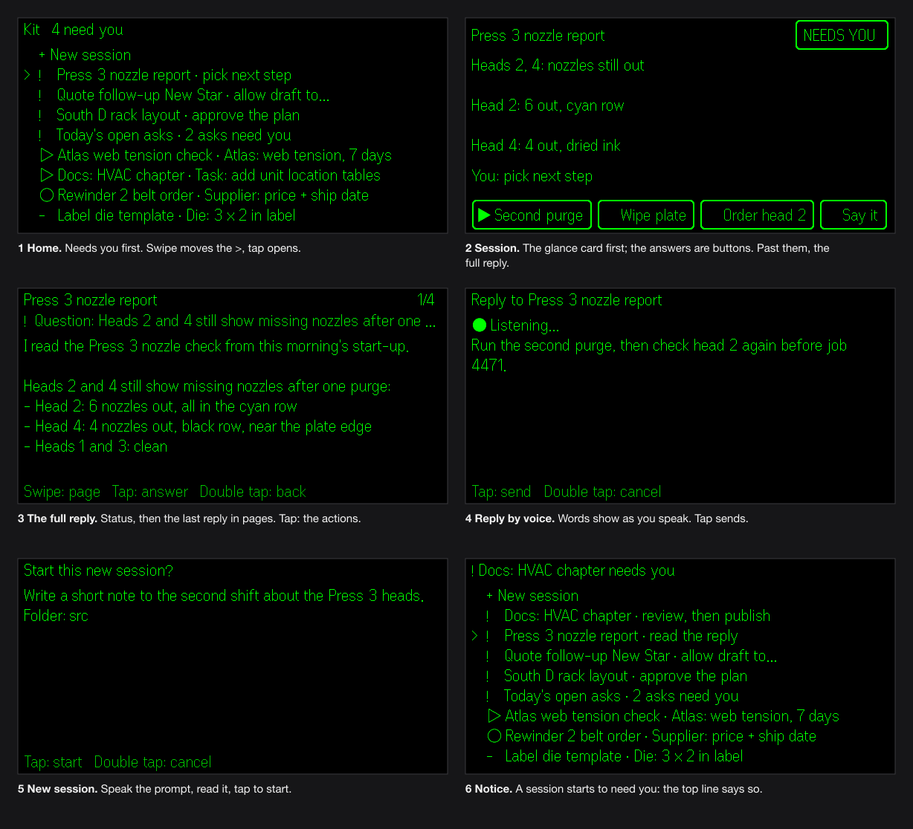
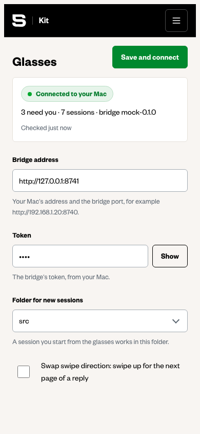
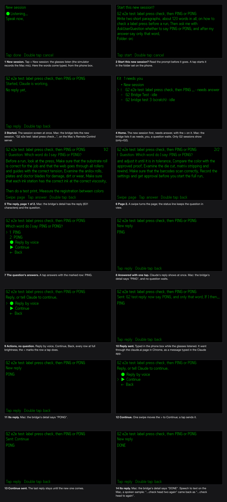

# Kit on Even Realities G2 glasses

A glasses app for people who walk the plant all day and run Claude Code sessions on their Mac. On the lens it shows which sessions need you, a session's status and last reply, and lets you keep a session going: reply by voice, send "Continue", or answer a question, a permission or a plan with one tap. It also starts a short new session by voice, and reads a session's summary aloud on the phone (Read to me).

The sessions stay on the Mac. A small bridge on the Mac (the Kit glasses bridge) gives this app a JSON API; the app runs on the phone, inside the Even Realities app, and draws on the glasses.



## Gestures

The glasses have a touch strip on each temple (and the optional R1 ring): tap, double tap, swipe up and swipe down. The app uses no long press alone, since the system uses it for its own menu. The system menu (tap, then hold) has the app's own items on Home, a session and its actions: Read to me and Stop reading.

| Screen | Swipe | Tap | Double tap |
| --- | --- | --- | --- |
| Home: the sessions, needs you first, with `+ New session` on top | Moves the `>` | Opens the session, or starts a new one | Asks to close the app (the system's own question) |
| Session: title, status, the last reply in pages | Next or last page | Opens the actions | Back to Home |
| Actions: a question's answers first, then Read to me, Reply by voice, Continue, Back | Moves the `>` | Does it. An answer goes at once. While it reads, Read to me shows Stop reading | Back to the session |
| Reply by voice: Listening, and the words as they come | Nothing | Sends the words | Cancels |
| New session: speak, then "Start this new session?" | Nothing | Done speaking, then Start | Cancels |

Every row shows at full brightness; `>` marks the row a tap acts on. Back on Home, the `>` is on the session you had open. When a list is longer than the lens, it scrolls with the `>`, and the top line shows where you are (`4/12`).

Status marks on Home: `!` needs you, `▷` working, `○` waiting on someone else, `-` idle. The words after the title say the same thing.

When a session starts to need you, the top line of whatever screen is open says so for 6 seconds. It takes no input and moves nothing.

## Read to me

The glasses have no speaker, and the Even Hub SDK has no sound output. But the app is a web page in the phone's Even app, so its sound plays on the phone: its speaker, or the earbuds connected to it. Read to me says a session's summary: its name; its `glance` when the bridge gives one, else its status line and the first two sentences of its last reply; then the question it asks, with the answers.

- **On the glasses:** in a session's actions, Read to me (the first row when nothing is asked). Or the system menu (tap, then hold), then Read to me: on Home it reads the session the `>` is on. The top line says `♪ Reading aloud: <session>` while it plays. The same row, or Stop reading in the menu, stops it. Reply by voice stops it too, so the mic does not hear it.
- **The sound:** the bridge makes it on the Mac with macOS `say`, in the Mac's own voice (`GET /api/sessions/:id/speech`), and the app plays it in one `<audio>` element. When the Mac cannot make it (an older bridge, or `say` fails), or the phone refuses the file, the app uses the phone's own voice (`speechSynthesis`), with the same words.
- **One tap on the phone:** many phone web views play a page's sound only after a tap on the page itself, and a gesture on the glasses is not such a tap. So the first tap anywhere on the Kit page turns sound on, without a sound, and the panel has Turn on sound, which plays a short tone. When the phone still refuses, the lens says `Sound blocked: on the phone, tap Turn on sound in Kit`.
- **Tests make no sound:** `mute=1` in the address plays everything with no volume. The app writes `[kit] speech playing` and `[kit] speech ended` to its console, so a script sees the sound play without listening. `npm run walk` uses it.

## The phone panel

The page the Even app shows for Kit. It holds the bridge address and token, the folder new sessions start in, and the swipe direction (some glasses swipe the other way). It says first whether Kit reaches the Mac. Its Read to me card turns the phone's sound on, says what it reads, and stops it. While the glasses listen, it also shows a box to type the words instead, for the simulator, which has no glasses mic.



## Run it in the simulator

Needs Node 20 or later.

```bash
cd glasses/app
npm install
npm run mock    # the mock bridge: made-up sessions on port 8741, token "mock"
npm run dev     # the app on http://localhost:5181
npm run sim     # the Even Hub simulator, on the app and the mock bridge
```

`npm run sim` opens the simulator's two windows (the lens and the phone page). A new window can take the keyboard, so it starts only when nobody has used the Mac for 2 minutes, and gives the front back to the app that had it. At the Mac, `KIT_SIM_ANYWAY=1 npm run sim` starts it at once. `npm run sim -- --stop` closes it.

In the simulator, the buttons under the lens are the gestures: Down and Up swipe (keys S, J or ↓, and W, K or ↑), Click taps (Space or Enter) and Double Click double taps (Space or Enter two times, fast). The keys work while the Glasses Display window is in front. The simulator records the Mac's own microphone; the mock bridge turns any sound into a made-up sentence. On the phone page, the typed box works too. `../TRY-IT.md` has the shortest way to run it all.

`npm run walk` goes through every screen and action on its own (the dev server must run) and saves a picture of each in `shots/`: the lens as `NN-step.png`, the phone page as `panel-*.png`, and six of them as `docs/lens-screens.png`. It starts its own mock bridge (port 8742) and simulator.

The simulator's page sleeps while the Mac is locked or its window is covered: replies from the bridge and timers wait until the next input. The walk pokes it with a long press and its release, which the app ignores.

The app writes each screen it shows to its console (`[kit] screen home`, `voice:listening`, ...), so a script can wait for a screen. With the dev server, `curl -X POST --data-binary 'the words' http://127.0.0.1:5181/__kit/typed` puts words in the app as if typed in the phone's box while the glasses listen (from this Mac only; a build has none of it).

`npm test` checks the text layout (pages, bytes, the font's glyphs), the screens' rows and lists, and, with a stand-in bridge, what a swipe and a tap do on a list, the pause after the answers open, and a prompt with two questions.

## Point it at the real bridge

The bridge runs on the Mac on port 8740. Its token is in `~/Library/Application Support/Sttark Kit Glasses/token`.

- **On the phone:** in the panel, enter `http://<the Mac's address>:8740` and the token, then Save and connect.
- **In the simulator:** give both in the address, so nothing is saved:
  `KIT_SIM_ANYWAY=1 node scripts/sim.mjs "http://localhost:5181/?bridge=http://127.0.0.1:8740&token=$(cat ~/Library/Application\ Support/Sttark\ Kit\ Glasses/token)&readonly=1"`
  `readonly=1` makes the app refuse to send anything (messages, answers, new sessions): use it to look at real sessions without touching them. `only=G2` shows only the sessions whose name starts with G2, and the ones started from these glasses (the Kit can rename a new session after its first prompt): use it for tests, and for pictures with no other session in them.
- **With the dev server:** `VITE_BRIDGE_URL` and `VITE_BRIDGE_TOKEN` set the panel's first values for `npm run dev` only. A build never reads them.

**End to end:** `node scripts/e2e.mjs --yes-start-a-session` drives the simulator on the real bridge with `only=G2`: it starts a session named "G2 e2e test: ...", opens it from Home, reads its pages, answers its question with one tap, replies with typed words and sends Continue, and after each step waits until the bridge shows the result on the Mac side. Then it sends a spoken sample (macOS `say`, written to a file, never played) to the bridge's speech to text. Pictures go to `shots/e2e/` and `docs/end-to-end.png`. It starts a real Claude Code session: archive it afterward. `--session cse_...` goes on with a G2 session that still asks its question.



## Try it on the glasses

**From the dev server**, with the phone on the same network as the Mac: turn on Developer Mode in the Even app, run `npm run dev`, then `npx evenhub qr --url http://<the Mac's address>:5181` and scan the code from the Even Hub tab. Changes show without a new scan.

**As a package:**

```bash
npm run pack    # builds, then writes kit-glasses-0.1.0.ehpk
```

Upload the `.ehpk` in the Even Hub portal (your project, Builds), then install it on the phone from Even Hub, Me, Apps, Private builds.

The Even app lets the app reach only the addresses its `app.json` lists. `npm run pack` lists this Mac's bridge, `http://<LAN address>:8740`, in the packed copy (`.pack/app.json`); `KIT_BRIDGE_URL=http://192.168.1.20:8740 npm run pack` picks another. If the Mac's address changes, pack again, or give the Mac a fixed address on the network. No token is ever packed.

## The bridge API

JSON, with the header `Authorization: Bearer <token>` on every request. What the app needs from the bridge besides the table:

- CORS on every answer, the preflight included: `Access-Control-Allow-Origin: *`, `Access-Control-Allow-Headers: Authorization, Content-Type`, `Access-Control-Allow-Methods: GET, POST, OPTIONS`. The phone's web view drops any answer without them.
- It listens on the network (`0.0.0.0:8740`), since the phone reaches the Mac by its address.
- 401 for a wrong token (the lens says "Token not accepted"), 404 for a session that is gone (the lens says so and goes back to Home).
- `why` (or `status_line`) is one short line: it follows the status on the session screen. `pending.text` shows above the answers, 3 lines at most; for a `plan`, the plan itself goes in `pending.text`, which the session screen shows as its pages.

| Request | Answer |
| --- | --- |
| `GET /api/health` | `{ok, version}` |
| `GET /api/sessions` | `{sessions: [{id, title, folder, status, why, status_line, updated_at, has_pending}]}`, needs you first. `status` is `needs_you`, `working`, `waiting` or `idle` |
| `GET /api/sessions/:id` | The same fields, and `last_reply` (text) and `pending`: `null` or `{kind, text, options: [{id, label}]}`, `kind` being `question`, `permission` or `plan` |
| `GET /api/sessions/:id/speech` | Read to me: the summary as sound (`audio/mp4`), and its words in the header `X-Speech-Text` (URL-encoded; `Access-Control-Expose-Headers: X-Speech-Text`). 404 "No such endpoint" from a bridge without it: the app uses the phone's voice |
| `POST /api/sessions/:id/message` `{text}` | `{ok}` |
| `POST /api/sessions/:id/answer` `{option_id}` | `{ok}`. A prompt with several questions takes one answer at a time: `{ok, done: false, pending}` holds the next question, which the app shows at once |
| `POST /api/sessions` `{prompt, folder?}` | `{id}`. It can take up to 90 s; the app waits 2 minutes. A message waits up to 60 s, since it goes through a claude.ai page in Chrome |
| `GET /api/folders` | `{folders: [{path, label}]}` |
| `POST /api/transcribe`, body raw PCM (16 kHz, mono, 16-bit little-endian) | `{text}` |
| `WS /api/live?token=...` | The bridge sends `{type: "sessions", sessions}` and `{type: "session", session}`; the app sends `{type: "subscribe", id}` for the session it shows (`null` on Home), which takes the place of the one before |

Without the live socket the app asks for the list every 5 seconds. Voice: the app sends all the audio so far every 2.5 seconds for the words to show, and once more when you tap.

## How it is built

TypeScript and Vite, with the Even Hub SDK (`@evenrealities/even_hub_sdk`) and the Even font measures (`@evenrealities/pretext`).

| File | What it does |
| --- | --- |
| `src/main.ts` | Starts the app: the SDK, settings, the panel, the input |
| `src/controller.ts` | The screens and what each gesture does there; keeps in step with the bridge |
| `src/screens.ts` | What each screen puts on the lens (pure functions) |
| `src/glasses.ts` | Draws a page: a full rebuild only when the layout changes, otherwise in-place text updates, one SDK call at a time, each with a time limit |
| `src/text.ts` | Line wrap and pages measured with the glasses' own font, byte limits, glyphs the font has |
| `src/events.ts` | One shape for every input (list, text and system events) |
| `src/voice.ts` | Collects the mic's audio and asks the bridge for the words |
| `src/speaker.ts` | Read to me on the phone: the one `<audio>` element, the tap that turns sound on, the phone's voice as the second way |
| `src/speech-text.ts` | Read to me's words, the same as the bridge's (`glasses/bridge/speech.py`) |
| `src/api.ts` | The bridge client |
| `src/panel.ts`, `index.html`, `src/styles/` | The phone panel, on `sttark-shared.css` |
| `mock-bridge/` | The mock bridge and its made-up sessions |
| `scripts/` | The simulator (`sim.mjs`, and `simkit.mjs` to drive it), the walk on the mock (`walk.mjs`), the end-to-end run on the real bridge (`e2e.mjs`), pictures with captions (`sheet.mjs`, needs `brew install librsvg`), fonts and packing |

What the lens allows, and how the app lives with it:

- 576 by 288 pixels, one font with no sizes or bold, 27 px a line, five brightness steps. A full screen holds about 10 lines of about 60 characters; a reply page holds 7 lines.
- A text box holds at most 999 bytes in the simulator (1000 on the glasses). Everything is cut by bytes, not characters.
- The font has no emoji, `…`, `•` or curly quotes; the app swaps them (`glyphSafe`).
- The lens's own list draws every row but the highlighted one dim, scrolls itself, tells the app nothing until a tap, and cannot change in place. So the app draws no lens list: Home and Actions are one text box each, every row at full brightness, the chosen row marked with `>`. The app moves the `>` on each swipe with an in-place text update (no flicker), scrolls the rows itself, and acts on the marked row on a tap.
- A swipe on a text box comes to the app only at the box's top or bottom. Each reply page and each list fits its box exactly, so every swipe turns the page or moves the `>`.
- Columns never line up in a proportional font, so the bridge sends each table row as a card: the row's name, then `  Header: cell` lines. The app keeps a line's indent when it wraps, never ends a page on a card's name alone, and drops the blank line before a card when that keeps the card on the page.
- The first screen must use the system's close question on double tap (Even Hub review checks it).

Not tried on glasses yet (the simulator differs from them): the glasses mic, which way a swipe turns a page (the panel has Swap swipe direction for that), whether the Even app takes a LAN `http://` address in the network list, and how the app keeps up while the phone is locked. For Read to me: whether the phone plays the sound after a glasses gesture with no tap on the page, on iPhone and on Android; whether it plays while the phone is locked or the Even app is in the background; that it goes to connected earbuds; that the system menu shows Read to me after a tap, then hold; and whether Android's web view has `speechSynthesis` at all.

Fonts: the panel uses Founders Grotesk, licensed to Sttark. The files are never committed (this repo is public); `scripts/fonts.mjs` copies them in for `npm run dev` and `npm run build` from the phone app, a `sttark-docs` checkout beside this repo, or Sttark/sttark-docs through `gh`.
