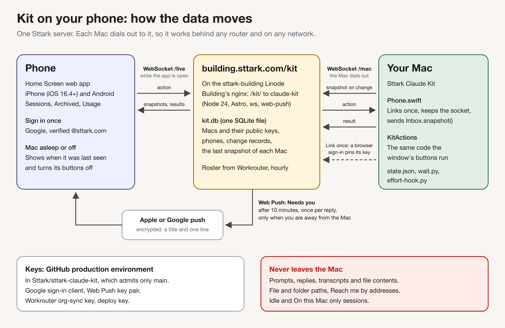
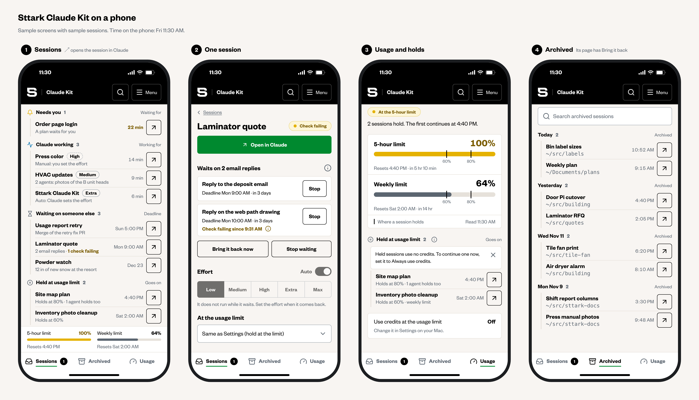

# Kit on your phone: design

How the Kit's phone web app works: where its server runs, how a Mac and a phone sign in, what goes up from a Mac and what never does, how a tap on the phone runs on the Mac, and the build steps.

The contract is in this folder and is the source of truth for every message: `asyncapi.yaml` (both sockets), `schema/` (JSON Schemas that refuse unknown fields), and `fixtures/` (sample messages, and cases that must fail). `node phone/schema/check.mjs` checks them; `.github/workflows/phone-contract.yml` runs it on each change. Change the schema, a fixture and this note in the same pull request.

## The answer in short

| Question | Answer |
|---|---|
| Repo | Sttark/sttark-claude-kit, new folder `phone/` (server and pages), next to the Mac code it mirrors |
| Host | The sttark-building Linode (2 GB, 45.33.102.173), as its own app, like HVAC |
| URL | `https://building.sttark.com/kit` (kit.sttark.com later: `APP_ORIGIN` and `BASE_PATH` only) |
| Phone sign-in | Google, verified @sttark.com, checked on the server, on the Workrouter roster |
| Mac sign-in | Each Mac makes its own key. One browser sign-in links it to the person. No typed secret |
| Mac to server | One WebSocket the Mac opens and keeps (`/mac`), so NAT and any network work |
| Server to phone | WebSocket `/live` while the app is open; Web Push when it is closed |
| Same code as the window | A new `KitActions` that both the window's buttons and the phone call |
| Storage | One SQLite file, the same as Building |
| Cost | None now |

## 1. Where the server lives

**Repo.** A new `phone/` folder in Sttark/sttark-claude-kit. The phone shows what the window shows, so one pull request changes both sides of the contract. The release workflow builds the Mac app only from `Sources`, `Resources`, `Helpers`, `Info.plist`, `build.sh` and `whats-new`, so a change in `phone/` makes no Mac release. The repo is public. That is fine: no secret is in code, the server's secrets are in the repo's GitHub `production` environment (admits only `main`), and the deploy key can only run one deploy script.

**Host.** The sttark-building Linode. It already runs nginx, certbot, Node 24, SQLite apps and a second app from another repo (HVAC, on its own ports, with its own deploy key). The Kit server is small: about 60 to 100 MB of memory, no build on the box.

**URL.** `https://building.sttark.com/kit`: a path on Building's origin, which needs no DNS change and no new certificate. Building's nginx passes `/kit/` to the Kit as it came, so the Kit is built with `BASE_PATH=/kit` and runs with `APP_ORIGIN=https://building.sttark.com`. kit.sttark.com can come later by changing `APP_ORIGIN` and `BASE_PATH` only (plus a DNS record and an nginx site on the box); the server's code does not change.

**One origin, two sites kept apart.** A Home Screen app, its service worker, its push permission and its sign-in cookie belong to an origin, so the Kit keeps to its path:
- Its sign-in cookie has the path `/kit`, and nginx passes the Kit only that cookie, never Building's.
- Its manifest (`/kit/site.webmanifest`) has `id`, `start_url` and `scope` `/kit/`, so its Home Screen app is a different app from Building. Its service worker is `/kit/sw.js` with the scope `/kit/`, answers no request, and opens or moves only its own pages. nginx drops `Service-Worker-Allowed` and `Clear-Site-Data` from the Kit, so it cannot reach past `/kit/` or clear Building's cookies.
- No Building page lives under `/kit/` (`kit` is a reserved location slug there), and Building has no service worker.
- What they share: the push permission (one per origin; each has its own subscription), and the Light, Auto or Dark choice (`sttark-theme`), which is the same person's choice in both.

**What it needs from people.**
- The redirect URI `https://building.sttark.com/kit/auth/callback` on the shared Workspace sign-in client (Google Cloud project `frontier-account`, the client docs.sttark.com and www.sttark.com use). Its id and secret then go into the Kit repo's production environment.
- A Workrouter org-sync key (`sk_org_...`) for the Kit, from Workrouter's admin API keys page.
- No new box and no money. If Building, HVAC and the Kit together run the 2 GB box short, a resize to 4 GB is about $12 a month more.

**Set up on the box by Building's ansible** (Sttark/building, flag `kit_on_this_box: true`, as `hvac_on_this_box` works; its `ansible/README.md`, "Kit on this box"):
- user `kit`; `/srv/claude-kit` (code) and `/srv/claude-kit-data/kit.db` (data);
- systemd unit `claude-kit` on `127.0.0.1:4350`, with `EnvironmentFile=/srv/claude-kit/env`;
- in Building's own nginx server block: `/kit` to `/kit/`, `/kit/` to 4350, `/kit/mac` and `/kit/live` with the Upgrade headers and `proxy_read_timeout 3600s`; no site or certificate of its own;
- `/usr/local/bin/kit-deploy` (owned by root), the `kit` user's `authorized_keys` line with `command="/usr/local/bin/kit-deploy"`, and one sudoers line for `systemctl restart claude-kit`;
- the nightly backup also writes `kit-<time>.db.age`, as it does for HVAC.

**Deploy.** `.github/workflows/phone-deploy.yml` in the Kit repo, on a push to `main` under `phone/` and by hand. The runner tests, copies in the fonts from Sttark/sttark-docs (`npm run fonts`), builds with `BASE_PATH=/kit`, packs the built app and its production modules, and writes the env file from the secrets without printing it. It sends the pack over SSH to the forced command. `kit-deploy` refuses a pack built for another path, unpacks to `releases/<sha>`, writes the env file (mode 600, with the box's own `NODE_ENV`, `HOST`, `PORT`, `KIT_DB` and `APP_ORIGIN`), moves the `current` link, restarts, checks `/kit/healthz`, and goes back to the last release when the check fails. Then the workflow asks the public `/kit/healthz` for its commit.

**Looked at and left out.**
- `kit.sttark.com`, its own origin: keeps the Kit's Home Screen app, service worker, push permission and cookie apart from Building with no work, but needs a DNS record that is not coming soon. The move later is `APP_ORIGIN` and `BASE_PATH`.
- `*.eng.sttark.com` (the Machine Broker's proxy): its Google sign-in gate blocks the Mac's socket and the phone's cookie-less icon and manifest fetches.
- The Machine Broker as the Mac's transport: one shared key for all devices, which a public app cannot carry. It is made for plant machines.
- docs.sttark.com's box: a document platform on MariaDB; nothing to share.
- A new Linode: money and one more box to run.

## 2. How a Mac proves who it is

**The key.** When the switch is on and the Mac is not linked, the Kit makes a P-256 signing key. On a Mac with a Secure Enclave (Apple silicon, T2) the key is made there and can never leave it; its saved form is useless on another Mac. Other Macs keep the key in the Keychain, this device only. Only the public half leaves the Mac.

**Linking, once.**
1. The Kit sends `POST /api/mac/link` with the public key (SPKI, DER, base64), the Mac's name, the Kit version, a random Mac id, where the key lives, and the Claude Code login as the account hint (`schema/link.v1.json` has every field and answer). The server answers with a link page address, a poll token and a 4-letter code. The link page works once, for 10 minutes. A Mac id the server knows is refused: a Mac id is linked once.
2. The Kit shows one Mac notice: "Use the Kit on your phone. Click to link this Mac with your Sttark sign-in." Settings shows **Link this Mac...** too. The Kit never opens the browser by itself, since it never takes the screen.
3. The click opens the link page. Google sign-in comes first, with the Claude Code login as the account hint when it is a @sttark.com address. The server checks a verified @sttark.com account on the roster.
4. The page says "Link MacBook Pro to your account?" with one green **Link** button. When the browser is not on the same public address as the Mac that asked, the page also shows the code and asks the person to check that the Kit shows the same code.
5. **Link** saves the Mac's public key to the person, and records the change. The Kit sees the answer (it polls every 2 seconds) and connects.
6. The page then says "Linked. On your phone, open building.sttark.com/kit", with a QR code.

**Each connection.** The server sends a random challenge. The Mac signs the UTF-8 text "kit-mac-v1", its Mac id and the challenge, one per line with no newline at the end (ECDSA P-256 with SHA-256; DER or the 64-byte r and s). The server checks the signature with the saved key, that the Mac is not removed and that its person is on the roster. Otherwise it closes with code 4401 (removed, unknown or a wrong signature) or 4403 (not on the roster); 4400 when no valid auth comes in 15 seconds, and 4409 when a newer connection of the same Mac takes over. A copy of the server's database cannot pose as a Mac, because the server holds only public keys. This follows the door controllers: the device's own key, saved when it is admitted.

**Removing a Mac.**
- On the phone: Menu > Macs > **Remove** (red, asks first). The server marks it removed (the record stays) and closes its socket. The Kit drops its key, shows "Removed from your phone" in Settings, and does not link again by itself.
- On the Mac: turn **Kit on your phone** off. The Kit tells the server to remove it, drops its key, and records the choice (`turnedOff`).
- Off the roster: at the hourly roster sync, all of that person's Macs, phone sign-ins and push subscriptions end.
- Not heard from in 90 days: the daily job removes it.
- `uninstall.sh`: removes the link if it can, and drops the key.

## 3. What the Kit sends, and when

**When.**
- On connect: the full snapshot.
- On change: the Kit already posts `kitStateChanged` 0.2 seconds after any write in its folder (`Sync.swift`; every hook writes with a new file and a rename). The phone part builds the snapshot and sends it only when it differs from the last one sent, at most once every 2 seconds.
- Every 5 minutes it builds the snapshot again and sends it only if it changed. This catches words that change with age, such as how often a wait is checked.
- Times are sent as timestamps, not words, so the clock alone never makes a send.
- A ping every 25 seconds keeps the socket and the router's mapping open. It carries no data.
- Before sleep, quit or an update the Kit sends `bye` with why (`sleep`, `quit`, `update`).

**What.** The same rows the window draws: `Inbox.snapshot()`, reduced to the four groups the phone shows (Needs you, Claude working, Waiting on someone else, Held at usage limit). Idle and On this Mac only sessions are not sent. Each label is cut to 160 characters on the Mac, and the server's schema refuses any field it does not know.

| Field | What it is | Where the window gets it today |
|---|---|---|
| `v`, `at` | Format version, time built | |
| `mac.name`, `mac.kit`, `mac.tz` | Mac name, Kit version, time zone | |
| `mac.account` | Short hash of the Claude Code login, to merge usage across Macs | `Reach.loginEmail` (`~/.claude.json`) |
| `flags.paused`, `flags.credits_all` | Auto effort off; Use credits at the usage limit | `Inbox.Snapshot.paused`, `.creditsAll` (`paused`, `limit_credits_all`) |
| `reach` | The names of the Reach me by ways only | `Reach.summary()` (`reach.ways`) |
| `usage.at`, `usage.bars[]` (`kind`, `name`, `percent`, `resets`) | The 5-hour and weekly bars | `Usage.read()` (`usage.json`) |
| `usage.reached` (`name`, `until`) | At the limit now | `Limit.reached` |
| `rows[].id`, `cse`, `sid` | Row id, Remote Control id, Claude Code session id | `Inbox.Row.id`, `.target` |
| `rows[].group`, `title`, `sub`, `sub_strong`, `sub_warn`, `late` | Group and the row's words | `Inbox.snapshot()` |
| `rows[].time_at` | What the time column counts from or to | `waitingSince`, turn or background start, `wait.by`, `hold.until` |
| `rows[].url` | The claude.ai link that Open in Claude uses | `Inbox.Row.url` |
| `rows[].session` (`level`, `manual`, `reason`, `needs_you`, `why`, `waiting_since`, `turn_at`) | Effort and why it needs you | `State.sessions()` (`sessions[cse]`, `.app`, `app_list`) |
| `rows[].background` (`agents`, `bash`, `what`, `since`) | What still runs after the turn | `Inbox.background()` |
| `rows[].waits[]` (`id`, `kind`, `what`, `from`, `why`, `by`, `checks`, `failing`, `failing_since`) | Each wait, its deadline and how the Kit checks it | `Waits.list()` (`state.waits`), `Inbox.checks()` |
| `rows[].hold` (`hold`, `at`, `percent`, `limit`, `since`, `until`, `agents`) | Held at the limit, or at its own percentage | `Limit.waiting` (`limit_pauses` with a live process) |
| `rows[].limit_mode` (`mode`, `at`) | At the usage limit setting | `Limit.mode(target)` (`limit_modes`) |
| `archived_rev`, `archived_count` | The archived list's version and length; the list itself goes up only when the server asks (section 13) | `archived.json` (`rev`, `items`) |

**Never leaves the Mac.** Prompts, replies, transcript lines, file contents, and the log. File and folder paths: transcripts, working folders, the server's folder. An archived session's folder goes up as its own name only (for example `src`), never the path. A wait's target (Gmail thread id, pull request), its check script and its output. A check-prompt's question: the phone shows "A yes/no check" unless the session gave `--what`. The Reach me by address, phone number and Chat webhook. Tokens and the Keychain. Idle and On this Mac only sessions.

Some labels are short lines the Kit or Claude wrote about the work. They are not prompt or reply text, and the window already shows them: the effort reason, why a session needs you, an agent's task, a wait's what and why.

**What the server keeps.** Only the last snapshot of each Mac, replaced each time, and deleted when the Mac is removed. No history of snapshots.

## 4. Actions from the phone

**Transport.** The Mac is behind NAT, so it opens the socket: `wss://building.sttark.com/kit/mac`, with `URLSessionWebSocketTask` (built into macOS, no new dependency). After a drop it connects again: at once on wake or a network change, else after 1, 2, 4 ... 60 seconds. The Engineering Handbook asks for WebSocket between backend and UI, with an AsyncAPI file and messages shaped `{event, success, payload}`. `phone/asyncapi.yaml` describes both sockets.

**The same code the window runs.** New `Sources/Actions.swift`: one function per action, each with an origin (`window` or `phone`), each returning a result with before and after. The window's buttons change to call them. The phone calls the same ones.

| Phone control | Action | `KitActions` (the window calls it too) | What runs |
|---|---|---|---|
| Bring it back now | `bring_back {wait}` | `bringBack(wait:origin:)` | `wait.py --now <id> --by <origin>`, `check(only=id)` |
| Stop waiting | `stop_waits {waits}` | `stopWaits(_:origin:)` with each wait of the row | `wait.py --cancel <id> --by <origin>` for each |
| Stop (one wait) | `stop_waits {waits: [id]}` | `stopWaits(_:origin:)` with one id | `wait.py --cancel <id> --by <origin>` |
| Effort level | `set_level {cse, level}` | `setLevel(cse:level:origin:)` | `effort-hook.py --set <cse> <level> --by <origin>`: Manual, then `apply_flag_settings` |
| Auto | `set_auto {cse, on}` | `setAuto(cse:on:origin:)` | `State.setManual`: `sessions[cse].manual` |
| At the usage limit | `set_limit {cse, sid, mode, at}` | `setLimit(cse:sid:mode:origin:)` | `Limit.setMode`: `limit_modes` |
| Bring it back (archived) | `unarchive {cse}` | `unarchive(cse:origin:)` (section 13) | `wait.py --unarchive <cse> --by <origin>`, then the existing `bring_back(w, None)` |
| Open in Claude | none | `Waiting.open` | The phone opens the claude.ai link. Nothing runs on the Mac |
| Use credits at the usage limit | none | `Menu.toggleCredits` | Read only on the phone: "Change it in Settings on your Mac" |

No other action exists. The server sends no free text, no command and no prompt. A server that someone broke into can do only these seven things, and only to linked Macs, and each one is in the Mac's log.

**The flow.**
1. The phone sends `action` with an id, the Mac, the action and the snapshot time it saw. The button says "Sending...".
2. The server checks that the person owns the Mac and that the Mac is connected. If the Mac is not connected, it answers `offline` at once. It never keeps an action for later.
3. The server sends the action to the Mac, with who asked.
4. The Mac reads its state again (`Inbox.snapshot(hours: 24)` and `state.waits`), runs the `KitActions` function off the main thread, logs it, and answers with the result, before and after. The state change sends a new snapshot by itself.
5. The server records the change and tells the phone. With no answer in 20 seconds it says "Your Mac did not answer in time. Check the session before you try again." The phone never shows a success the Mac did not confirm.

**A session the Mac no longer has.** The Mac checks at the moment it runs, never from the phone's copy:
- The wait is gone (it ended, or the person stopped it on the Mac): `gone`, "That wait already ended. Nothing was changed."
- The session is in no group, idle included: `gone`, "This session is no longer on your Mac. It may be archived. Nothing was changed."
- An effort change for a session that waits on someone else: `not_now`, "It does not run while it waits. Set the effort when it comes back."
- A wait the phone did not show (added since) is never stopped by Stop waiting. The Mac stops only the ids the phone sent.
- Bring it back for a session that is no longer archived: `gone`, "It is not archived now. It is in your list."
- Bring it back for a session whose conversation is not on this Mac: `not_here`, "Its conversation is not on this Mac, so this Mac cannot bring it back."

The Mac always sends a new snapshot after, so the phone draws the truth.

**Every change has a name on it.** The server's `records` table gets one row per change: who, when, the Mac and session names at the time, the action, before, after, the result and the words. Linking and removing a Mac are recorded too. SQLite triggers refuse any edit or delete. The only delete is a daily job for rows over one year old, and the README says so. The One session page lists its changes from the phone ("Set effort to High from the phone, 11:32 AM"). The Mac's log gets a `phone` line for each, and the Events page shows it.

## 5. Live updates and Web Push

**Live.** The page is drawn on the server from the last snapshots, then opens `/live` (sign-in cookie, Origin checked). The server sends each Mac's state and snapshot, and forwards each new snapshot at once. While any of a person's phone pages is visible, the server tells that person's Macs `watching: true`. The Kit then reads the Claude app's session list every 10 seconds, as it does while its window is open, so a change in the Claude app shows on the phone in about 10 seconds. On iPhone the socket closes when the app goes to the background; on return it connects again and redraws.

**Web Push needs.**
- iPhone: a Home Screen web app, iOS 16.4 or later. Permission is asked only from a tap inside the installed app ("Turn on Needs you notices"). Every push must show a notice: there is no silent push, so the server sends only when a notice must show. The app badge shows the Needs you count (`setAppBadge`).
- Android: Chrome or Samsung Internet. Push also works in a tab; installing gives the Home Screen icon.
- One VAPID key pair (in GitHub secrets). Payloads are encrypted for the phone, so Apple and Google see only an endpoint. Payload: a title and one line ("Claude needs you: Order page login", "Waiting 10 min: a plan waits for you."). A tap opens the One session page.

**No double notices.**
1. One kind only: Needs you. No push for working, waits, holds or a finished reply.
2. Same moment as today's Mac notice: once per reply, when a session that needs you has waited 10 minutes (`Waiting.notifyDue` with `waitingTold`).
3. One place, chosen by the Mac. If the person is at the Mac (screen on and unlocked, input in the last 2 minutes), the Mac notice shows. If they are away, the phone push goes out. Never both. With no linked phone, or no socket, the Mac notice shows as today. The Mac knows how many phones can get a push from `welcome`'s `phones`, then from each `phones` message when it changes (a phone turns notices on or off, signs out, or its push service says it is gone).
4. The Claude app's own push (`inputNeededNotifEnabled`) comes the moment Claude asks. The Kit's comes 10 minutes later and only if the session is still not opened, so it is a reminder, not a repeat.
5. Reach me by: a session that sent a Reach me by message in the last 30 minutes gets no reminder, on the phone or the Mac. `notify.py` records the time in `reach_sent[cse]` in the state file.
6. A visible phone page gets no push. The page already shows it.
7. Each push has the tag `needs-<cse>`, so a newer one replaces the old one. The server keeps the person, session and waiting time for 2 days, so a reconnect or two Macs never send it twice.
8. Notices can be turned off per phone in Menu.

## 6. Several Macs, sign out, a Mac that is away

**Several Macs.** Link each one. Rows of all live Macs go into the same four groups. A row shows its Mac's name only when the person has more than one Mac. Usage shows one block per Claude account (the account hash), from the newest read. Menu > Macs lists each Mac, its state and when it was last seen.

**A Mac that is away.** The server knows each socket.
- Live: connected, heard from in the last 60 seconds.
- Updating: after `bye update`, for up to 2 minutes; no alarm.
- Asleep: after `bye sleep`. Kit quit: after `bye quit`. Not heard from: 60 seconds of silence with no `bye`.

A Mac that is not live is never drawn as live. Its sessions leave the four groups (a sleeping Mac runs nothing). One row stands for it under "Macs away": "Mac mini: asleep since 6:12 PM. 4 sessions then." A tap shows its last list, headed "As of 6:12 PM", in gray, with no buttons and the line "Actions work when this Mac is back." Its usage says "Read 6:12 PM". Open in Claude still works, since the session lives in the Claude app.

**Sign out.** Menu > **Sign out** ends this phone's sign-in and deletes its push subscription. Menu > Macs > **Sign out everywhere** ends every sign-in and push subscription of the person. Neither removes a Mac.

## 7. Storage and keys

**One SQLite file** (`/srv/claude-kit-data/kit.db`, WAL), as Building does.

| Table | What | Kept |
|---|---|---|
| `web_sessions`, `oauth_states` | Phone and browser sign-ins (random ids, no data in the cookie) | 30 days, rolling |
| `people`, `roster` | Who signed in; the last good roster from Workrouter | A failed sync keeps the last good one |
| `macs` | Id, person, name, public key, key kind, linked, last seen, last `bye`, Kit version, removed and why | Never deleted; removed is a mark |
| `links` | Link pages waiting for a sign-in | 1 day |
| `snapshots` | The last snapshot per Mac | Replaced; deleted with the Mac |
| `archived` | One row per Mac: the archived list's `rev` and its items (section 13) | Replaced at each update; deleted with the Mac |
| `push_subs` | Endpoint and keys per phone, notices on or off, when that changed, the kind of device | Until sign-out or the push service says gone |
| `pushes_sent` | Person, session, waiting time | 2 days |
| `records` | Every change, append only | 1 year |

In memory only: the open sockets, which phone pages are visible, actions waiting for an answer (20 seconds). A database is needed for the Mac keys, push subscriptions and records. Memory alone would also lose the "as of" view of an away Mac at each deploy. The nightly backup covers the records and links. Snapshots refill from the Macs.

**Keys**, in Sttark/sttark-claude-kit's GitHub `production` environment, which admits only `main`:

| Secret | What | Made by |
|---|---|---|
| `DEPLOY_SSH_KEY` | Forced-command key for the `kit` user; it runs only `kit-deploy`. Its public half goes in Building's group vars | A repo admin: `ssh-keygen` piped into `gh secret set`, then deleted |
| `VAULT_GOOGLE_CLIENT_ID`, `VAULT_GOOGLE_CLIENT_SECRET` | The shared Workspace sign-in client | A frontier-account project owner |
| `VAULT_ORG_SYNC_TOKEN` | The Kit's own read-only org-sync key | A Workrouter admin |
| `VAULT_VAPID_PUBLIC_KEY`, `VAULT_VAPID_PRIVATE_KEY` | Web Push key pair. A new one breaks every phone's subscription, so it also gets a break-glass copy in Google Secret Manager (frontier-account) | A repo admin, made and set without showing it |

No session secret (sign-ins are random ids in the database) and no Mac secret (each Mac holds its own key).

## 8. The Kit side

**Files that change.**

| File | Change |
|---|---|
| `Sources/Phone.swift` (new) | The switch; the key; linking; the socket; the snapshot builder; send on change; `bye`; `watching`; reminder routing; facts for Settings |
| `Sources/Actions.swift` (new) | `KitActions`: bring back, stop waits, set level, set Auto, set the usage setting, unarchive (bring an archived session back), each with an origin and a result |
| `Sources/Window.swift` | The buttons call `KitActions`; new Settings box **Phone** |
| `Sources/Menu.swift` | Starts `Phone`; `Sync.watching` is also true while a phone page is visible; `MenuFacts` gets the phone's state |
| `Sources/Waiting.swift` | `notifyDue` asks `Phone` where the reminder goes |
| `Sources/Limit.swift`, `Sources/State.swift` | `setMode` and `setManual` take an origin; log word `(phone)` |
| `Sources/Defaults.swift` | `phone` in the switches the Kit turns on |
| `Sources/Events.swift` | Reads the `phone` lines |
| `Resources/hooks/effort-hook.py` | `--set ... --by phone` for the log; `STTARK_EFFORT_DRY`; `keep()` writes `archived.json` when the archived part of the session list changes; new `--archived` for a Mac with no server (section 13) |
| `Resources/hooks/wait.py` | `--by phone` on `--now` and `--cancel` for the log; new `--unarchive <cse> [--by phone]`; `bring_back` takes an empty prompt |
| `Resources/hooks/notify.py` | Records `reach_sent[cse]` |
| `uninstall.sh` | Removes the link, drops the key |
| `README.md` | Settings table row, a section "Kit on your phone", How it works item 23, Files rows, the new test variables |
| `DESIGN-DECISIONS.md` | Phone pages: no Access page (one rule: everyone on the roster, each person sees only their own Macs); changes listed on the session page; bottom tab bar on the phone |
| `whats-new/kit-on-your-phone.md` and pictures | Below |
| `tools/phone-test.swift` (new) | Tests on copies, below |
| `phone/`, `.github/workflows/phone-deploy.yml`, `phone-checks.yml` | The server, its pages, `asyncapi.yaml`, tests, page check and app review |

**The switch.** Settings, new box **Phone**, after Reach me by:
- **Kit on your phone**. On, not linked: "Link this Mac with your Sttark sign-in to see your sessions on your phone." and **Link this Mac...**. On and linked: "Your sessions show at building.sttark.com/kit, signed in as name@sttark.com. Last sent 11:30 AM." Off: "Nothing goes to building.sttark.com/kit."
- One line: "Needs you notices go to your phone when you are away from this Mac."

On by default, the Kit's rule: `KitDefaults` turns `phone` on at the first start after the update. It sends nothing until a person links the Mac, and linking shows its own notice once. Turning it off records `turnedOff`, and the Kit never turns it on again.

**Tests on copies.** Never the live server or a live Kit.
- Existing: `STTARK_KIT_DIR`, `STTARK_KIT_LOG`, `STTARK_WAIT_DRY`, `STTARK_NOTIFY_DRY`, `STTARK_CLAUDE_KIT_TEST`.
- New: `STTARK_PHONE_URL` (a local server), `STTARK_PHONE_KEY` (a key file in the test folder, not the Keychain), `STTARK_PHONE_DRY=1` (builds and logs snapshots, connects to nothing), `STTARK_EFFORT_DRY=1` (`--set` writes Manual and logs, sends nothing).
- `tools/phone-test.swift`: builds snapshots and the archived list from sample state in a temp folder. It plants marker words in transcripts, prompts, paths (archived folder paths included), wait targets and the Reach me by settings, and fails if any marker is in the JSON. It writes the fixture the server and the pages test against. It runs every `KitActions` function on copies with the dry variables, including a gone wait, an archived session, an effort change while waiting, and `unarchive` with `STTARK_WAIT_DRY=1`. It talks to a local copy of the server with a test database.
- Server: `vitest` for linking, the signed challenge, ownership (one person cannot act on another's Mac), the action allowlist, offline and timeout, append-only records and their expiry, the push skip rules, roster removal, and a schema that refuses extra fields. Local runs use `DEV_FAKE_USER`, as Building does, and a stand-in push service (`tools/push-sink.mjs`) that decrypts each push.

**What's new note** (`whats-new/kit-on-your-phone.md`, with `kit-on-your-phone.png` and `-dark.png`, a crop of the phone screens at most 880 by 560 at 2x):

    # Your sessions on your phone

    **Icon:** iphone

    **Kind:** New

    You can see your sessions on your phone and act on them, also when you are away from this Mac.

    - To start, click the Kit's notice, or click Link this Mac in Settings, then sign in with Google.
    - On your phone, open building.sttark.com/kit, add it to the Home Screen, and turn on notices.
    - When a session needs you for 10 minutes and you are away, your phone gets one notice.

    

Run `python3 tools/whats-new.py check` and `ste` on it, and check the words against the code.

## 9. Build steps

Sizes: S is about half a day, M about one day, L two to three days.

| # | Step | Size | Needs | Worktree |
|---|---|---|---|---|
| 1 | Contract: `phone/asyncapi.yaml` for `/mac` and `/live`, the snapshot JSON Schema v1 (no extra fields, length caps), the archived list schema, the result reasons | S | | main |
| 2 | Clickable prototype from the mockup (`mockup.png`): every state (Mac away, two Macs, action sending, gone, signed out, notices off), phone and desktop width, tried on a phone | S | 1 | A |
| 3 | Kit: `KitActions`, the window calls it, origin words in Swift and the two hooks, `STTARK_EFFORT_DRY`. The window works as before | S | | B |
| 4 | Kit: snapshot builder and `tools/phone-test.swift` (marker test, fixture) | S | 1 | C |
| 5 | Server base in `phone/`: Astro SSR, Google sign-in and sessions and roster sync (copied from Building), the SQLite schema with append-only records, `/healthz`, the shared style file, page check and app review | M | 1 | D |
| 6 | Hosting: Building pull request `kit_on_this_box`, `phone-deploy.yml`, a blank `/healthz` live at building.sttark.com/kit | S to M | | E |
| 7a | Server: link pages, the signed challenge, removal, the Macs page | M | 5 | D |
| 7b | Kit: the key, the link notice, the Settings box, the socket, reconnect, `bye`, `watching` | M | 3, 4 | B |
| 8 | Phone pages: Sessions, Archived, One session, Usage, Menu and Macs, Macs away; first from the fixture and a fake Mac script, then live | L | 2, 4, 5 | A |
| 9 | Actions end to end: forward, timeout, records with before and after, the list on the session page; on the Mac, `gone` and `not_now`, log lines, the Events page | M | 7a, 7b, 8 | D |
| 9b | Archived: `archived.json` writer and `--archived` in effort-hook.py, `wait.py --unarchive`, `KitActions.unarchive`, `want_archived` and `archived_delta` on both ends, the Archived tab live | M | 7a, 7b, 8 | F |
| 10 | Web Push: manifest and icons (sttark-docs icon script), service worker, turning notices on inside the installed app, the VAPID sender and its skip rules; on the Mac, reminder routing and `reach_sent` | M | 7a, 7b | C |
| 11 | Docs: README parts, DESIGN-DECISIONS rows, the What's new note with light and dark pictures, the STE check | S | 9, 10 | main |
| 12 | Try it: local server and a test build on copies. Then a person on the live server, with a test build run from `build/` (it does not take over the login item), one iPhone and one Android phone. Then merge the Kit change, which releases to every Mac | S | 11 | main |

**At the same time.** Step 1 first; it is small. Then steps 2, 3, 4, 5 and 6 in five worktrees. Then 7a, 7b and 8 at once. Then 9, 9b and 10 at once. Then 11 and 12. The longest chain is 1, 5, 7a, 9, 12. About 10 days of agent work, about a week from start to release.

## 10. Needs a person

1. A frontier-account Google Cloud project owner: add `https://building.sttark.com/kit/auth/callback` to the shared Workspace sign-in client, and give its id and secret to the Kit repo's production environment.
2. A Workrouter admin: an org-sync key for the Kit.
3. A Kit repo admin: make the `production` environment, set `DEPLOY_SSH_KEY` and the VAPID keys, and put the VAPID break-glass copy in Secret Manager.
4. Building's owners: review the `kit_on_this_box` pull request and run `site.yml`.
5. sttark-docs: the Kit's icon in the icon script, and the row in the guide's App icons table. A candidate is Lucide `inbox`.

Money: none now.

## 11. Test these first

- Google sign-in inside an iPhone Home Screen web app. Its storage is separate from Safari, so the sign-in must finish inside the installed app. Try it on a blank page in step 6.
- Turning notices on in the installed app, and a push arriving with the app closed, on iPhone and Android.
- Memory on the 2 GB box during a Building or HVAC build.
- A Secure Enclave key that keeps working across Kit updates (the same certificate signs each release).
- The socket on plant Wi-Fi, a hotel network and cell data, and the reconnect after sleep.
- Whether the session list gives an archive time, and whether it accepts `statuses=archived`. The code already sends `statuses=active&statuses=paused` (`open_chats()`), so `statuses=archived` is likely to work. No code reads an archive time today, only `last_event_at`, so `archived_at` falls back to `last_event_at` until a response shows a better field.

## 12. Phone layout

The phone is used one-handed, often while walking. Two of the app guide's rules are set aside on the phone for that reason:

- **Tabs in a bottom tab bar**, within thumb reach: **Sessions**, **Archived**, **Usage**. The Sessions tab shows the Needs you count as a badge. The guide's tabs under the top bar stay the rule for desktop pages.
- **A ↗ button on each session row** (Sessions, Archived, and the held rows on Usage) opens that session in the Claude app with one tap. Its accessible name is "Open in Claude". A tap on the rest of the row opens the session's own page, as the guide says.

Everything else follows the guide: the black top bar with the Sttark mark, "Claude Kit", search and Menu; groups with their icon, count and time label; the most urgent group first; one green button per page (Open in Claude on a session page); explanations behind an ⓘ.

| Tab | What it shows |
|---|---|
| Sessions | The four groups (Needs you, Claude working, Waiting on someone else, Held at usage limit), then "Macs away"; a compact 5-hour and weekly strip above the tab bar |
| Archived | Archived sessions, newest first, with a search field (section 13) |
| Usage | The 5-hour and weekly bars with reset times and the 60% and 80% marks, the held sessions and when each goes on |

Dark mode: `mockup-dark.png`.

## 13. Archived sessions

The phone and the Mac window both list archived sessions, so a person can find an old session and bring it back.

**The source.** `all_chats()` in `Resources/hooks/effort-hook.py` (`GET /v1/code/sessions?limit=100`, up to 5 pages), the sessions with `status == 'archived'`, without runs of a scheduled task (`trigger_id`, or a tag that starts with `routine`, as `app_list()` drops them). `keep()` already reads this list every 15 seconds while the server runs; it writes `archived.json` in the Kit's folder when the archived part changes. A Mac with no server runs a new `effort-hook.py --archived` every 10 minutes and when an Archived page opens (it asks for `statuses=archived` if the API accepts it). The window's Archived page and the phone part both read `archived.json`.

**`archived.json`.** `{at, rev, items: [{cse, title, folder, transcript, archived_at, url}]}`. `folder` and `transcript` are full paths and stay on the Mac. `rev` is a hash of the items as the phone sees them. `archived_at` is the API's archive time if it gives one, else `last_event_at` (archiving writes an `end_session` event with reason `archived`).

**Which sessions are listed.** A session is listed only when it is archived, is not a run of a scheduled task, its conversation is on this Mac, and it has no open Kit wait. A session with an open wait shows under "Waiting on someone else", so a session is never in two lists.

**What goes up, and when.** The snapshot carries only `archived_rev` and `archived_count`. The full list goes up only when the server asks with `want_archived {have}`, which it sends when a phone opens the Archived tab and its copy is older than the Mac's `archived_rev`. After that, the Mac sends changes as `archived_delta {base, rev, add, remove}` (`remove` is a list of `cse`). When the server does not have `base`, it asks for the full list again. Each item sent:

| Field | What it is |
|---|---|
| `cse` | Remote Control id (the claude.ai session) |
| `title` | The session name, cut to 160 characters |
| `folder` | The working folder's own name only (for example `src`), never a path |
| `archived_at` | When it was archived (or its last event, as above) |
| `url` | The claude.ai link that Open in Claude uses |

**The action.** `unarchive {cse}`, with the other actions on both sockets. A new `wait.py --unarchive <cse> [--by phone]` builds the facts from `archived.json` and calls the existing `bring_back(w, None)`: it skips the archive step, takes `keep.lock`, writes the `bridge-session` line with `point_at()` at `waiting_since_reply()`, starts `claude --resume <conversation> --remote-control` in a `kit-` screen in its folder, and adds it to `keep.alone`. The one change to `bring_back`: the prompt may be empty (no first message is typed). Claude Code unarchives the same link, so the person's link and the phone's ↗ keep working, and the session joins the normal groups in the next snapshot. `KitActions.unarchive(cse:by:)` runs it for the window and for the phone. The log line is `wait ... brought back from the archive (phone)`. After it runs, the Kit writes `archived.json` again.

Results:
- `ok`: started again on the same link.
- `gone`: "It is not archived now. It is in your list."
- `not_here`: "Its conversation is not on this Mac, so this Mac cannot bring it back."

**Never leaves the Mac.** The saved conversation, the `transcript` and `folder` paths, transcript text and prompts.

**On the server.** Table `archived`: one row per Mac with its `rev` and list, replaced at each update, deleted with the Mac.

**On the phone.** The Archived tab sends `open_archived`; the server answers with `archived {mac, rev, items}` from its copy and asks the Mac for a newer one if needed. A search field at the top searches the names on the phone. Rows show the name, folder and when archived, with the ↗ button. A tap on a row opens its page with **Bring it back** and **Open in Claude**.

## Appendix: the two sockets

Every message is `{event, success, payload}`. Linking comes before `/mac`, over HTTP: `POST /api/mac/link` and `GET /api/mac/link/<poll>` (`schema/link.v1.json`).

| Socket | From | Event | Payload |
|---|---|---|---|
| `/mac` | server | `challenge` | `nonce` |
| `/mac` | Mac | `auth` | `mac`, `sig`, `kit` |
| `/mac` | server | `welcome` | `phones` (how many can get a push), `watching` |
| `/mac` | Mac | `snapshot` | as in section 3 |
| `/mac` | server | `want_archived` | `have` (the rev the server holds, or null) |
| `/mac` | Mac | `archived` | `rev`, `items` (section 13) |
| `/mac` | Mac | `archived_delta` | `base`, `rev`, `add`, `remove` |
| `/mac` | server | `watching` | `on` |
| `/mac` | server | `phones` | `phones` (how many can get a push, when it changes after `welcome`) |
| `/mac` | server | `action` | `id`, `act`, `args`, `by` (email, name) |
| `/mac` | Mac | `result` | `id`, `reason` (`ok`, `gone`, `not_now`, `not_here`, `bad`), `words`, `before`, `after` |
| `/mac` | Mac | `remind` | `cse`, `waiting_since`, `title`, `why` |
| `/mac` | Mac | `bye` | `why`: `sleep`, `quit` or `update` |
| `/mac` | Mac | `unlink` | |
| `/mac` | server | `error` | `code` (`bad_message`, `old_version`, `too_fast`), `words`; the socket closes after `old_version` |
| `/live` | phone | `hello`, `visible` | `visible` |
| `/live` | server | `macs` | each Mac: id, name, state, last seen |
| `/live` | server | `snapshot` | `mac`, the snapshot |
| `/live` | phone | `open_archived` | |
| `/live` | server | `archived` | `mac`, `rev`, `items` |
| `/live` | phone | `action` | `id`, `mac`, `act`, `args`, `basis` |
| `/live` | server | `action_result` | `id`, `reason` (also `offline`, `timeout`, `denied`), `words` |
| `/live` | server | `record` | a new change record for the session that is open |
| `/live` | server | `error` | `code`, `words` |

`success` is true, except on `error` and on a `result` or `action_result` whose reason is not `ok`. Times are Unix seconds.
