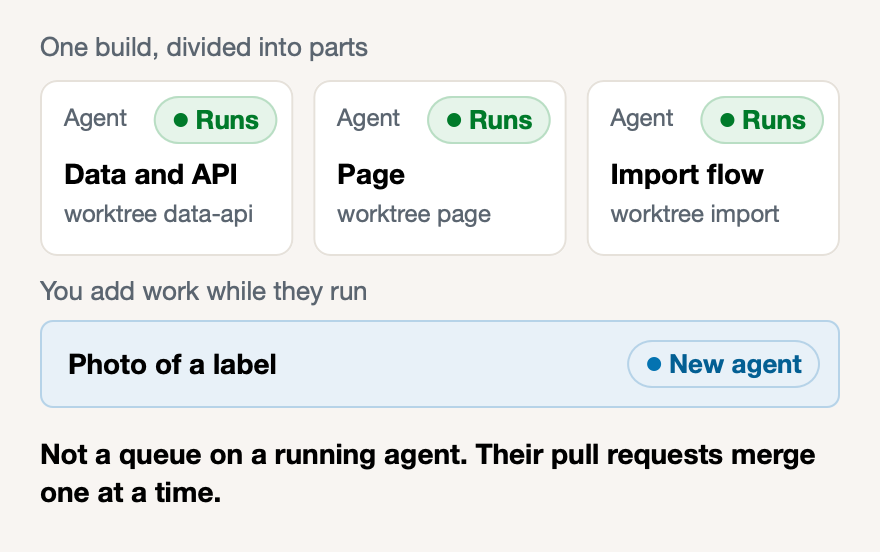

# One agent for a build needs a reason

**Icon:** rectangle.split.3x1

**Kind:** Better

A session now starts one agent for each part of a build, also when the parts share code.

- The plan line gives the number of agents and what each one builds.
- Shared code comes first as a small interface, then the agents build on it.
- A session uses one agent only when it can say why the parts must go in order.

