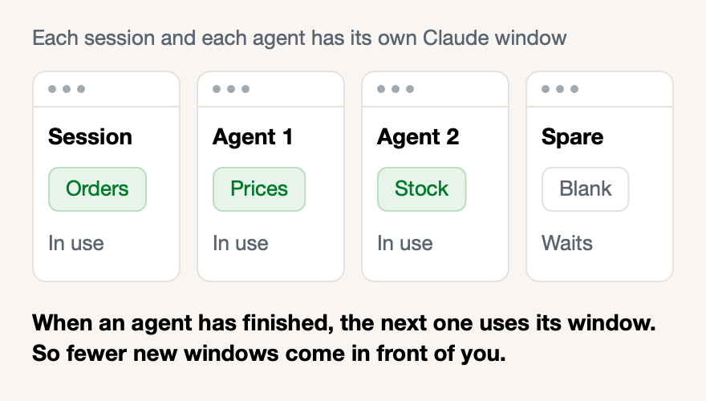

# A Claude window for each agent

**Icon:** macwindow.on.rectangle

**Kind:** Better

**Replaces:** own-claude-windows

Each agent now has its own Claude window in Chrome, and a new window goes behind your Chrome window.

- Agents that use the browser at the same time do not take the front tab from each other.
- A window that is not in use stays open for 30 minutes, and the next session or agent uses it.
- A session or an agent gets its window when it first runs `claude-window`; `claude-window done` gives the window back.

