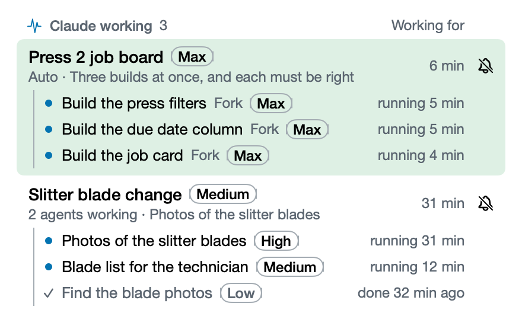

# Agents show under their sessions

**Icon:** list.bullet.indent

**Kind:** New

The Sessions page shows the agents of each session under it, with the effort level of each agent.

- Agents that run show first, and finished agents show in gray with the time that they finished.
- Click a session to see why each agent has its level, and that a fork runs at the session level.
- Click **Open Sttark Claude Kit** in the menu, then see the agents under each session on the **Sessions** page.

