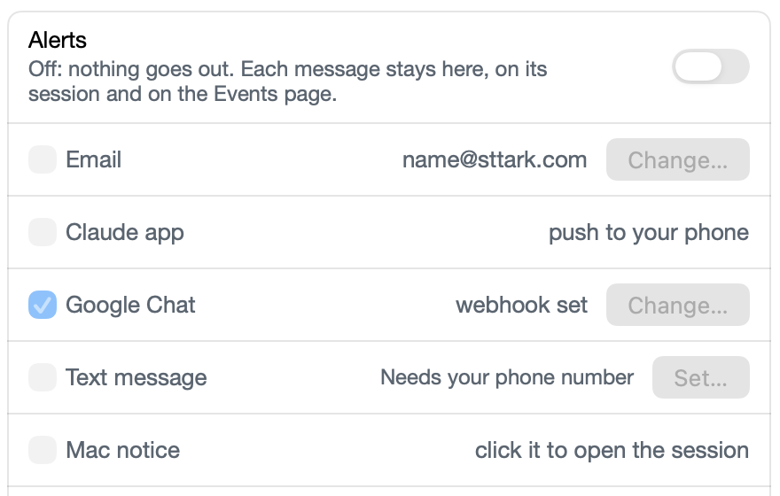

# Turn all alerts off

**Icon:** bell.slash

**Kind:** New

You can turn all alerts off and see your sessions only in the Kit.

- To start, turn off **Alerts** in **Settings** under **Reach me by**, and your ways stay as they are.
- Then no email, text, Chat message, Mac notice or phone notice is sent.
- Each message stays on its session on the **Sessions** page, and on the **Events** page.

