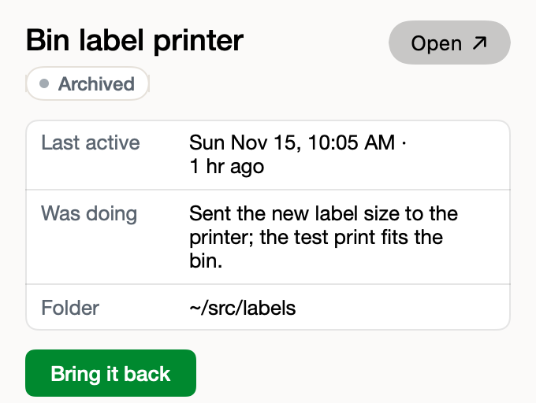

# Archived sessions

**Icon:** archivebox

**Kind:** New

The window shows your archived sessions, and you can bring one back with its full conversation.

- Click **Archived** under **Sessions** in the window to see them, most recent first.
- Click a session, then click **Bring it back**: it comes back to your list on the same link.
- A session that waits on someone else stays under **Waiting on someone else**.

