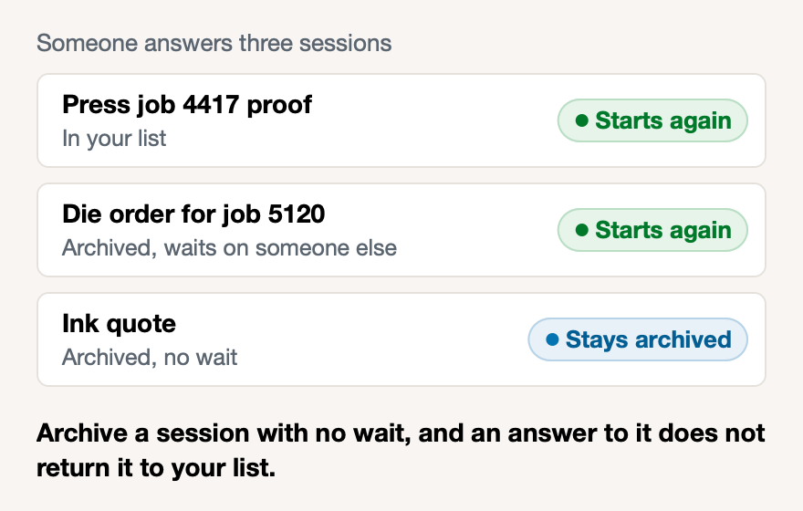

# Archived sessions stay archived

**Icon:** archivebox

**Kind:** Better

When you archive a session that has no wait, an answer to it does not return it to your list.

- A session under **Waiting on someone else** returns as before, also when it is archived.
- After a session returns to your list, the Kit watches for answers to it again.
- To see which sessions the Kit does not watch, run `claude-wait --watching`.

