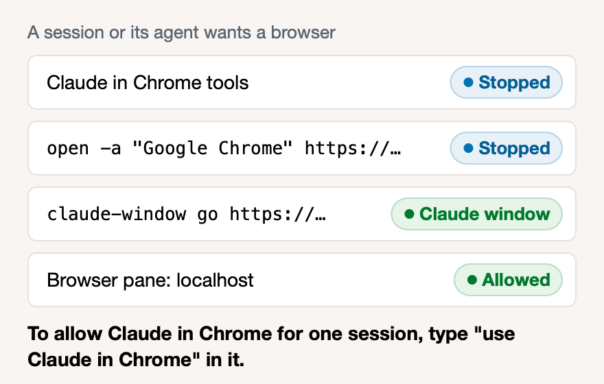

# Sessions stay out of your own Chrome

**Icon:** hand.raised

**Kind:** Better

Sessions and their agents can no longer open your Chrome or bring it to the front while you type.

- The Kit stops Claude in Chrome, Control Chrome and `open -a Chrome`, and sends Claude to the Claude window.
- To let one session use Claude in Chrome, type `use Claude in Chrome` in that session.
- This works while **Claude window in Chrome** is on in Settings.

