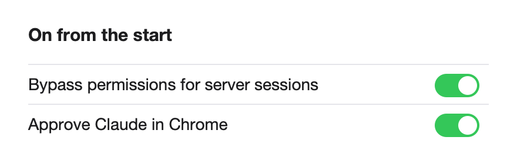

# Bypass permissions and Chrome approvals are on

**Icon:** bolt.shield

**Kind:** Better

Claude now runs commands in every session without asking you, and approves sites in Chrome for you.

- New sessions start in Bypass permissions, from the Claude app, a terminal or your phone.
- When macOS asks, allow **SttarkChromeApprover** in **Privacy & Security > Accessibility**.
- To turn one off, open **Settings** and turn off its switch; the Kit then keeps it off.

