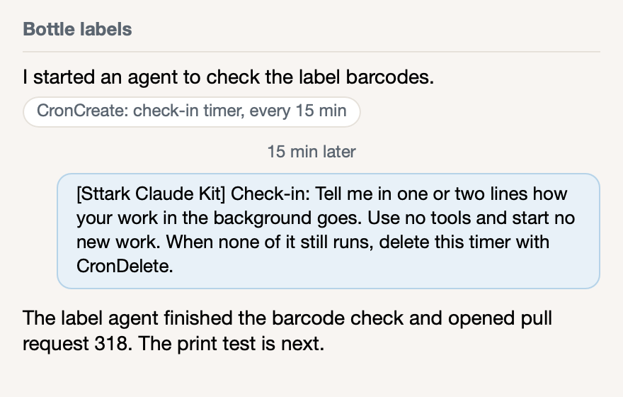

# Check-ins in the chat of every session

**Icon:** bubble.left.and.text.bubble.right

**Kind:** Better

**Replaces:** check-ins-in-the-chat

Every session now gets a check-in in its own chat while its work runs in the background.

- The session sets a timer that asks it for one or two lines on its work every 15 minutes.
- Sessions on this Mac's server, in the Claude desktop app and in a terminal get them too.
- To stop it, turn off **Check-ins in the session** in **Settings** under **Sessions**.

