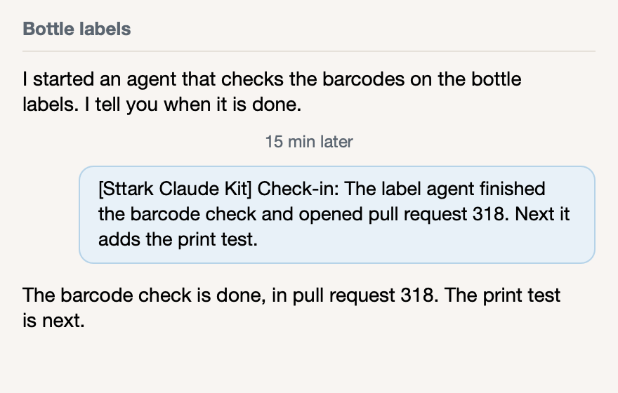

# Check-ins in the session's chat

**Icon:** bubble.left.and.text.bubble.right

**Kind:** New

A session that the Kit started now gets each check-in in its chat, and answers it in a short turn.

- The check-in comes as a prompt while the session's agents work, and the answer is one or two lines.
- A session on this Mac's server takes no typed prompt, so its check-ins stay in the Kit only.
- To stop it, turn off **Check-ins in the session** in **Settings** under **Sessions**.

