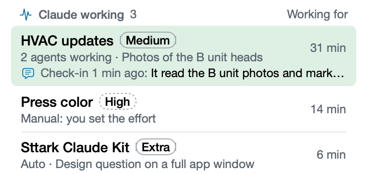

# Check-ins show in the Kit, not as alerts

**Icon:** text.bubble

**Kind:** Better

**Replaces:** progress-check-ins

Progress check-ins now show on the session's row in the Kit, and never come as an email, text or notice.

- Under **Claude working**, a session's row shows its last check-in and how old it is, here and on your phone.
- Select the session to read all of the note, and see each check-in on the **Events** page.
- To stop them, turn off **Progress check-ins in the Kit** in **Settings** under **Sessions**.

