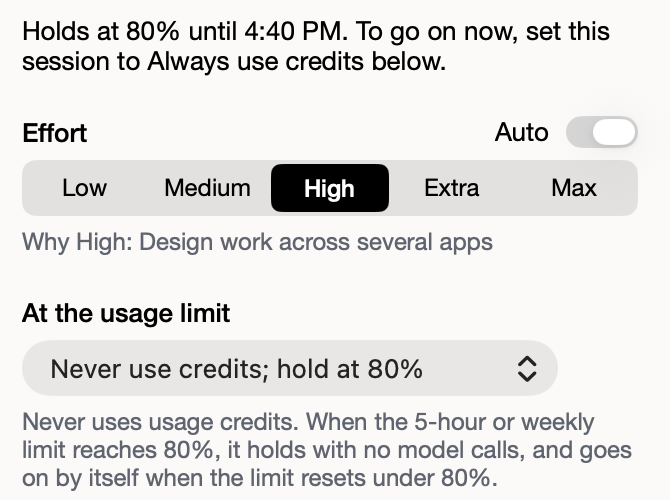

# One setting for credits

**Icon:** creditcard

**Kind:** Better

Each session has one control for credits, so what the menu shows is what the session does.

- To let a held session continue now, select **Always use credits** under **At the usage limit**.
- To undo it, select another item in the same menu.
- If you send `use credits` in the session, it also sets **Always use credits**.

