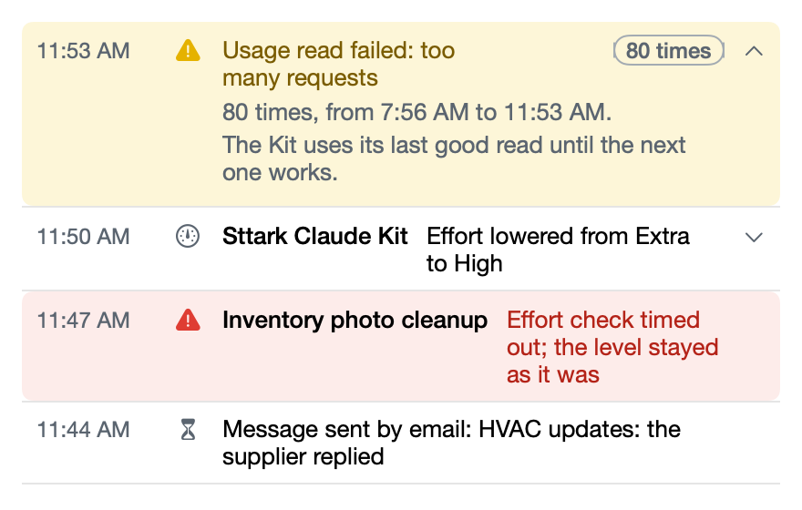

# See what the Kit did

**Icon:** list.bullet.rectangle

**Kind:** New

The new Events page tells what the Kit did for each session, in plain words, newest first.

- Open it with **Events** in the window, or **Show events** in **Settings**.
- Problems show in yellow or red, and a problem that occurs again shows as one row.
- Click a row to see more, or a session's name to open that session.

