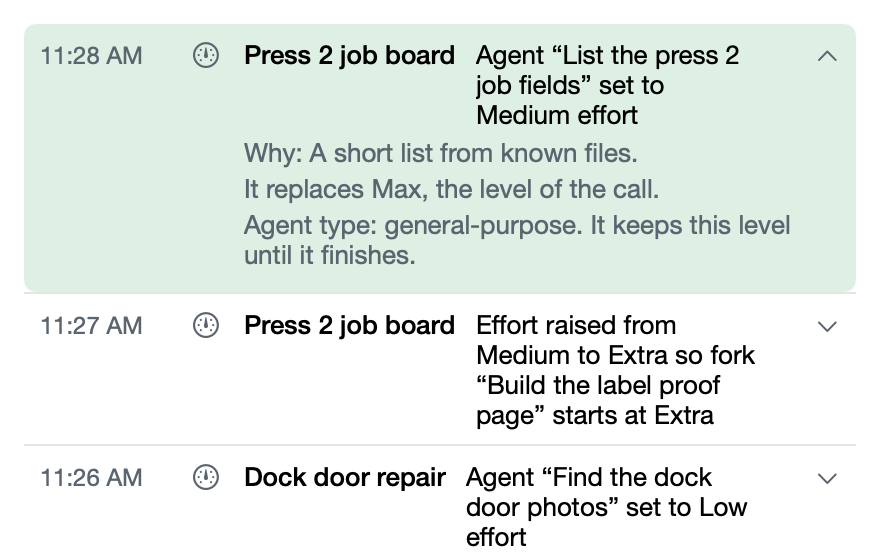

# The Kit sets the level of every agent

**Icon:** person.2.badge.gearshape

**Kind:** Better

Sttark Claude Kit sets the effort of every agent, also when Claude or the agent's file gives a level.

- A fork runs at the session's level, so the Kit raises the session for a fork that needs more.
- To keep the level that Claude gives an agent, turn off **Auto** under **Effort** for that session.
- The **Events** page shows the level of each agent, and the level that the Kit replaced.

