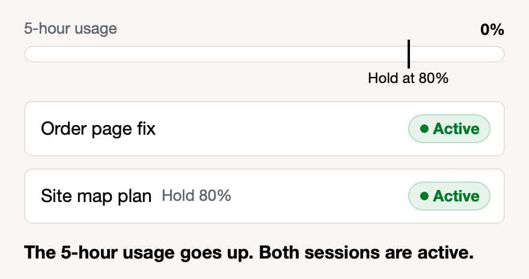

# Low-priority sessions hold before the limit

You can set a session to hold before your usage limit. When your 5-hour or weekly limit gets to the percentage that you set, the session stops before its next step. It starts again by itself when the limit resets. Your other sessions can use what is left.

**What you do:** In Sttark Claude Kit, click the session. Under **At the usage limit**, pick **Never use credits; hold at 80%** or another value. Or send `no credits` in the session.

