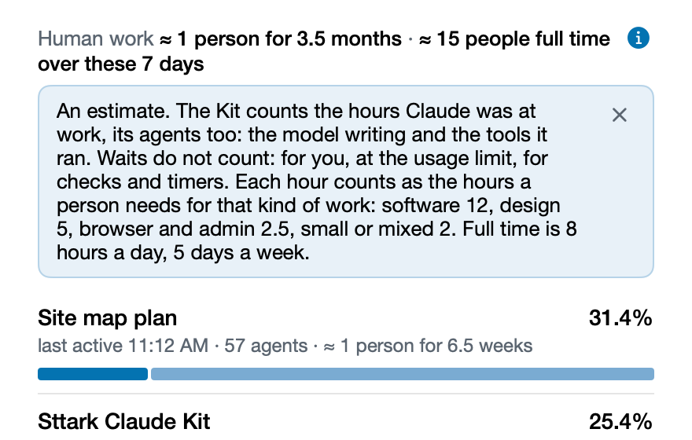

# Human work estimate

**Icon:** person.2

**Kind:** New

The Usage page now shows an estimate of the time that people would need to do the same work.

- Click **Usage** in the window's sidebar to see the estimate under the totals.
- Each session row shows its own estimate, and the **Usage** tab on your phone shows it too.
- Click the ⓘ to see how the Kit counts the work and leaves out the waits.

