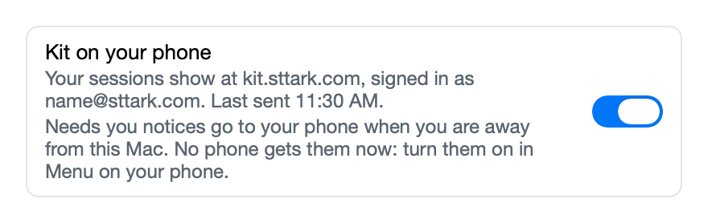

# Kit on your phone has a new address

**Icon:** iphone

**Kind:** Better

**Replaces:** kit-on-your-phone

Kit on your phone is now at kit.sttark.com, and a linked Mac stays linked.

- A Claude Kit app that you added from building.sttark.com/kit does not work now, so delete it.
- On your phone, open kit.sttark.com, sign in, and add it to your Home Screen.
- Open **Claude Kit**, then turn on **Needs you notices** in **Menu** again.

