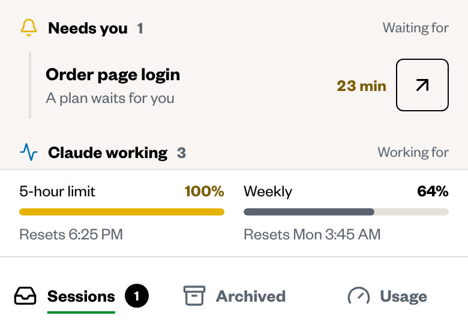

# Use the Kit on your phone

**Icon:** iphone

**Kind:** New

Your sessions now show on your phone, and the window's buttons work there too.

- On your Mac, click the Kit's notice, or **Link this Mac…** in **Settings** > **Phone**, then click **Link**.
- On your phone, open building.sttark.com/kit, add it to the Home Screen, and turn on notices in **Menu**.
- **Needs you** notices go to your phone when you are away from this Mac.

