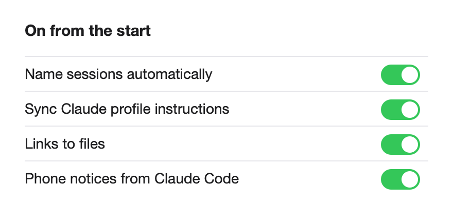

# The Kit sets up your Mac for you

**Icon:** checkmark.seal

**Kind:** Better

The Kit now starts the parts that Sttark uses with Claude, so you do not set them.

- Session names, links to files, the profile sync and phone notices start automatically.
- A Mac notice tells you which parts started.
- To turn a part off, open **Settings**; the Kit then keeps it off.

