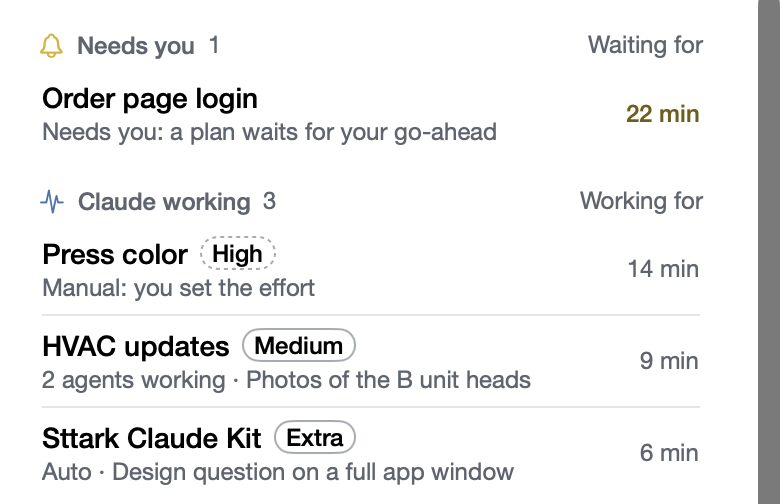

# Sttark Claude Kit has a window

**Icon:** macwindow

**Kind:** New

Your sessions and all the Kit settings are now in one window, not in the menu.

- Click the gauge in the menu bar, then click **Open Sttark Claude Kit**.
- **Needs you** shows only the sessions where you must do something.
- Click a session to set its effort and its usage limit.

