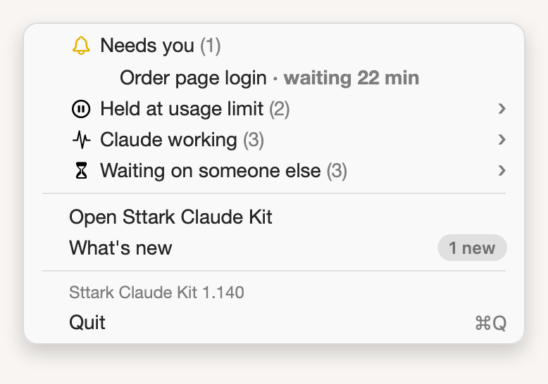

# A shorter menu

**Icon:** filemenu.and.selection

**Kind:** Better

The menu shows each group of sessions as one row, and each time tells what it is.

- Point at a group, such as **Held at usage limit**, to see its sessions.
- **Needs you** still shows its sessions in the menu, because they need you now.
- Each time has a word: **waiting 15 min**, **continues 4:40 PM** or **deadline Mon 9:00 AM**.

