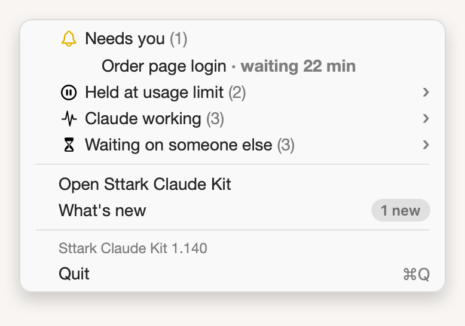

# Menu opens sessions in the Claude app

**Icon:** arrow.up.right.square

**Kind:** Better

Click a session in the menu to open it in the Claude app, as **Open** in the window does.

- A session with no Remote Control link opens in Sttark Claude Kit instead.
- **Open Sttark Claude Kit** still opens the window.

