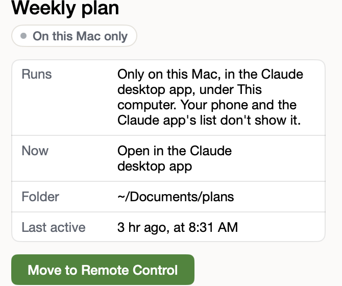

# Move a session to Remote Control

**Icon:** desktopcomputer

**Kind:** New

A session that runs only on this Mac can move to Remote Control, with its whole conversation.

- Sessions from Terminal, or from This computer in the desktop app, show under **On this Mac only**.
- Click the session, then **Move to Remote Control**: it shows on your phone and in the Claude app.
- In Terminal, type `claude-migrate --list` to see them, and `claude-migrate <name>` to move one.

