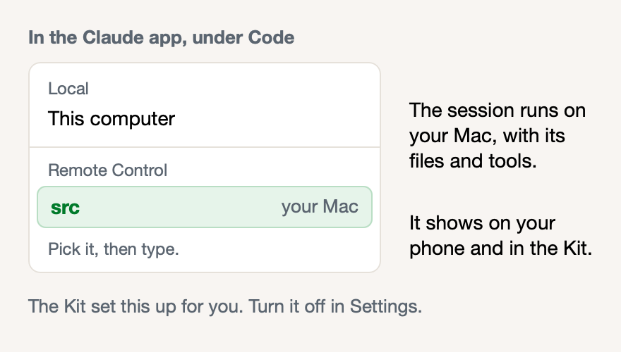

# New sessions start on your Mac's server

**Icon:** iphone.and.arrow.forward

**Kind:** Better

New Code sessions in the Claude app now start on your Mac's server, so you do not select it.

- Each new session shows on your phone and in the Kit, and continues after a restart.
- The Kit also starts the Claude Code sign-in before your login ends; you only approve it.
- To stop it, turn off **New sessions start on this Mac's server** in **Settings**.

