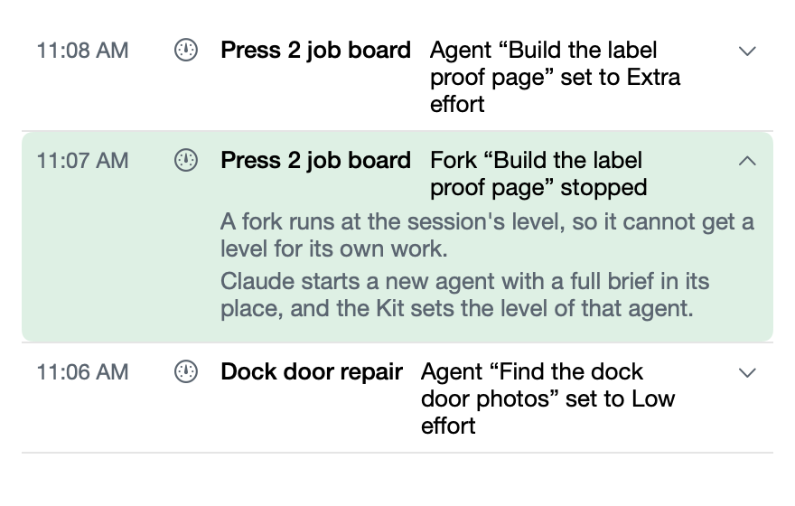

# Each agent runs at the level for its own work

**Icon:** person.2.badge.gearshape

**Kind:** Better

**Replaces:** every-agent-effort

Sttark Claude Kit stops fork agents, so each session and each agent runs at the level for its own work.

- A fork can only run at the session's level, so Claude starts a new agent with a full brief instead.
- The Kit sets the level of every other agent, also when Claude or the agent's file gives a level.
- The **Events** page shows the level of each agent, and each fork that the Kit stopped.

