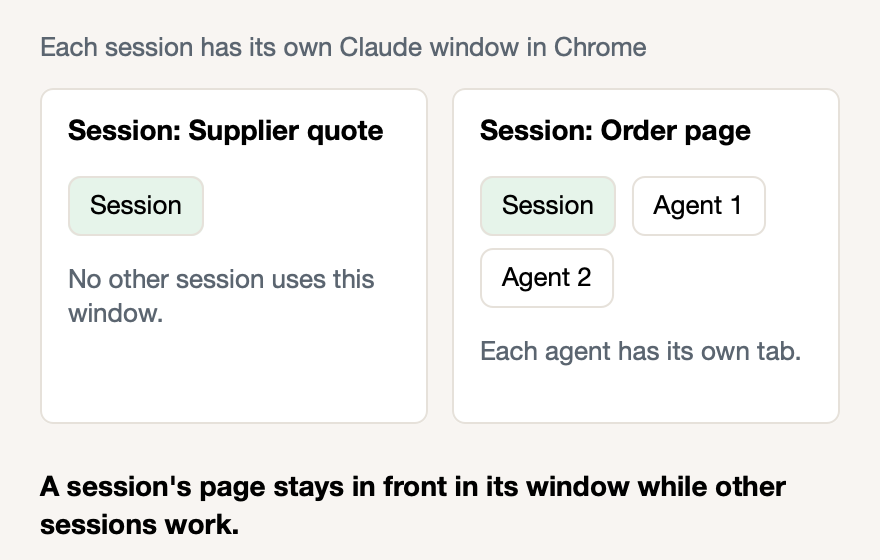

# A Claude window for each session

**Icon:** macwindow.on.rectangle

**Kind:** Better

Each session now has its own Claude window in Chrome, and each agent has its own tab in it.

- Sessions and agents that use the browser at the same time do not move each other's pages.
- A session makes its window when it first runs `claude-window`, and Chrome shows in front for less than one second.
- The Kit closes the tab of an agent that stops, and the window of a session that ends.

