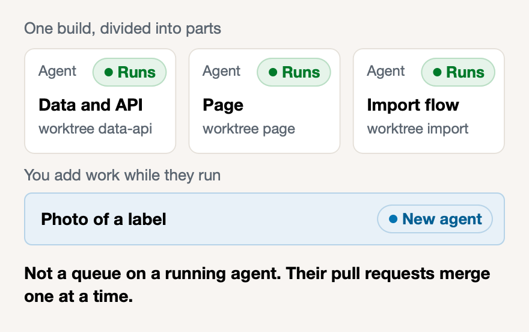

# Agents work in parallel

**Icon:** rectangle.split.3x1

**Kind:** Better

A session now divides a large build into parts and starts one agent for each part.

- Each agent has its own git worktree and a name that matches its part.
- When you add work, the session starts a new agent and does not add it to a running agent.
- The Kit notes a session that sends new work to a running agent, so its next turn does better.

