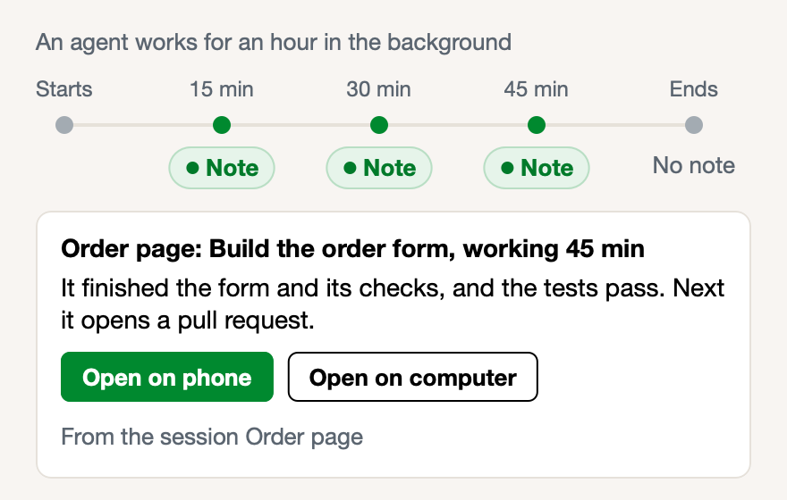

# Notes while a session works

**Icon:** clock.badge.checkmark

**Kind:** New

While a session or its agents work for 15 minutes or more, you get a short note every 15 minutes.

- Each note says what is done, what it does next, and what stops it, if something does.
- It goes the ways you checked under **Reach me by**, but not by **Claude app**.
- To stop the notes, turn off **Progress check-ins** in **Settings** under **Reach me by**.

