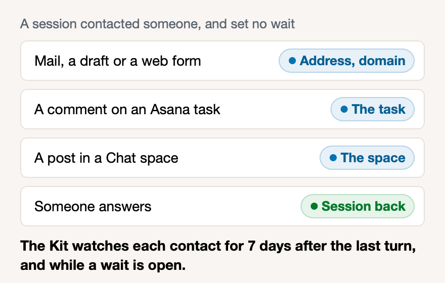

# Answers bring sessions back

**Icon:** arrowshape.turn.up.left

**Kind:** New

When someone that a session contacted answers by email, web form, Asana or Chat, the Kit brings the session back.

- It watches each person, site, Asana task and Chat space that a session contacted, also when it set no wait.
- The session reads the answer, does the next step, and sends you a message only when you must know.
- To read your own mailbox with no model, run `claude-mail sign-in <your address>` one time on this Mac.

