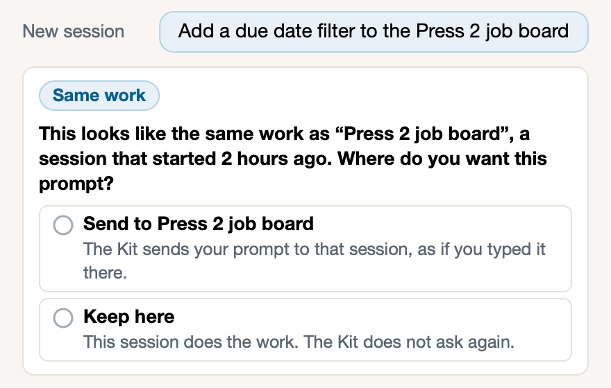

# One session for the same work

**Icon:** arrow.triangle.merge

**Kind:** New

When a new session starts on the work of an open session, Claude asks you where the prompt goes.

- Pick **Send to** and the name of the session, and the Kit sends your prompt there, as you typed it.
- Pick **Keep here**, and the new session does the work and does not ask again.
- To stop the question, turn off **One session for the same work** in **Settings**.

