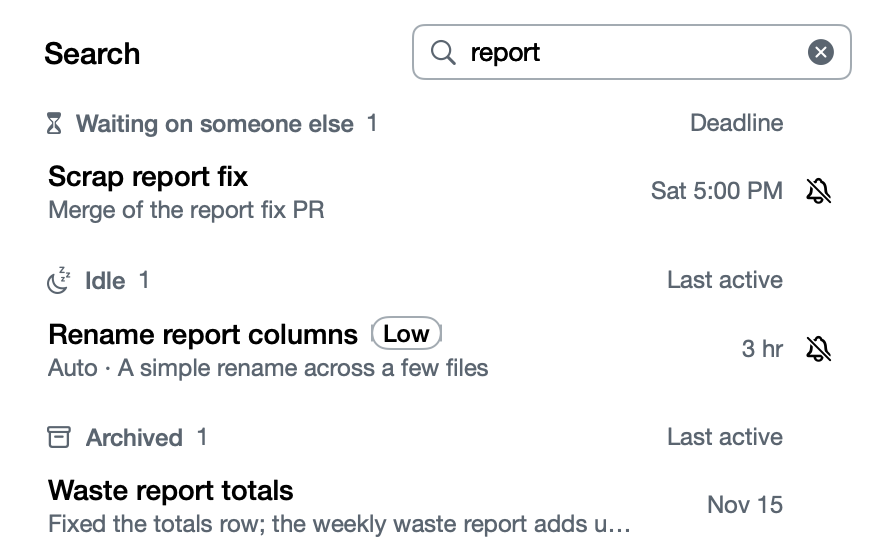

# One search for all sessions

**Icon:** magnifyingglass

**Kind:** Better

The search at the top of the window now finds every session, also archived sessions, from each page.

- Type in **Search sessions** at the top right of any page, or push Command-F.
- It finds a session by its name, folder, waits, last check-in or messages, and shows **Archived** last.
- On your phone, the search at the top finds archived sessions too.

