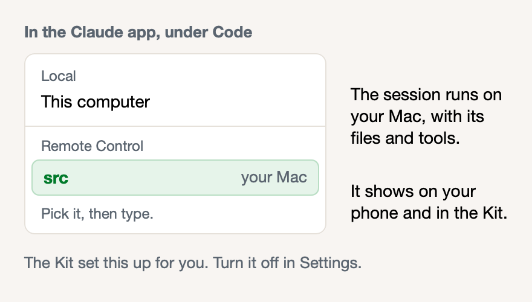

# Sessions from the Claude app run on your Mac

**Icon:** iphone.and.arrow.forward

**Kind:** Better

The Kit now prepares your Mac to run the sessions that you start from the Claude app.

- In the Claude app, open **Code**, then select your folder under **Remote Control**.
- Sessions that you start on **This computer** also show on your phone and in the Kit.
- To stop it, turn off **Start sessions from the Claude app** in **Settings**.

