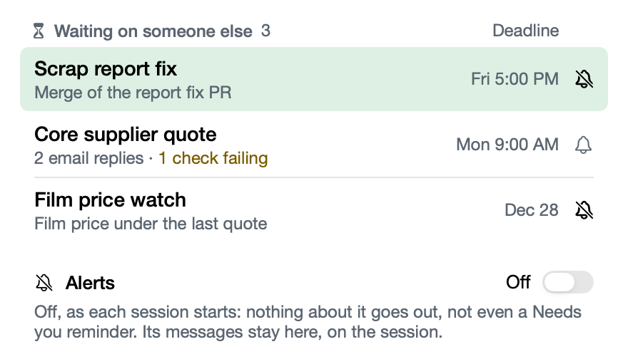

# Alerts for each session start off

**Icon:** bell.slash

**Kind:** Better

**Replaces:** session-alerts

Each session now starts with its alerts off, so its messages and reminders stay in the Kit app.

- To let a session reach you, click the bell at the end of its row on the **Sessions** page.
- On your phone, use the **Alerts** switch on the page of the session.
- A session that you turned on before stays on, and a session that you turned off stays off.

