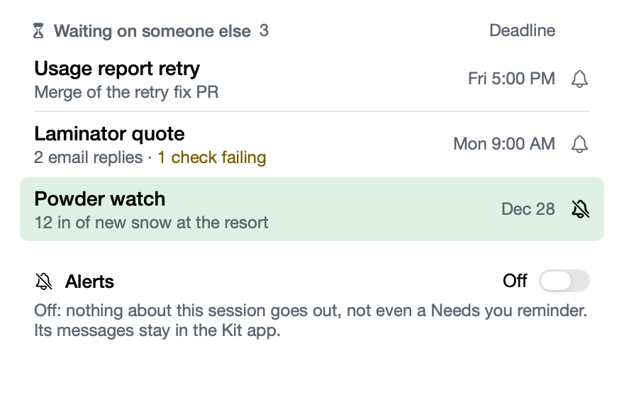

# Alerts for one session

**Icon:** bell.slash

**Kind:** New

You can stop the alerts of one session, and its messages stay in the Kit app.

- To stop them, click the bell at the end of the session's row on the **Sessions** page.
- On your phone, use the **Alerts** switch on the page of the session.
- With its alerts off, no message, notice or **Needs you** reminder about the session goes out.

