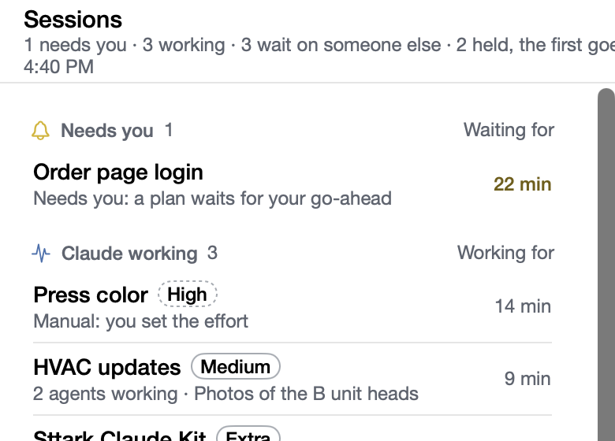

# Sessions update at once

**Icon:** bolt

**Kind:** Better

Sttark Claude Kit now shows a change to a session almost at the same time as the Claude app.

- A change on this Mac shows in the window and the menu in less than one second.
- A new session, a new name or an archive in the Claude app shows within about 10 seconds.
- Open the window or the menu to see each change.

