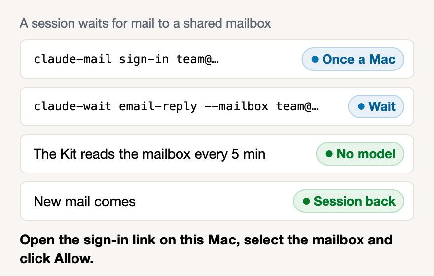

# Wait for mail to a shared mailbox

**Icon:** envelope.badge

**Kind:** New

A session can wait for mail to a shared mailbox, and the Kit reads that mailbox with no model.

- To start, the session runs `claude-mail sign-in <address>` one time on each Mac and gives you a link.
- Open the link on that Mac, select the shared mailbox and click **Allow**.
- Then `claude-wait email-reply --mailbox <address>` brings the session back when new mail comes.

