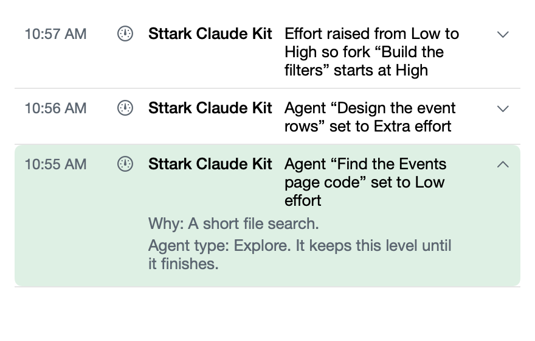

# Agents get their own effort

**Icon:** person.2.badge.gearshape

**Kind:** New

Sttark Claude Kit now sets the effort of each agent that a session starts, from the task of that agent.

- A quick search agent starts at Low, and an agent that designs or builds starts higher.
- An agent keeps its level until it finishes, also when the session changes level.
- See each agent and its level on the Events page, under its session.

