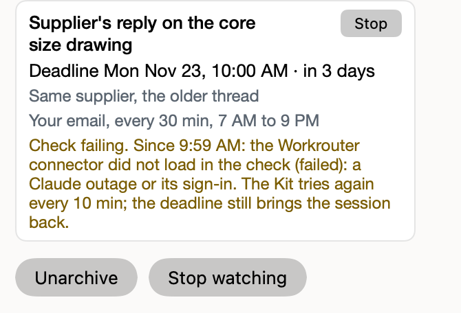

# Unarchive and Stop watching

**Icon:** tray.and.arrow.up

**Kind:** Better

**Replaces:** archived-sessions

The buttons on a session now say what they do, and none of them sends a message to the session.

- **Unarchive**, on the **Archived** page and on archived sessions that wait, puts the session back in your list.
- **Stop watching** removes a session from **Waiting on someone else** and sends it nothing.
- **Bring it back now** is gone: to make a waiting session act now, open it and type.

