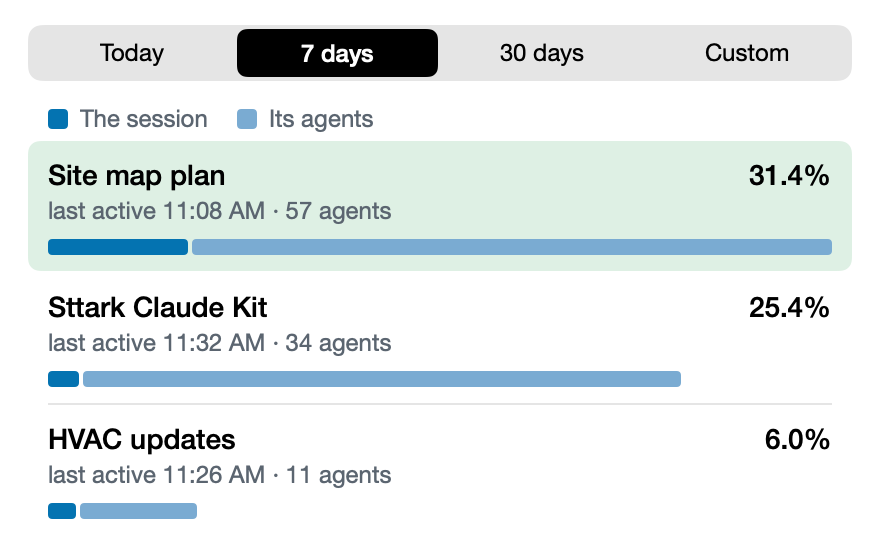

# Usage by session

**Icon:** chart.bar

**Kind:** New

You can see how much of your Claude Code use on this Mac each session and its agents used.

- Click **Usage** in the window's sidebar, then select a period at the top of the page.
- On your phone, open the **Usage** tab: the list is below your 5-hour and weekly limits.
- Each percent is a part of your use, not a percent of your usage limit.

