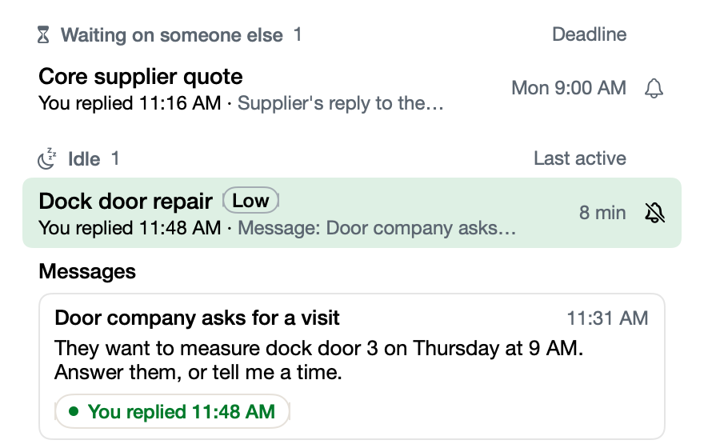

# The Kit sees your own replies

**Icon:** checkmark.bubble

**Kind:** Better

When you answer someone yourself where a session waits, the Kit tells the session and marks its message.

- A message in the Kit about that thread then shows **You replied** and the time, on your Mac and phone.
- Your answer does not end an email reply wait: it shows **You replied** and continues to wait for them.
- To see what the Kit found, open **Events** and set **Kind** to **Waits and messages**.

